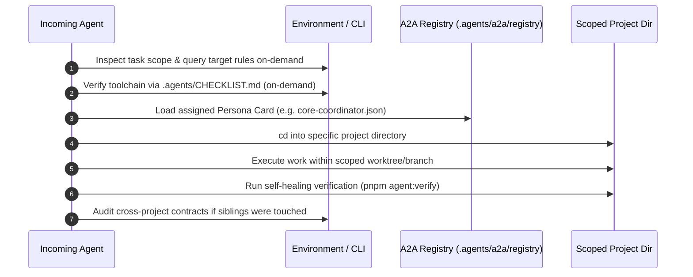

# Autonomous Agent Onboarding Playbook

> **Canonical Document:** `.agents/ONBOARDING.md`  
> **Target Audience:** All AI Agents (Antigravity, Cursor, Codex, OpenCode, Claude Code, Subagents)  
> **Governing SSoT:** `/home/tim/Fork/Arch-System/AGENTS.md` and `.agents/SYSTEMS.md`

---

## 1. Lean Orientation & Context-Budget Invariant

> [!IMPORTANT]
> **DO NOT eager-read full documentation files into context.**
> Reading full `AGENTS.md`, `SYSTEMS.md`, and `GUIDE.md` consumes ~27,000 tokens before any work begins.
> Query specific line ranges or symbols on demand using `read_file` (with `StartLine`/`EndLine`), structural search (`codemap` / `ast-grep`), or dynamic skills (`skills-mcp`).

### Fast Architecture Summary (Zero Turn Overhead)

- **Project:** Arch-System (Plantcor / Arch OS) industrial mining-operations portal.
- **Stack:** Next.js 16 App Router + React 19, Turborepo 2.x, pnpm 9.15.9, Supabase Postgres/Realtime CDC, Redis L1/L2.
- **Governing SSoT:** [`AGENTS.md`](file:///home/tim/Fork/Arch-System/AGENTS.md) — query target sections on demand.
- **Toolchain Mandate:** Node ≥ 24, commands run inside `Arch-System/` with mise path.
- **Verification Gate:** `pnpm agent:verify` (28 gates).

---

## 2. Hard Workspace Invariants (Absolute Rules)

1. **NO ROOT RUNNER:**
   - `/home/tim/Fork/package.json` is a zero-dependency delegation runner; its `preinstall` hook blocks root installs.
   - **NEVER** run `pnpm install`, `pnpm build`, or `npm test` from `/home/tim/Fork`.
   - Always run commands scoped inside `Arch-System/`, `skills-mcp/`, `memory-gateway-mcp/`, `slim-tooling-mcp/`, or `langgraph-mcp/` (see `.agents/config/federation.json`).
2. **ZERO EXTERNAL API COSTS:**
   - All LLM inference must use Google Gemini / Antigravity models (`GEMINI_API_KEY`).
   - All embeddings must run locally via `transformers.js` (`all-MiniLM-L6-v2`) in Ruflo.
   - All web scraping must use the LAN Firecrawl service on `http://192.168.0.215:3002`.
3. **ZERO-INTERRUPTION SELF-HEALING:**
   - Before reporting completion to the user, run native verification (`pnpm agent:verify` or `npm test`).
   - If tests fail, autonomously inspect the trace, repair the source, and re-verify until passing without asking the user for help.
4. **MAKER-CHECKER SEPARATION:**
   - Any sensitive architecture, database, or security change must be submitted to the Maker-Checker review gate on the A2A bus before merging.

---

## 3. Session Bootstrapping Sequence

---

## 4. Persona Selection & A2A Handoffs

Select the matching agent persona card from `.agents/a2a/registry/`:

- **Master Coordination:** `core-coordinator.json`
- **Cross-Project Auditing:** `federation-auditor.json`
- **Deployments & Preflight:** `deployment-sentinel.json`
- **Code & Migration Review:** `maker-checker-gate.json`
- **Contract Synchronization:** `contract-sync-agent.json`

For deep monorepo work inside `Arch-System`, refer to the 17 A2A persona cards under `Arch-System/.agents/a2a/registry/` and 19 agent definitions under `Arch-System/.agents/agents/`.
