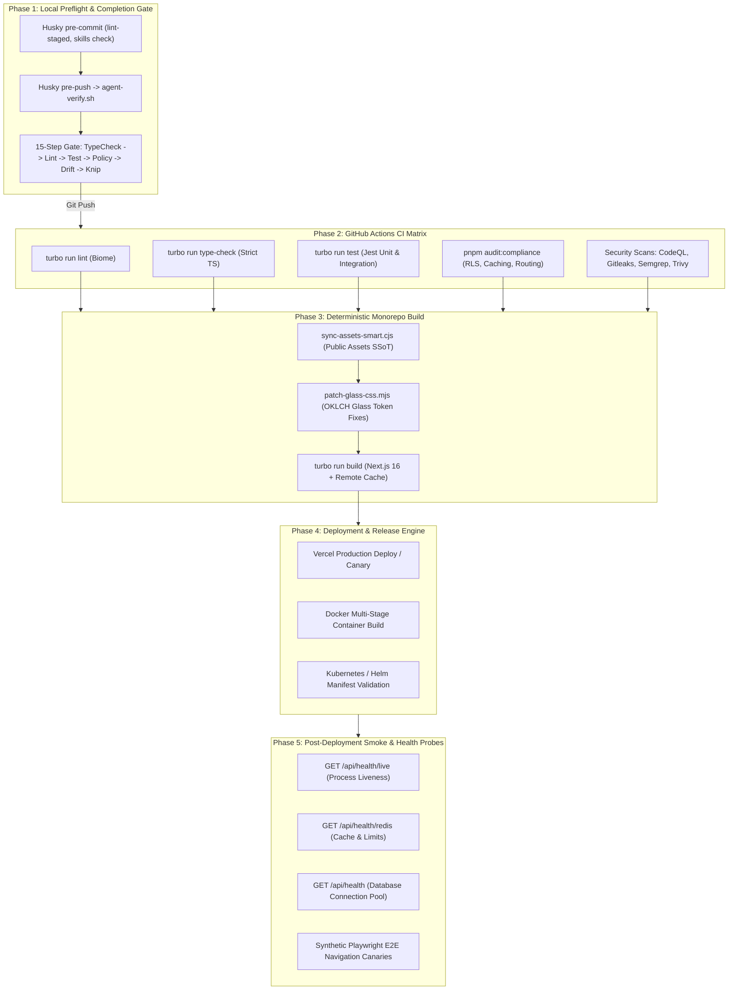

# 🚀 CI/CD Pipeline & Quality Gate Topology Map

**Generated:** ${dateInfo.displayDate}  
**Orchestration:** Local Preflight + GitHub Actions + Vercel Production Deploy

---

## 🧪 Visual Multi-Stage Pipeline & Verification Flow

---

## 📋 Comprehensive Quality Gates Reference

1. **`turbo run type-check`**: Zero `any`, zero `@ts-ignore`, concurrency=2.
2. **`turbo run lint`**: Biome formatter & linter enforcing single quotes, sorted Tailwind classes, and clean syntax.
3. **`turbo run test`**: Hermetic Jest suites across apps, feature libs, and shared packages.
4. **`pnpm policy:check`**: Monorepo scope-tagging boundaries verified by `policy-compiler.cjs`.
5. **`pnpm audit:drift`**: Database schema vs. `@repo/contract` Zod definition parity.
6. **`pnpm audit:compliance`**: Exhaustive invariant scan across RLS, server cache profiles, RSC, routing, and design system rules.
7. **`pnpm deps:lint` & `pnpm knip`**: Syncpack version harmonization and dead code eradication.
