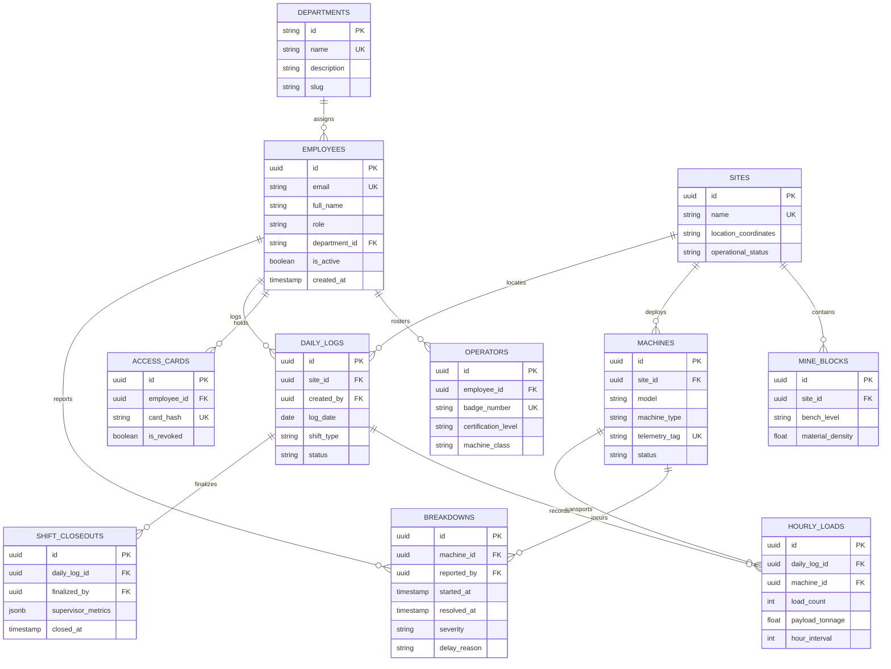

# 🔒 Database Schema & Topology Map

**Generated:** ${dateInfo.displayDate}  
**Engine:** PostgreSQL 17 via Supabase  
**Migrations SSoT:** `packages/database/migrations/` (189 Applied Immutable Migrations)

---

## 📊 Core Mining Entity Relationship Diagram

---

## 🛡️ Security & Row Level Security (RLS) Mandates

1. **100% Table RLS Coverage**: Every table in `public` schema has Row Level Security enabled.
2. **InitPlan Subquery Optimization**: Policies wrap `auth.uid()` in scalar subqueries (e.g. `(SELECT auth.uid())`), enabling PostgreSQL query planner to evaluate authentication once per query rather than once per row.
3. **Multi-Tenant Department Isolation**: Employee access is strictly gated by department membership and verified against `accessible_departments` claims.
4. **Primary vs. Read Replica Routing**:
   - Transactional mutations & RPCs use `createServerSupabaseClient()` directed to primary PgBouncer.
   - Heavy analytical aggregations & overview reports use `createReadReplicaClient()` to protect OLTP throughput.
5. **Contract Parity**: Every database column has a matching runtime Zod validator in `packages/contract/src/schemas/`, validated on every commit by `pnpm audit:drift`.
