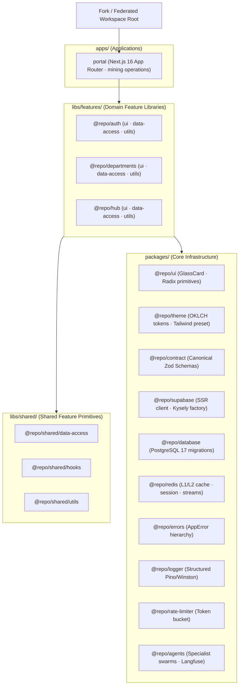

# 📁 Package Structure & Module Map

**Generated:** ${dateInfo.displayDate}  
**Standard**: Clean Workspace Modularization + Strict Directional Layering

---

## 📂 Visual Monorepo Structure & Package Hierarchy

---

## 📂 Detailed Directory Responsibilities

- **`apps/portal/`**: Unified Next.js 16 App Router application. Contains route groups, `proxy.ts`, Server Actions, and `lib/server-cache.ts`.
- **`packages/`**: Reusable shared infrastructure libraries:
  - `@repo/ui`: Pure presentational React 19 components (GlassCard, Button, Tabs, Badge). Storybook-tested.
  - `@repo/theme`: Single Source of Truth for OKLCH color primitives and Tailwind configuration preset.
  - `@repo/contract`: Canonical Zod schemas defining all database tables, API mutations, and input validation.
  - `@repo/supabase`: SSR/Browser/Kysely Supabase client factories and auth helpers.
  - `@repo/database`: Numbered SQL migrations (`migrations/*.sql`), RLS policies, and generated DB types.
  - `@repo/redis`: Capability-only façade for L1/L2 caching, session management, locks, and streams.
  - `@repo/errors`: Canonical `AppError` domain error class hierarchy.
  - `@repo/logger`: Structured telemetry and log formatting.
  - `@repo/rate-limiter`: Token bucket and sliding window rate limiting.
  - `@repo/agents`: Multi-agent orchestration, LLM Critique Council, and Langfuse tracing.
- **`libs/features/`**: Domain-specific business logic divided into `ui`, `data-access`, and `utils`:
  - `@repo/auth`: Authentication forms, session guards, and credential handlers.
  - `@repo/departments`: Mining operational departments (drilling, production, control room, engineering, access control).
  - `@repo/hub`: Central Command Hub carousel, live department grid, and KPI strip.
- **`libs/shared/`**: Cross-feature shared utilities, custom hooks, and data-access adapters.
- **`tools/`**: Build-time verification scripts, policy compiler, anti-drift test suites, and codebase map generators.
- **`codebase-maps/`**: Automated architectural topology maps, versioned snapshots, and metadata manifest index.
