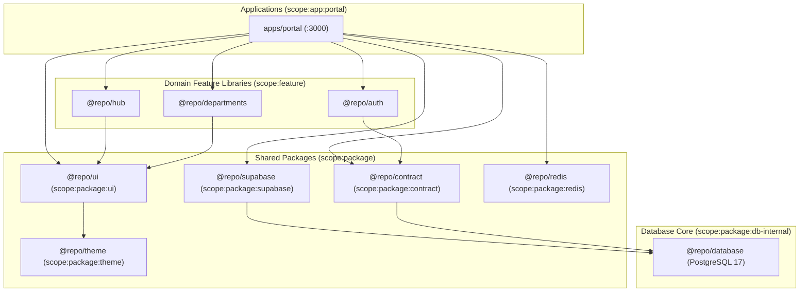

# 🕸️ Project Dependencies & Monorepo Graph Map

**Generated:** ${dateInfo.displayDate}  
**Workspace:** Turborepo Monorepo Workspace (pnpm 9.15.9)

---

## 📦 Package Dependency & Boundary Rules

---

## 🚫 Module Boundary Enforcement Matrix

| Source Scope          | Allowed Targets                                | Strictly Forbidden Targets                                      | Enforcement Gate    |
| :-------------------- | :--------------------------------------------- | :-------------------------------------------------------------- | :------------------ |
| `scope:app`           | `scope:package`, `scope:feature`               | `scope:package:db-internal`                                     | `pnpm policy:check` |
| `scope:package:ui`    | `scope:package:theme`                          | `scope:package:db-internal`, `scope:package:supabase`, `apps/*` | `pnpm policy:check` |
| `scope:package:theme` | Tokens source (`tokens.json`)                  | `scope:package:ui`, `apps/*`                                    | `pnpm policy:check` |
| `scope:feature`       | `@repo/ui`, `@repo/contract`, `@repo/supabase` | `@repo/database` direct access                                  | `pnpm policy:check` |
| `scope:tool`          | Local Node utilities, static AST tools         | `apps/*`, runtime database clients                              | `pnpm policy:check` |
