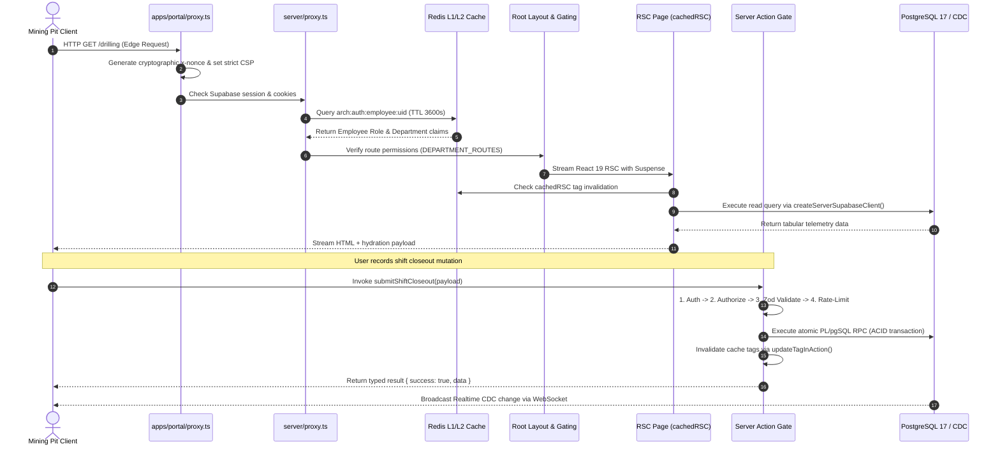

# 🗺️ Route & Feature Architecture Map

**Generated:** ${dateInfo.displayDate}  
**System:** Arch-System Mining Operations Portal (Next.js 16.3.8 App Router + React 19)

---

## 🔄 End-to-End Request & Server Action Lifecycle

---

## 🏛️ Route Groups & Operational Department Hierarchy

| Route Path                      | Scope / Access Gate             | Core Functionality                                           | Primary Components & SSoT                             |
| :------------------------------ | :------------------------------ | :----------------------------------------------------------- | :---------------------------------------------------- |
| `/` -> `/hub`                   | Authenticated Mining Staff      | Central Operations Hub, Hero Carousel, Bento Department Grid | `@repo/hub/ui`, `LiveKpiStrip`, `useSupabaseRealtime` |
| `/overview`                     | Authenticated Mining Staff      | System Topology, DB Explorer, Codemaps & Invariant Audits    | `DocumentationMaps.tsx`, `codebase-maps-data.ts`      |
| `/(auth)/*`                     | Public / PKCE Handshake         | Login (`/login`), Reset Password, Update Password            | `@repo/auth/ui`, Supabase SSR Auth cookies            |
| `/(departments)/control-room`   | Gated by `control_room` claim   | SCADA live telemetry, FUXA diagnostics, OPC-UA alert panels  | `AlertPanel.tsx`, `ScadaDiagnosticGrid.tsx`           |
| `/(departments)/drilling`       | Gated by `drilling` claim       | Drill rig telemetry, penetration rates, borehole logs        | `DrillRigGrid.tsx`, `machine-telemetry/`              |
| `/(departments)/production`     | Gated by `production` claim     | Haulage cycles, payload tonnage, excavator tally             | `HourlyLoadsTable.tsx`, `shift-compilation/`          |
| `/(departments)/engineering`    | Gated by `engineering` claim    | Breakdown logs, preventive maintenance schedule              | `BreakdownLedger.tsx`, `machine-operations/`          |
| `/(departments)/access-control` | Gated by `access_control` claim | On-site C66 visitor badging, card actions, QR scanner        | `BadgeScanner.tsx`, `access-logs/`, `card-actions/`   |
| `/admin/*`                      | Gated by Admin / Exec role      | Sites, fleet registry, employee RBAC, AI token costs         | `app/admin/layout.tsx` (independent RBAC re-check)    |
| `/database`                     | Gated by Admin / Lead           | Supabase PostgreSQL schema, query latency, index health      | `createReadReplicaClient()`, schema explorer          |
| `/api/*`                        | Authenticated Handlers          | Codebase maps, system health probes, hardware webhooks       | `getAuthenticatedEmployee()` explicit auth check      |

---

## 🔒 Security Invariants & Server Action Contract

Every Server Action strictly adheres to the machine-enforced 7-step execution order:

1. **Authenticate**: Verify identity via `getAuthenticatedEmployee()`.
2. **Authorize**: Verify role/department claims against resource requirements.
3. **Validate**: Parse input payload using canonical Zod schemas from `@repo/contract`.
4. **Rate-Limit**: Token-bucket limit via `@repo/rate-limiter` (`RedisStore` / `MemoryStore`).
5. **Mutate**: Atomic execution via Supabase PL/pgSQL RPC or Kysely query.
6. **Invalidate**: Clear Next.js data cache and Redis L1/L2 tags via `updateTagInAction()`.
7. **Redirect / Return**: Return typed response or trigger `redirect()` only after cache eviction.
