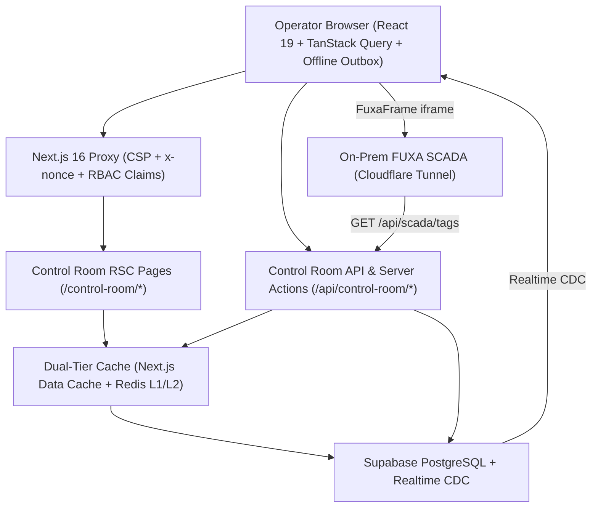

# Control Room System Architecture (`TASK-13.6`)

**Audience:** Platform Engineers, Architects, Backend & Frontend Developers  
**Department:** Control Room (`/control-room`)

---

## 1. Architectural Overview

The Control Room subsystem is built on **Next.js 16 App Router + React 19**, following Arch-System's RSC-first rendering model, strict package layering (`@repo/contract`, `@repo/supabase`, `@repo/redis`, `@repo/errors`, `@repo/logger`, `@repo/ui`), and dual-tier caching.

---

## 2. Component & Module Topology

| Layer                   | Key Files / Modules                                                                                                                                                                                                                      | Responsibility                                                                                  |
| :---------------------- | :--------------------------------------------------------------------------------------------------------------------------------------------------------------------------------------------------------------------------------------- | :---------------------------------------------------------------------------------------------- |
| **Routes & RSC Pages**  | `apps/portal/app/(departments)/control-room/page.tsx`, `shift-closeout/page.tsx`, `apps/portal/app/(departments)/[department]/{machine-operations,hourly-loads,excavator-activity,end-smr,engineering-notes,shift-compilation}/page.tsx` | Server-rendered initial state, Suspense streaming, `ErrorBoundary` wrapping                     |
| **Control Room UI**     | `features/departments/components/control-room/{ScadaPanel,FuxaFrame,AlertPanel,CloseShiftModal,MachineControl,DozerRollForm}.tsx`                                                                                                        | Interactive client islands, FUXA degraded-mode fallback, 8-state closeout modal                 |
| **Domain Logic**        | `apps/portal/lib/{shift-closeout,shift-completeness,shift-sheet-buckets}.ts`                                                                                                                                                             | Completeness aggregation, SMR/bin-factor constraint validation, PIN verification, rate limiting |
| **API & Health Routes** | `apps/portal/app/api/control-room/{shift-closeout,shift-completeness,machine-operator-scan}/route.ts`, `apps/portal/app/api/health/{fuxa,redis,supabase-realtime}/route.ts`                                                              | REST endpoints, idempotency key handling, health probes                                         |
| **Background Jobs**     | `apps/portal/lib/jobs/{shift-completeness-check,shift-closeout-report}.ts`                                                                                                                                                               | Scheduled 15-minute shift completeness monitoring and weekly integrity reporting                |

---

## 3. Security & Reliability Invariants

1. **Canonical 8-Step Server Action Sequence:**
   - Authenticate (`getAuthenticatedEmployee`) $\rightarrow$ Authorize (role + department) $\rightarrow$ Validate (`@repo/contract` Zod + `validateMachineOperationConstraints`) $\rightarrow$ Rate-limit (`@repo/rate-limiter`) $\rightarrow$ Execute RPC (`atomic_shift_closeout`) $\rightarrow$ Audit log (`@repo/logger`) $\rightarrow$ Invalidate cache (`updateTagInAction`) $\rightarrow$ Return typed result.
2. **Separation of Duties:**
   - Enforced in `shift-closeout.ts` and PostgreSQL RPC: the supervisor approving closeout (`approverId`) cannot match the submitting operator (`operatorId`).
3. **Graceful Degradation:**
   - `FuxaFrame` falls back to Redis cached telemetry when the FUXA tunnel is unreachable.
   - `verifyPin` falls back to an in-process `MemoryStore` if Redis is temporarily unavailable.
   - Client mutations queue in the browser's offline outbox (`useOfflineQueue`) during WAN drops.
