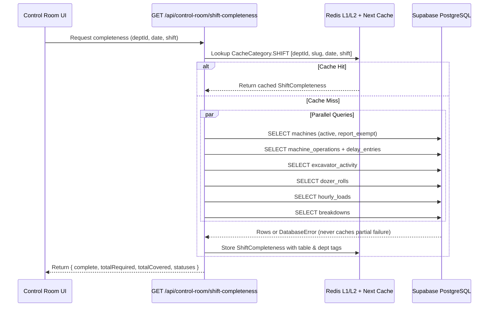
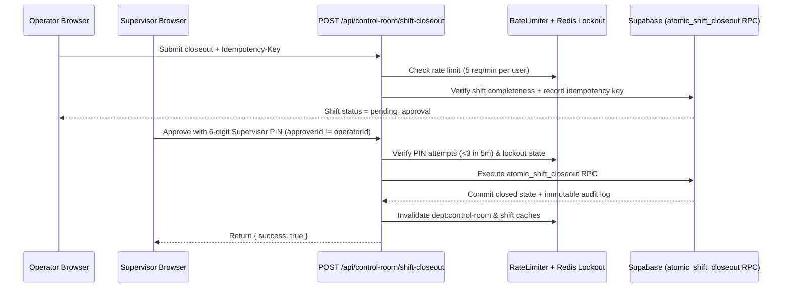
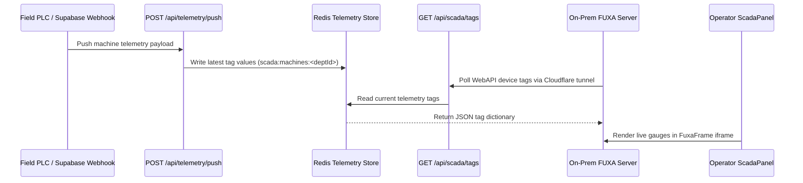

# Control Room Data Flows (`TASK-13.7`)

**Audience:** Platform Engineers, Backend Developers, Data Engineers  
**Department:** Control Room (`/control-room`)

---

## 1. Shift Completeness & Production Accounting Flow

`getShiftCompleteness` (`apps/portal/lib/shift-completeness.ts`) executes six parallel Supabase queries via `Promise.all` and caches the aggregated sheet under `CacheCategory.SHIFT`:

---

## 2. Audited Shift Closeout & PIN Approval Flow

---

## 3. Reverse-Flow FUXA SCADA Telemetry Flow

