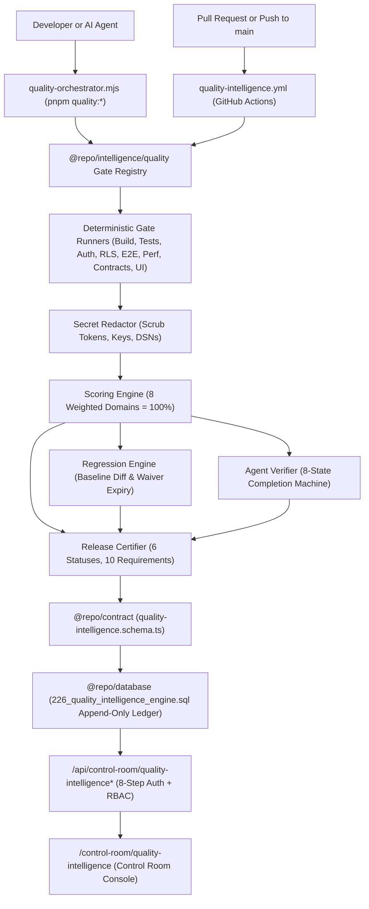

# Quality Intelligence Engine — Target Architecture

**Branch:** `feature/quality-intelligence-engine`  
**Scope:** Unified verification, weighted quality scoring, regression diffing, agent completion state machine, release certification, append-only PostgreSQL evidence ledger, Control Room dashboard, and consolidated GitHub Actions CI.

---

## 1. Existing vs. Proposed Architecture

### Current Fragmented State

Today, verification is split across 33 mostly disabled GitHub workflows, overlapping `pnpm` scripts (`quality`, `audit:compliance`, `verify:gates`, `agent:verify`), local-only `.ci-local/*.json` files, regex-based static checks, and self-attested commit statuses (`tools/scripts/autonomous-ci-gatekeeper.mjs`).

### Proposed Unified Quality Intelligence Architecture

The Quality Intelligence Engine replaces ad-hoc scripts and duplicated workflows with a deterministic, schema-validated pipeline backed by `@repo/contract`, `@repo/intelligence/quality`, append-only `@repo/database` tables, a single CLI orchestrator (`tools/scripts/quality-orchestrator.mjs`), a Control Room console, and one consolidated GitHub Actions workflow (`.github/workflows/quality-intelligence.yml`).

---

## 2. Component Architecture

### 2.1 `@repo/contract` (`packages/contract/src/schemas/quality-intelligence.schema.ts`)

Canonical Zod 4 contracts exported via `@repo/contract/schemas/quality-intelligence` and re-exported from `packages/contract/src/index.ts`:

- `qualityDomainIdSchema` & `domainWeightMapSchema` (8 weighted scoring domains summing to `100`).
- `gateDefinitionSchema` & `gateExecutionResultSchema` (typed gate result, `durationMs`, `exitCode`, `evidenceType`, `outputSha256`, redacted `summary`).
- `qualityRunRecordSchema` & `createQualityRunSchema` (run metadata, `gitSha`, `gitTreeHash`, `branch`, `actorType`, `compositeScore`, `prevRunDigest`, `evidenceSha256`).
- `regressionFindingSchema` (new failure vs. baseline, severity `CRITICAL | HIGH | MEDIUM | LOW`, file/symbol target, optional time-bounded waiver).
- `agentCompletionStateSchema` (8-state enum + transition payload).
- `releaseCertificationSchema` (6-status enum + 10 boolean/evidence requirement evaluations).
- `qualityRunListQuerySchema` & `qualityRunDetailResponseSchema` for Control Room API endpoints.

### 2.2 `@repo/database` (`packages/database/migrations/226_quality_intelligence_engine.sql`)

Append-only PostgreSQL 17 evidence ledger adhering to Arch-System RLS and InitPlan invariants:

- **Tables**:
  - `quality_intelligence_runs`: immutable header per orchestrator execution (`id`, `run_id`, `git_sha`, `git_tree_hash`, `branch`, `trigger_source`, `composite_score`, `certification_status`, `agent_state`, `prev_run_digest`, `evidence_sha256`, `created_at`).
  - `quality_gate_results`: per-gate records linked by `run_id` (`gate_id`, `domain`, `weight_pct`, `score_pct`, `status`, `exit_code`, `duration_ms`, `output_sha256`, `redacted_summary`).
  - `quality_regressions`: regression deltas compared against the last certified `main` baseline (`finding_key`, `severity`, `category`, `description`, `is_blocking`).
  - `quality_release_certifications`: formal release decision ledger evaluating all 10 mandatory requirements (`git_sha`, `status`, `requirements_json`, `certified_by`, `evidence_sha256`).
- **Immutability Triggers**: `BEFORE UPDATE OR DELETE` trigger function `prevent_quality_ledger_mutation()` attached to all four tables, raising an exception so historical evidence cannot be tampered with or purged.
- **RLS Policies**: `ENABLE ROW LEVEL SECURITY` on all tables; `SELECT` restricted to authenticated `public.employees` with `(SELECT auth.uid())` InitPlan wrapping and Control Room/Admin/Executive department or role access; `INSERT` permitted only via verified service-role / RPC paths.

### 2.3 `@repo/intelligence/quality` (`packages/intelligence/src/quality/`)

Pure, deterministic TypeScript engines (zero direct database or network side effects, 100% unit-testable) exported via `@repo/intelligence/quality`:

| Module                 | Responsibility                                                                                                                                            |
| :--------------------- | :-------------------------------------------------------------------------------------------------------------------------------------------------------- |
| `gate-registry.ts`     | Authoritative catalog of quality domains, active gates, timeouts, empirical vs. static classification, and blocking rules                                 |
| `scoring-engine.ts`    | Computes weighted `0–100` composite score across the 8 domains, penalizes skipped/mocked gates, and produces deterministic breakdown vectors              |
| `regression-engine.ts` | Diffs current run gate results and findings against the latest `main` certified baseline to flag new failures, score drops, or expired waivers            |
| `agent-verifier.ts`    | Evaluates agent execution artifacts (`git_tree_hash`, empirical gate outputs, tracer compliance) and transitions the 8-state agent completion machine     |
| `release-certifier.ts` | Evaluates the 10 mandatory release requirements and assigns one of the 6 release certification statuses                                                   |
| `secret-redactor.ts`   | Scrubs bearer tokens, Supabase keys (`sb_secret_*`, `eyJ*`), Postgres DSNs, OpenAI/GitHub/Vercel tokens, and private keys prior to hashing or persistence |

### 2.4 CLI Orchestrator (`tools/scripts/quality-orchestrator.mjs`)

Single entry point wired into root `package.json`:

- `pnpm quality:run` — Executes the ordered gate registry, runs `secret-redactor`, computes SHA-256 digests, persists immutable run record, and writes local summary.
- `pnpm quality:score` — Evaluates weighted domain scores from run results and exits non-zero on blocking threshold violations.
- `pnpm quality:diff` — Compares current branch results against the latest certified `main` baseline via `regression-engine`.
- `pnpm quality:certify` — Evaluates the 10 mandatory release requirements and outputs machine-readable certification status.
- `pnpm quality:agent-verify` — Runs agent verification checks and emits the 8-state agent completion verdict.

### 2.5 Control Room Integration

- **Page**: `apps/portal/app/(departments)/control-room/quality-intelligence/page.tsx` (async RSC shell wrapping leaf `'use client'` views using `@repo/ui/GlassCard` and light-mode OKLCH tokens from `@repo/theme`).
- **API Routes**:
  - `GET /api/control-room/quality-intelligence` (`apps/portal/app/api/control-room/quality-intelligence/route.ts`): paginated runs, current domain score breakdown, regression alerts, and latest release certification status.
  - `GET /api/control-room/quality-intelligence/[runId]` (`apps/portal/app/api/control-room/quality-intelligence/[runId]/route.ts`): detailed gate-by-gate results, SHA-256 verification status, and regression diff for a single run.
  - Both routes follow the **Canonical 8-Step Security Sequence** (`getAuthenticatedEmployee`, explicit role check allowing `['admin', 'supervisor', 'operator', 'control_room_operator']`, department access check, Zod input validation, rate limiting, audit logging, cache tagging, typed JSON response).

### 2.6 GitHub Actions Consolidation (`.github/workflows/quality-intelligence.yml`)

Replaces fragmented duplicate quality workflows with a single SHA-pinned, least-privilege workflow triggered on `pull_request` and `push` to `main`:

- Runs `quality-orchestrator.mjs` in CI mode (never trusting local `.ci-local/` caches).
- Executes real unit/integration tests, TypeScript check, Biome/Stylelint/CSpell/Markdownlint, migration lint & replay, policy/cycle/contract/RLS audits, and conditional live E2E/k6 probes on `main` / release tags.
- Uploads SHA-256 verified evidence artifacts and posts authoritative GitHub Check Run results (removing reliance on local self-attested commit statuses).

---

## 3. Scoring Model (Exact Weights = 100%)

Each domain score (`0–100`) is weighted strictly as follows:

| #   | Quality Domain            | Weight   | Blocking Floor                     | Primary Signal Sources                                                               |
| :-- | :------------------------ | :------- | :--------------------------------- | :----------------------------------------------------------------------------------- |
| 1   | Build & Type Safety       | `20%`    | `100%` (Mandatory pass)            | `pnpm type-check`, `pnpm --filter portal build`, Vercel preflight                    |
| 2   | Unit & Integration Tests  | `20%`    | `>= 90%` (Zero test failures)      | `pnpm test`, `@repo/redis` & `@repo/database` integration suites, coverage deltas    |
| 3   | Security & Authorization  | `15%`    | `100%` (Zero critical/high)        | Auth matrix (no blind route exemptions), Gitleaks, Trivy, `pnpm audit`, SkillSpector |
| 4   | Database & RLS Integrity  | `15%`    | `100%` (Zero unwrapped modern RLS) | Migration drift check, Squawk PG17 lint, 4-op RLS matrix, migration replay           |
| 5   | E2E & Behavioral Flows    | `10%`    | `>= 85%`                           | Executed Playwright behavioral specs (not regex counts), API contract checks         |
| 6   | Performance & Budgets     | `10%`    | `>= 85%`                           | CSS size (`<= 115 KB`), gzipped bundle budget, Lighthouse/k6 thresholds              |
| 7   | Architecture & Contracts  | `5%`     | `100%` (Zero cycles/drift)         | `pnpm policy:check`, `pnpm cycles`, column-level Zod-to-DB contract parity           |
| 8   | Accessibility & UI Tokens | `5%`     | `>= 90%`                           | Light-mode OKLCH tokens, `audit:tailwind`, `html:check`, `audit:images`, axe a11y    |
|     | **Total Composite Score** | **100%** |                                    | Weighted sum of all 8 domain scores                                                  |

_Rule:_ Any stubbed or skipped mandatory gate scores `0` for that gate unless explicitly marked non-applicable by environment policy, preventing echo stubs from inflating scores.

---

## 4. Agent Completion States (8 States)

| State            | Meaning                                                               | Entry / Transition Condition                                       |
| :--------------- | :-------------------------------------------------------------------- | :----------------------------------------------------------------- |
| `UNCLAIMED`      | Task created, no agent execution started                              | Initial state prior to branch/worktree claim                       |
| `SCOPED`         | Branch created, target files and contracts identified                 | Branch verified (`!= main`) and scope manifest recorded            |
| `IMPLEMENTING`   | Code or documentation mutations in progress                           | Dirty working tree or unverified commits present                   |
| `SELF_HEALING`   | Verification failed; agent executing autonomous remediation           | Non-zero gate exit detected with active retry loop                 |
| `VERIFIED_LOCAL` | All local gates pass on current `HEAD^{tree}`                         | `quality-orchestrator` local run passes with valid `git_tree_hash` |
| `VERIFIED_CI`    | Remote GitHub Actions `quality-intelligence.yml` passed on commit SHA | Authoritative GitHub Check Run `success` recorded for `HEAD` SHA   |
| `BLOCKED`        | Hard guardrail failure, missing secret/infra, or policy violation     | Unrecoverable failure or expired self-healing budget               |
| `CERTIFIED`      | Agent task complete and eligible for release promotion                | `VERIFIED_CI` + `AGENT_TRACER.md` updated + zero open regressions  |

---

## 5. Release Certification Statuses (6 Statuses)

| Status             | Meaning                                                                                             | Deployment Eligibility |
| :----------------- | :-------------------------------------------------------------------------------------------------- | :--------------------- |
| `DRAFT`            | Preliminary run initiated on feature branch or incomplete tree                                      | Not deployable         |
| `PENDING_GATES`    | Required CI or runtime gates are still executing                                                    | Not deployable         |
| `CONDITIONAL_PASS` | All blocking floors passed; non-blocking `MEDIUM`/`LOW` advisories have active time-bounded waivers | Staging / preview only |
| `CERTIFIED`        | All 10 mandatory release requirements satisfied and signed by CI                                    | Production eligible    |
| `BLOCKED`          | One or more mandatory requirements failed or critical regression detected                           | Blocked                |
| `REVOKED`          | Previously certified SHA invalidated by post-certification vulnerability or regression              | Rollback required      |

---

## 6. Mandatory Release Requirements (10 Requirements)

A release candidate SHA achieves `CERTIFIED` status only when **all 10** requirements evaluate to `true`:

1. **Composite Score Floor**: Weighted composite quality score `>= 90.0` with zero domains below their blocking floor.
2. **Remote CI Attestation**: `quality-intelligence.yml` completed on the exact `git_sha` in GitHub Actions (no local self-attested commit status substitutions).
3. **Clean Build & Type Safety**: `type-check`, `portal` production build, and `vercel-preflight` passed with zero errors.
4. **Zero Failing Tests & Real Eval Execution**: All workspace unit/integration suites pass and no eval/gate command is a zero-exit stub.
5. **Security & RBAC Parity**: Zero unauthenticated non-public API routes, full RBAC role coverage (including `admin` on observability and `control_room_operator` on shift closeout), and zero high/critical advisories.
6. **Database & RLS Integrity**: All migrations lint cleanly, replay cleanly, enable RLS with `(SELECT auth.uid())` InitPlan policies, and match `@repo/contract` schemas.
7. **Zero Active Regressions Without Waivers**: `regression-engine` detects zero new `CRITICAL` or `HIGH` regressions relative to the latest certified `main` baseline.
8. **Behavioral & Performance Thresholds**: Executed Playwright behavioral smoke checks and bundle/CSS/latency budgets satisfy SLA thresholds.
9. **Append-Only Evidence Integrity**: Run manifest contains valid `git_tree_hash`, per-gate `output_sha256`, chained `prev_run_digest`, and top-level `evidence_sha256` persisted to `quality_intelligence_runs`.
10. **Secret-Free Output & Branch Protection**: `secret-redactor` reports zero leaked credential patterns in logs/evidence, and PR satisfies `main` linear-history & non-bypass review rules.

---

## 7. Append-Only Evidence Integrity Guarantees

1. **Pre-Persistence Secret Redaction**: `secret-redactor.ts` runs before any stdout snippet or metadata is hashed or stored, replacing matching credentials (Supabase service/anon keys, JWTs, Postgres URLs with passwords, Bearer headers, GitHub/Vercel/OpenAI tokens) with `[REDACTED:<PATTERN>]`.
2. **Per-Gate & Chained Manifest Hashing**:
   - Each gate records `output_sha256 = SHA-256(canonical_redacted_output)`.
   - Each run computes `evidence_sha256 = SHA-256(canonical_json({ runId, gitSha, gitTreeHash, prevRunDigest, gates, compositeScore }))`.
   - `prev_run_digest` links sequentially to the previous run's `evidence_sha256` on the target branch, creating a tamper-evident hash chain.
3. **Database Immutability Enforcement**: Migration `226_quality_intelligence_engine.sql` attaches `BEFORE UPDATE OR DELETE` triggers to `quality_intelligence_runs`, `quality_gate_results`, `quality_regressions`, and `quality_release_certifications` that unconditionally `RAISE EXCEPTION` on mutation attempts, ensuring audit records are strictly append-only.
