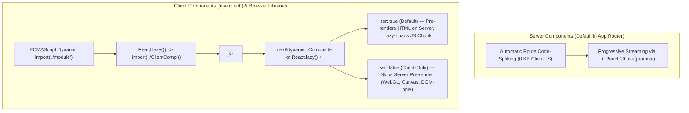

# Next.js Application Optimization & Configuration Architecture (`optimization.md`)

> **Canonical Reference for Arch-System (`apps/portal` & Monorepo Workspace)**
> Built on **Next.js 16 App Router + React 19 + TypeScript 5.9 + Turbopack + Tailwind CSS**, this guide consolidates official Next.js optimization and configuration standards (`next/image`, `next/font`, `next/script`, Metadata API, Static Assets, `@next/bundle-analyzer`, Lazy Loading with `next/dynamic` / `React.lazy()` / `<Suspense>`, Web Vitals & Analytics, `instrumentation.ts`, OpenTelemetry, and TypeScript Configuration) together with their concrete implementation in the **Arch-System** industrial mining-operations portal.

---

## Table of Contents

1. [Overview: Built-in Components, Metadata, Static Assets & Observability](#1-overview-built-in-components-metadata-static-assets--observability)
2. [Image Optimization (`next/image`), Web Almanac, Page Weight & LCP Performance](#2-image-optimization-nextimage-web-almanac-page-weight--lcp-performance)
3. [Font Optimization (`next/font`) & Tailwind CSS Variables](#3-font-optimization-nextfont--tailwind-css-variables)
4. [Script Optimization (`next/script`) & Third-Party Libraries](#4-script-optimization-nextscript--third-party-libraries)
5. [Metadata API, Static Metadata Object & File-Based Metadata Conventions](#5-metadata-api-static-metadata-object--file-based-metadata-conventions)
6. [Static Assets in `public`](#6-static-assets-in-public)
7. [Bundle Analyzer (`@next/bundle-analyzer`)](#7-bundle-analyzer-nextbundle-analyzer)
8. [Lazy Loading (`next/dynamic`, `React.lazy()`, and `<Suspense>`)](#8-lazy-loading-nextdynamic-reactlazy-and-suspense)
9. [Analytics & Web Vitals (`TTFB`, `FCP`, `LCP`, `FID`, `CLS`, `INP`)](#9-analytics--web-vitals-ttfb-fcp-lcp-fid-cls-inp)
10. [Instrumentation (`instrumentation.ts`)](#10-instrumentation-instrumentationts)
11. [OpenTelemetry (`@vercel/otel` & Manual `NodeSDK` Instrumentation)](#11-opentelemetry-vercelotel--manual-nodesdk-instrumentation)
12. [Project Configuration & TypeScript Architecture](#12-project-configuration--typescript-architecture)
13. [Layouts and Pages (`page.tsx`, `layout.tsx`, `<Link>`, `searchParams`, `PageProps`, `LayoutProps`)](#13-layouts-and-pages-pagetsx-layouttsx-link-searchparams-pageprops-layoutprops)
14. [Dynamic Route Segments (`[segment]`, `[...slug]`, `[[...slug]]`, Cache Components & `generateStaticParams`)](#14-dynamic-route-segments-segment-slug-slug-cache-components--generatestaticparams)
15. [Root Layout Architecture & Caveats (`app/layout.tsx`)](#15-root-layout-architecture--caveats-applayouttsx)
16. [Markdown, MDX & `mdx-components.tsx` (`@next/mdx`, `remark`/`rehype`, Turbopack & `mdxRs`)](#16-markdown-mdx--mdx-componentstsx-nextmdx-remarkrehype-turbopack--mdxrs)
17. [Optimizing Memory Usage (Heap Profiling, Build Workers & Preloading Entries)](#17-optimizing-memory-usage-heap-profiling-build-workers--preloading-entries)
18. [Optimizing Package Bundling (`next analyze`, `next analyze export`, `optimizePackageImports`, `serverExternalPackages`)](#18-optimizing-package-bundling-next-analyze-next-analyze-export-optimizepackageimports-serverexternalpackages)
19. [Migrating from Pages Router to App Router & Component Codemods](#19-migrating-from-pages-router-to-app-router--component-codemods)
20. [Third-Party Libraries (`@next/third-parties` & First-Party Script Proxies)](#20-third-party-libraries-nextthird-parties--first-party-script-proxies)
21. [Environment Variables, Module Path Aliases & `src` Directory Conventions](#21-environment-variables-module-path-aliases--src-directory-conventions)
22. [Draft Mode & Content Security Policy (CSP) with Per-Request Nonces](#22-draft-mode--content-security-policy-csp-with-per-request-nonces)
23. [Linking, Navigating, Speculation Rules & Dual-Tier Cache Architecture (`'use cache'`, `cacheLife`, `updateTag`)](#23-linking-navigating-speculation-rules--dual-tier-cache-architecture-use-cache-cachelife-updatetag)
24. [Recommended Actionable Optimization Steps for Arch-System (Prioritized Roadmap)](#24-recommended-actionable-optimization-steps-for-arch-system-prioritized-roadmap)
25. [Caching with Cache Components (`cacheComponents`, `partialPrefetching`, `'use cache'`, `<Suspense>`, Runtime APIs, `connection()`, PPR & ISR)](#25-caching-with-cache-components-cachecomponents-partialprefetching-use-cache-suspense-runtime-apis-connection-ppr--isr)
26. [Revalidating Cached Data (`cacheLife`, `cacheTag`, `revalidateTag`, `updateTag`, `revalidatePath`)](#26-revalidating-cached-data-cachelife-cachetag-revalidatetag-updatetag-revalidatepath)
27. [Error Handling (Expected Errors, `useActionState`, `notFound`, `error.tsx`, `catchError`, `global-error.tsx`)](#27-error-handling-expected-errors-useactionstate-notfound-errortsx-catcherror-global-errortsx)
28. [Ecosystem Assessment: `MDX`, `@next/mdx`, `remark`, `rehype` & `Markdoc` for Arch-System](#28-ecosystem-assessment-mdx-nextmdx-remark-rehype--markdoc-for-arch-system)

---

## 1. Overview: Built-in Components, Metadata, Static Assets & Observability

Next.js provides built-in abstractions and compiler-level integrations designed to improve Core Web Vitals, reduce bundle weight, and streamline production operations.

### Built-in Components

Built-in components abstract away the complexity of implementing common UI optimizations:

- **Images (`next/image`)**: Built on the native `` element. The Image Component optimizes images for performance by lazy loading and automatically resizing images based on device size, preventing Cumulative Layout Shift (CLS), and serving modern formats (WebP/AVIF).
- **Link (`next/link`)**: Built on the native `<a>` tags. The Link Component prefetches pages in the background for faster and smoother client-side page transitions (paired with `partialPrefetching: true` and `<SpeculationRules />` in [apps/portal/app/layout.tsx](file:///home/tim/Fork/Arch-System/apps/portal/app/layout.tsx)).
- **Scripts (`next/script`)**: Built on the native `<script>` tags. The Script Component gives you fine-grained control over loading and execution of third-party scripts (`beforeInteractive`, `afterInteractive`, `lazyOnload`, `worker`).

### Metadata

Metadata helps search engines understand your content better (resulting in better SEO) and allows you to customize how your content is presented on social media and chat platforms (such as WhatsApp, Slack, and Microsoft Teams used by shift operators), helping create a more engaging and consistent user experience across platforms.

The Metadata API in Next.js allows you to modify the `<head>` element of a page in two ways:

1. **Config-based Metadata**: Export a static `metadata` object or a dynamic `generateMetadata` function in a `layout.tsx` (`layout.js`) or `page.tsx` (`page.js`) file.
2. **File-based Metadata**: Add static or dynamically generated special files (`favicon.ico`, `icon`, `apple-icon`, `opengraph-image`, `twitter-image`, `robots.txt`, `sitemap.xml`) to route segments.

Additionally, you can create dynamic Open Graph Images using JSX and CSS with the `ImageResponse` constructor from `next/og` (implemented in [apps/portal/app/opengraph-image.tsx](file:///home/tim/Fork/Arch-System/apps/portal/app/opengraph-image.tsx)).

### Static Assets

The Next.js `/public` folder ([apps/portal/public](file:///home/tim/Fork/Arch-System/apps/portal/public)) is used to serve static assets like images, icons, service workers, manifests, and background media. Files inside `/public` are cached by CDN providers and edge nodes so they are delivered efficiently. In Arch-System, root canonical assets are synchronized into `apps/portal/public` prior to every build via [scripts/sync-assets-smart.cjs](file:///home/tim/Fork/Arch-System/scripts/sync-assets-smart.cjs).

### Analytics and Monitoring

For large-scale production applications, Next.js integrates with analytics and monitoring tools to measure and diagnose runtime performance through **Speed Insights**, **Instrumentation** ([apps/portal/instrumentation.ts](file:///home/tim/Fork/Arch-System/apps/portal/instrumentation.ts)), and **OpenTelemetry** (`@vercel/otel` + `@opentelemetry/sdk-trace-base`).

### Optimization & Configuration Matrix

| Capability                | Next.js Module / Feature                                                     | Arch-System Implementation                                                                                                                                                                                                                                                              |
| :------------------------ | :--------------------------------------------------------------------------- | :-------------------------------------------------------------------------------------------------------------------------------------------------------------------------------------------------------------------------------------------------------------------------------------- |
| **Images**                | Optimize images with the built-in `next/image` component                     | [apps/portal/next.config.mjs](file:///home/tim/Fork/Arch-System/apps/portal/next.config.mjs) (`images.localPatterns`, `images.remotePatterns`) & [RouteBackground.tsx](file:///home/tim/Fork/Arch-System/apps/portal/components/RouteBackground.tsx)                                    |
| **Fonts**                 | Optimize web fonts with built-in `next/font` loaders                         | `IBM_Plex_Sans`, `JetBrains_Mono`, `Space_Grotesk` in [apps/portal/app/layout.tsx](file:///home/tim/Fork/Arch-System/apps/portal/app/layout.tsx#L64-L89)                                                                                                                                |
| **Scripts**               | Optimize 3rd-party scripts with the built-in `Script` component              | `next/script` + CSP `x-nonce` forwarding via [apps/portal/proxy.ts](file:///home/tim/Fork/Arch-System/apps/portal/proxy.ts)                                                                                                                                                             |
| **Metadata**              | Use the Metadata API to define metadata in any layout or page                | `metadata` & `viewport` in [layout.tsx](file:///home/tim/Fork/Arch-System/apps/portal/app/layout.tsx#L113-L162), [opengraph-image.tsx](file:///home/tim/Fork/Arch-System/apps/portal/app/opengraph-image.tsx), [robots.ts](file:///home/tim/Fork/Arch-System/apps/portal/app/robots.ts) |
| **Static Assets**         | Serve static files in the `public` directory                                 | [apps/portal/public/](file:///home/tim/Fork/Arch-System/apps/portal/public) + [scripts/sync-assets-smart.cjs](file:///home/tim/Fork/Arch-System/scripts/sync-assets-smart.cjs)                                                                                                          |
| **Bundle Analyzer**       | Analyze JavaScript bundle sizes with `@next/bundle-analyzer`                 | Configured in [apps/portal/next.config.mjs](file:///home/tim/Fork/Arch-System/apps/portal/next.config.mjs#L4) (`ANALYZE=true pnpm build`)                                                                                                                                               |
| **Lazy Loading**          | Lazy load imported libraries and React Client Components                     | [LazyHeavyComponents.tsx](file:///home/tim/Fork/Arch-System/apps/portal/components/dynamic/LazyHeavyComponents.tsx) & [LAZY_LOADING_GUIDE.md](file:///home/tim/Fork/Arch-System/apps/portal/LAZY_LOADING_GUIDE.md)                                                                      |
| **Analytics**             | Measure and track page performance using Next.js Speed Insights & Web Vitals | `<Analytics />` + `<SpeedInsights />` in [layout.tsx](file:///home/tim/Fork/Arch-System/apps/portal/app/layout.tsx#L275-L276) & [speed-insights.ts](file:///home/tim/Fork/Arch-System/apps/portal/lib/observability/speed-insights.ts)                                                  |
| **Instrumentation**       | Run code at server startup in your Next.js app                               | `register()` & `onRequestError()` in [apps/portal/instrumentation.ts](file:///home/tim/Fork/Arch-System/apps/portal/instrumentation.ts)                                                                                                                                                 |
| **OpenTelemetry**         | Instrument your Next.js app with OpenTelemetry spans & exporters             | `@vercel/otel` + `OTLPTraceExporter` in [apps/portal/instrumentation.ts](file:///home/tim/Fork/Arch-System/apps/portal/instrumentation.ts#L80-L93)                                                                                                                                      |
| **Third Party Libraries** | Optimize third-party libraries with `@next/third-parties`                    | Compatible alongside `@vercel/analytics/next` and `@vercel/speed-insights/next`                                                                                                                                                                                                         |
| **TypeScript**            | TypeScript-first development experience & Next.js TS plugin                  | [apps/portal/tsconfig.json](file:///home/tim/Fork/Arch-System/apps/portal/tsconfig.json) & [packages/typescript-config/nextjs.json](file:///home/tim/Fork/Arch-System/packages/typescript-config/nextjs.json)                                                                           |

---

## 2. Image Optimization (`next/image`), Web Almanac, Page Weight & LCP Performance

- **Reference URL**: `https://nextjs.org/docs/14/app/building-your-application/optimizing/images`
- **Related API**: `/docs/14/app/api-reference/components/image`

### Research: Web Almanac, Page Weight, and LCP Performance

According to the [HTTP Archive Web Almanac](https://almanac.httparchive.org), images account for the largest proportion of a typical website's [page weight](https://almanac.httparchive.org/en/2022/page-weight#content-type-and-file-formats) (often exceeding 40–50% of total transferred bytes on median desktop and mobile pages) and exert a decisive impact on [Largest Contentful Paint (LCP) performance](https://almanac.httparchive.org/en/2022/performance#lcp-image-optimization):

1. **Page Weight & Bandwidth Saturation**: Uncompressed JPEG/PNG assets saturate mobile and pit-side cellular/radio links (`slow-2g`, `2g`, `3g`), delaying critical RSC payload hydration and telemetry WebSocket initialization. Converting raster assets to **WebP** or **AVIF** typically reduces image byte weight by **30%–50%** at equivalent perceptual quality.
2. **Largest Contentful Paint (LCP)**: On ~70%+ of web pages audited by the Web Almanac, the LCP element is an ``, `<picture>`, or CSS background image. When the LCP image lacks priority hints (`priority` / `fetchPriority="high"`) or is discovered late via client-side JavaScript, LCP degrades past the `2500ms` "Good" threshold.
3. **Cumulative Layout Shift (CLS)**: Unsized images (`` without `width` and `height` or aspect-ratio reservation) force browser layout reflows when image headers arrive over the network, directly degrading CLS past `0.1`.

The Next.js `Image` component extends the HTML `` element with four core automatic optimizations:

- **Size Optimization**: Automatically serve correctly sized images for each device, using modern image formats like WebP and AVIF.
- **Visual Stability**: Prevent [layout shift](https://nextjs.org/learn/seo/web-performance/cls) automatically when images are loading.
- **Faster Page Loads**: Images are only loaded when they enter the viewport using native browser lazy loading (`loading="lazy"`), with optional blur-up placeholders (`placeholder="blur"`).
- **Asset Flexibility**: On-demand image resizing, even for images stored on remote servers.

### Usage

```tsx
import Image from 'next/image';
```

You can then define the `src` for your image (either local or remote).

#### Local Images

To use a local image, `import` your `.jpg`, `.png`, or `.webp` image files. Next.js will automatically determine the `width` and `height` of your image based on the imported file. These values are used to determine the image ratio and prevent Cumulative Layout Shift while your image is loading.

```tsx title="app/page.tsx"
import Image from 'next/image';
import profilePic from './me.png';

export default function Page() {
  return (
    <Image
      src={profilePic}
      alt="Picture of the author"
      // width={500} automatically provided
      // height={500} automatically provided
      // blurDataURL="data:..." automatically provided
      // placeholder="blur" // Optional blur-up while loading
    />
  );
}
```

> [!WARNING]
> Dynamic `await import()` or `require()` are **not** supported for static image analysis. The `import` must be static so it can be analyzed at build time.

#### Remote Images

To use a remote image, the `src` property should be a URL string. Since Next.js does not have access to remote files during the build process, you must provide the `width`, `height`, and optional `blurDataURL` props manually.

The `width` and `height` attributes are used to infer the correct aspect ratio of the image and avoid layout shift from the image loading in. The `width` and `height` do **not** determine the rendered size of the image file.

```tsx title="app/page.tsx"
import Image from 'next/image';

export default function Page() {
  return (
    <Image
      src="https://s3.amazonaws.com/my-bucket/profile.png"
      alt="Picture of the author"
      width={500}
      height={500}
    />
  );
}
```

To safely allow optimizing remote images, define a list of supported URL patterns in `next.config.mjs`. Be as specific as possible to prevent malicious usage:

```js title="next.config.js"
module.exports = {
  images: {
    remotePatterns: [
      {
        protocol: 'https',
        hostname: 's3.amazonaws.com',
        port: '',
        pathname: '/my-bucket/**',
      },
    ],
  },
};
```

#### Domains & Loaders

- **Domains / `remotePatterns`**: To protect your application from malicious users, you must define a list of remote hostnames you intend to use with `next/image` via `images.remotePatterns`.
- **Loaders**: A loader is a function that generates the URLs for your image. It modifies the provided `src` and generates multiple URLs to request the image at different sizes for automatic `srcset` generation. The default loader uses the built-in Next.js Image Optimization API, or you can define a custom loader per-image with the `loader` prop or globally via `loaderFile` in `next.config.mjs`.

### Priority (LCP Optimization)

You should add the `priority` property (or `preload` in Next.js 16) to the image that will be the **Largest Contentful Paint (LCP) element** for each page. Doing so allows Next.js to specially prioritize the image for loading (e.g., through `<link rel="preload">` tags and `fetchPriority="high"` hints), leading to a meaningful boost in LCP.

The LCP element is typically the largest image or text block visible within the viewport of the page. When you run `next dev`, you'll see a console warning if the LCP element is an `<Image>` without the `priority` property.

```tsx title="app/page.tsx"
import Image from 'next/image';
import profilePic from '../public/me.png';

export default function Page() {
  return <Image src={profilePic} alt="Picture of the author" priority />;
}
```

### Image Sizing (Preventing CLS)

One of the ways that images most commonly hurt performance is through **layout shift**, where the image pushes other elements around on the page as it loads in ([Cumulative Layout Shift](https://web.dev/cls/)). Because `next/image` is designed to guarantee good performance results, it **must** be sized in one of three ways:

1. **Automatically**, using a static import (`import pic from './pic.png'`).
2. **Explicitly**, by including `width` and `height` properties (`width={500} height={500}`).
3. **Implicitly**, by using `fill`, which causes the image to expand to fill its parent element.

> **What if I don't know the size of my images?**
>
> - **Use `fill`**: The `fill` prop allows your image to be sized by its parent element. Use CSS to give the image's parent element space on the page along with the `sizes` prop to match media query breakpoints. Combine with `object-fit` (`fill`, `contain`, or `cover`) and `object-position` to define how the image occupies that space.
> - **Normalize your images**: Modify your image pipeline to normalize images to a deterministic aspect ratio and size.
> - **Modify your API calls**: Return image dimensions alongside image URLs in database/API payloads.

### Styling

Styling the `Image` component is similar to styling a normal `` element, with three key rules:

- **Use `className` or `style`, not `styled-jsx`**: `styled-jsx` is scoped to the current component unless marked `global`. Prefer Tailwind utility classes via `className` or inline `style`.
- **When using `fill`, the parent element must have `position: relative`** (or `fixed`/`absolute`): Required for proper layout containment of the `fill` image element.
- **When using `fill`, the parent element must have `display: block`**: Default for `<div>`, but must be specified for inline elements.

### Canonical `next/image` Examples

#### 1. Responsive Image

```tsx
import Image from 'next/image';
import mountains from '../public/mountains.jpg';

export default function Responsive() {
  return (
    <div style={{ display: 'flex', flexDirection: 'column' }}>
      <Image
        alt="Mountains"
        // Importing an image automatically sets the width and height
        src={mountains}
        sizes="100vw"
        // Make the image display full width
        style={{
          width: '100%',
          height: 'auto',
        }}
      />
    </div>
  );
}
```

#### 2. Fill Container (Responsive Grid)

```tsx
import Image from 'next/image';
import mountains from '../public/mountains.jpg';

export default function Fill() {
  return (
    <div
      style={{
        display: 'grid',
        gridGap: '8px',
        gridTemplateColumns: 'repeat(auto-fit, minmax(400px, auto))',
      }}
    >
      <div style={{ position: 'relative', height: '400px' }}>
        <Image
          alt="Mountains"
          src={mountains}
          fill
          sizes="(min-width: 808px) 50vw, 100vw"
          style={{
            objectFit: 'cover', // cover, contain, none
          }}
        />
      </div>
      {/* And more images in the grid... */}
    </div>
  );
}
```

#### 3. Background Image

```tsx
import Image from 'next/image';
import mountains from '../public/mountains.jpg';

export default function Background() {
  return (
    <Image
      alt="Mountains"
      src={mountains}
      placeholder="blur"
      quality={100}
      fill
      sizes="100vw"
      style={{
        objectFit: 'cover',
      }}
    />
  );
}
```

### Arch-System Codebase Implementation (`apps/portal`)

1. **`next.config.mjs` Image Configuration** ([apps/portal/next.config.mjs](file:///home/tim/Fork/Arch-System/apps/portal/next.config.mjs#L116-L150)):
   - Defines `formats: ['image/avif', 'image/webp']`, `minimumCacheTTL: 14400`, `qualities: [75]`, strict SVG sandboxing (`contentSecurityPolicy: "default-src 'self'; script-src 'none'; sandbox;"`), `localPatterns` (`/images/**`, `/background/**`, `/error-pages/**`, `/icons/**`, `/logo.svg`, `/whatsapp-logo.jpeg`), and `remotePatterns` (`*.supabase.co`, `*.supabase.in`, `res.cloudinary.com`, `*.whatsapp.net`, `*.whatsapp.com`).
2. **LCP Background Poster Optimization** ([apps/portal/components/RouteBackground.tsx](file:///home/tim/Fork/Arch-System/apps/portal/components/RouteBackground.tsx#L29-L52)):
   - Serves viewport-specific WebP posters (`/background/global-background-poster-mobile.webp` for `<=767px` and `/background/global-background-poster.webp` for desktop) with `fetchPriority="high"` and `decoding="async"`, while deferring background video mounting until after browser idle (`requestIdleCallback`) and skipping video on `prefers-reduced-motion: reduce`, `saveData`, or `2g`/`3g` pit links.

---

## 3. Font Optimization (`next/font`) & Tailwind CSS Variables

- **Reference URL**: `https://nextjs.org/docs/14/app/building-your-application/optimizing/fonts`
- **Related API**: `/docs/14/app/api-reference/components/font`

`next/font` automatically optimizes your fonts (including custom fonts) and removes external network requests for improved privacy and performance.

- **Built-in Automatic Self-Hosting**: `next/font` downloads CSS and font files at build time and self-hosts them alongside your static assets. **No requests are sent to Google by the browser.**
- **Zero Layout Shift (CLS = 0)**: Uses the underlying CSS `size-adjust` property (`adjustFontFallback: true`) so fallback system fonts match the exact metrics of the web font.

### Google Fonts

Import the font you want to use from `next/font/google` as a function. Variable fonts are recommended for the best performance and flexibility:

```tsx title="app/layout.tsx"
import { Inter } from 'next/font/google';

// If loading a variable font, you don't need to specify the font weight
const inter = Inter({
  subsets: ['latin'],
  display: 'swap',
});

export default function RootLayout({ children }: { children: React.ReactNode }) {
  return (
    <html lang="en" className={inter.className}>
      <body>{children}</body>
    </html>
  );
}
```

If you cannot use a variable font, specify a weight (or an array of weights and styles):

```tsx title="app/layout.tsx"
import { Roboto } from 'next/font/google';

const roboto = Roboto({
  weight: ['400', '700'],
  style: ['normal', 'italic'],
  subsets: ['latin'],
  display: 'swap',
});
```

> **Good to know**: Use an underscore (`_`) for font names with multiple words (e.g., `IBM Plex Sans` → `IBM_Plex_Sans`, `JetBrains Mono` → `JetBrains_Mono`, `Space Grotesk` → `Space_Grotesk`).

### Specifying a Subset

Google Fonts are automatically subset to reduce font file size. Define which subsets to preload in the function call (failing to specify `subsets` while `preload` is `true` results in a build warning):

```tsx title="app/layout.tsx"
const inter = Inter({ subsets: ['latin'] });
```

### Using Multiple Fonts

You can import and use multiple fonts using two approaches:

#### Approach 1: Shared Font Utility Module (`app/fonts.ts`)

Calling the font loader in a single shared file ensures the font is hosted only once and preloaded only where rendered:

```ts title="app/fonts.ts"
import { Inter, Roboto_Mono } from 'next/font/google';

export const inter = Inter({
  subsets: ['latin'],
  display: 'swap',
});

export const roboto_mono = Roboto_Mono({
  subsets: ['latin'],
  display: 'swap',
});
```

#### Approach 2: CSS Variables (`variable` Option)

Define CSS variable names and attach `.variable` to the root `<html>` / `<body>` element:

```tsx title="app/layout.tsx"
import { Inter, Roboto_Mono } from 'next/font/google';

const inter = Inter({
  subsets: ['latin'],
  variable: '--font-inter',
  display: 'swap',
});

const roboto_mono = Roboto_Mono({
  subsets: ['latin'],
  variable: '--font-roboto-mono',
  display: 'swap',
});

export default function RootLayout({ children }: { children: React.ReactNode }) {
  return (
    <html lang="en" className={`${inter.variable} ${roboto_mono.variable}`}>
      <body>
        <h1>My App</h1>
        <div>{children}</div>
      </body>
    </html>
  );
}
```

### Local Fonts (`next/font/local`)

Import `next/font/local` and specify the `src` of your local `.woff2` font file(s) colocated in `app/`:

```tsx title="app/layout.tsx"
import localFont from 'next/font/local';

const roboto = localFont({
  src: [
    { path: './Roboto-Regular.woff2', weight: '400', style: 'normal' },
    { path: './Roboto-Italic.woff2', weight: '400', style: 'italic' },
    { path: './Roboto-Bold.woff2', weight: '700', style: 'normal' },
    { path: './Roboto-BoldItalic.woff2', weight: '700', style: 'italic' },
  ],
  display: 'swap',
});
```

### With Tailwind CSS (Including CSS Variables)

`next/font` integrates seamlessly with Tailwind CSS through CSS variables:

1. **Define CSS Variables in [apps/portal/app/layout.tsx](file:///home/tim/Fork/Arch-System/apps/portal/app/layout.tsx#L64-L89)**:

```tsx title="apps/portal/app/layout.tsx"
import { IBM_Plex_Sans, JetBrains_Mono, Space_Grotesk } from 'next/font/google';

const ibmPlexSans = IBM_Plex_Sans({
  subsets: ['latin'],
  variable: '--font-sans',
  weight: ['400', '500', '600', '700'],
  display: 'swap',
  preload: false,
  adjustFontFallback: true,
});

const jetbrainsMono = JetBrains_Mono({
  subsets: ['latin'],
  variable: '--font-mono',
  weight: ['400', '500'],
  display: 'swap',
  preload: false,
  adjustFontFallback: true,
});

const spaceGrotesk = Space_Grotesk({
  subsets: ['latin'],
  variable: '--font-display',
  weight: 'variable',
  display: 'swap',
  preload: false,
  adjustFontFallback: true,
});

export default function RootLayout({ children }: { children: React.ReactNode }) {
  return (
    <html
      lang="en"
      data-theme="light"
      className={`${ibmPlexSans.variable} ${jetbrainsMono.variable} ${spaceGrotesk.variable} bg-[#f3f4f6]`}
    >
      <body
        className={`${ibmPlexSans.variable} ${jetbrainsMono.variable} ${spaceGrotesk.variable} font-sans`}
      >
        {children}
      </body>
    </html>
  );
}
```

2. **Bind CSS Variables in Tailwind Configuration** ([packages/theme/src/tailwind.preset.ts](file:///home/tim/Fork/Arch-System/packages/theme/src/tailwind.preset.ts)):

```js title="tailwind.config.js"
/** @type {import('tailwindcss').Config} */
module.exports = {
  content: [
    './pages/**/*.{js,ts,jsx,tsx}',
    './components/**/*.{js,ts,jsx,tsx}',
    './app/**/*.{js,ts,jsx,tsx}',
  ],
  theme: {
    extend: {
      fontFamily: {
        sans: ['var(--font-sans)'],
        mono: ['var(--font-mono)'],
        display: ['var(--font-display)'],
      },
    },
  },
  plugins: [],
};
```

You can now apply `font-sans`, `font-mono`, and `font-display` utility classes across all components.

### Preloading & Reusing Fonts

- **Route-Scoped Preloading**:
  - **Unique Page (`page.tsx`)**: Preloaded only on that unique route.
  - **Nested Layout (`layout.tsx`)**: Preloaded on all routes wrapped by the layout.
  - **Root Layout (`app/layout.tsx`)**: Preloaded on all routes.
  - _Arch-System Production Note_: In [apps/portal/app/layout.tsx](file:///home/tim/Fork/Arch-System/apps/portal/app/layout.tsx#L55-L63), all three fonts (`--font-sans` ~40 KB, `--font-display` ~22 KB, `--font-mono` ~31 KB) set `preload: false` because `next/font` otherwise injects preload `Link` headers into RSC prefetches, which Chrome flags as unused preloads during client navigations.
- **Reusing Fonts**: Every call to `localFont()` or a Google font function hosts a separate font instance. Always call the font loader once in a single shared file (`app/layout.tsx` or `app/fonts.ts`), export it as a constant, and reference its CSS variable or `className`.

---

## 4. Script Optimization (`next/script`) & Third-Party Libraries

- **Reference URL**: `https://nextjs.org/docs/14/app/building-your-application/optimizing/scripts`
- **Related API**: `/docs/14/app/api-reference/components/script`

### Layout Scripts vs. Application Scripts

- **Layout Scripts**: Import `next/script` inside a route segment layout (e.g., `app/dashboard/layout.tsx`). The script is fetched when that folder route or any nested route is accessed, and Next.js guarantees the script **loads only once** even as a user navigates between routes in the same layout:

```tsx title="app/dashboard/layout.tsx"
import Script from 'next/script';

export default function DashboardLayout({ children }: { children: React.ReactNode }) {
  return (
    <>
      <section>{children}</section>
      <Script src="https://example.com/script.js" />
    </>
  );
}
```

- **Application Scripts**: Import `next/script` in `app/layout.tsx` to load a script across all routes. Only include third-party scripts in specific pages or layouts whenever possible to minimize main-thread impact.

### Loading Strategies (`strategy`)

Fine-tune `next/script` loading behavior with the `strategy` property:

| Strategy            | Execution Timing                                                                                      | Primary Use Cases                                                                                     |
| :------------------ | :---------------------------------------------------------------------------------------------------- | :---------------------------------------------------------------------------------------------------- |
| `beforeInteractive` | Loads before any Next.js code and before any page hydration occurs (`app/layout.tsx` only).           | Critical bot detectors, cookie consent managers, polyfills.                                           |
| `afterInteractive`  | (**Default**) Loads early, immediately after some page hydration occurs.                              | Tag managers, first-party analytics (`@vercel/analytics`).                                            |
| `lazyOnload`        | Loads later during browser idle time (`requestIdleCallback`).                                         | Chat widgets, social media embeds, non-critical telemetry.                                            |
| `worker`            | (_Experimental_) Offloads script execution to a Web Worker via Partytown (`nextScriptWorkers: true`). | Heavy third-party marketing/tracking scripts (Pages Router only; not yet compatible with App Router). |

### Inline Scripts

Inline scripts are supported using curly braces or `dangerouslySetInnerHTML`. **An `id` property must always be assigned** so Next.js can track and deduplicate the inline script:

```tsx
<Script id="show-banner">
  {`document.getElementById('banner').classList.remove('hidden')`}
</Script>

<Script
  id="show-banner-html"
  dangerouslySetInnerHTML={{
    __html: `document.getElementById('banner').classList.remove('hidden')`,
  }}
/>
```

### Executing Additional Code (`onLoad`, `onReady`, `onError`)

Event handlers work when `next/script` is imported inside a Client Component (`'use client'`):

- `onLoad`: Executes once after the script finishes loading.
- `onReady`: Executes after the script finishes loading and **every time** the component mounts.
- `onError`: Executes if the script fails to load.

```tsx title="app/page.tsx"
'use client';

import Script from 'next/script';

export default function Page() {
  return (
    <Script
      src="https://example.com/script.js"
      onLoad={() => {
        console.log('Script has loaded');
      }}
    />
  );
}
```

### Additional Attributes & CSP Nonce Forwarding

Additional DOM attributes such as `nonce` or `data-*` are automatically forwarded to the underlying `<script>` element. In Arch-System, [apps/portal/proxy.ts](file:///home/tim/Fork/Arch-System/apps/portal/proxy.ts) generates a per-request cryptographic nonce (`x-nonce` header) for strict Content Security Policy enforcement:

```tsx title="app/page.tsx"
import Script from 'next/script';

export default function Page() {
  return (
    <Script
      src="https://example.com/script.js"
      id="example-script"
      nonce="XUENAJFW"
      data-test="script"
    />
  );
}
```

---

## 5. Metadata API, Static Metadata Object & File-Based Metadata Conventions

- **Reference URL**: `https://nextjs.org/docs/14/app/building-your-application/optimizing/metadata`
- **Related APIs**:
  - [generateMetadata](/docs/14/app/api-reference/functions/generate-metadata): Add Metadata to your Next.js application for improved SEO and web shareability.
  - [Metadata Files](/docs/14/app/api-reference/file-conventions/metadata): API documentation for the metadata file conventions.
  - [generateViewport](/docs/14/app/api-reference/functions/generate-viewport): API Reference for the `generateViewport` function and static `viewport` object.

### Config-Based Metadata

Both static `metadata` and dynamic `generateMetadata` exports are **supported exclusively in Server Components**.

#### 1. Static Metadata Object (`export const metadata: Metadata`)

In Arch-System, the canonical static `metadata` and `viewport` objects are exported from [apps/portal/app/layout.tsx](file:///home/tim/Fork/Arch-System/apps/portal/app/layout.tsx#L113-L162):

```tsx title="apps/portal/app/layout.tsx"
import type { Metadata, Viewport } from 'next';

export const metadata: Metadata = {
  metadataBase: new URL(resolveSiteOrigin()),
  title: 'Arch-Systems | Arch OS',
  description: 'Multi-departmental industrial operations portal',
  applicationName: 'Arch-Systems',
  manifest: '/manifest.json',
  robots: {
    index: false,
    follow: false,
    noarchive: true,
    nosnippet: true,
  },
  openGraph: {
    type: 'website',
    siteName: 'Arch-Systems',
    locale: 'en_GB',
    title: 'Arch-Systems | Arch OS',
    description: 'Multi-departmental industrial operations portal',
    url: '/',
  },
  twitter: {
    card: 'summary_large_image',
    title: 'Arch-Systems | Arch OS',
    description: 'Multi-departmental industrial operations portal',
  },
};

export const viewport: Viewport = {
  width: 'device-width',
  initialScale: 1,
  minimumScale: 1,
  maximumScale: 5,
  userScalable: true,
  themeColor: '#f5f5f7',
  viewportFit: 'cover',
};
```

#### 2. Dynamic Metadata (`generateMetadata`)

Use `generateMetadata` to fetch metadata that depends on dynamic route params or external data. `fetch` requests inside `generateMetadata` are automatically memoized across `generateMetadata`, `generateStaticParams`, Layouts, Pages, and Server Components (or wrapped with `React.cache()` for database queries):

```tsx title="app/(departments)/[department]/page.tsx"
import type { Metadata, ResolvingMetadata } from 'next';

type Props = {
  params: Promise<{ department: string }>;
  searchParams: Promise<{ [key: string]: string | string[] | undefined }>;
};

export async function generateMetadata(
  { params }: Props,
  parent: ResolvingMetadata
): Promise<Metadata> {
  const { department } = await params;
  const previousImages = (await parent).openGraph?.images || [];

  return {
    title: `${department.toUpperCase()} | Arch-Systems`,
    openGraph: {
      images: [...previousImages],
    },
  };
}
```

### File-Based Metadata Setup & Special Files

Next.js recognizes the following special metadata files in `app/` (and static icons in `public/`). **File-based metadata has higher priority than config-based metadata** and overrides matching config fields:

| Special File Convention                         | Supported Formats / Code Files                                                          | Purpose & Arch-System Setup                                                                                                                                                                                                                                                                                |
| :---------------------------------------------- | :-------------------------------------------------------------------------------------- | :--------------------------------------------------------------------------------------------------------------------------------------------------------------------------------------------------------------------------------------------------------------------------------------------------------- |
| **`favicon.ico`, `apple-icon.jpg`, `icon.jpg`** | `.ico`, `.jpg`, `.jpeg`, `.png`, `.svg`, or dynamic `.tsx`/`.ts` (`ImageResponse`)      | Browser tab favicon and Apple touch icons. Served from [apps/portal/public/favicon.ico](file:///home/tim/Fork/Arch-System/apps/portal/public/favicon.ico) and `/icons/icon-192x192.png`, `/icons/icon-512x512.png` in [manifest.json](file:///home/tim/Fork/Arch-System/apps/portal/public/manifest.json). |
| **`opengraph-image.jpg` & `twitter-image.jpg`** | `.jpg`, `.jpeg`, `.png`, `.gif`, or dynamic `opengraph-image.tsx` / `twitter-image.tsx` | Social & operator chat preview cards (1200×630). Dynamically generated at build time in [apps/portal/app/opengraph-image.tsx](file:///home/tim/Fork/Arch-System/apps/portal/app/opengraph-image.tsx), which also supplies the Twitter `summary_large_image` card via Next.js file-convention fallback.     |
| **`robots.txt`**                                | Static `robots.txt` or dynamic `robots.ts` (`MetadataRoute.Robots`)                     | Crawler directives. Implemented in [apps/portal/app/robots.ts](file:///home/tim/Fork/Arch-System/apps/portal/app/robots.ts) (`userAgent: '*', disallow: '/'`) paired with `X-Robots-Tag: noindex, nofollow, noarchive, nosnippet` in `next.config.mjs`.                                                    |
| **`sitemap.xml`**                               | Static `sitemap.xml` or dynamic `sitemap.ts` (`MetadataRoute.Sitemap`)                  | XML route index for search engines. (Intentionally omitted for authenticated SCADA routes per [apps/portal/app/robots.ts](file:///home/tim/Fork/Arch-System/apps/portal/app/robots.ts#L4-L8); template pattern provided below).                                                                            |

#### Programmatic File-Based Metadata Implementations (`robots.ts`, `sitemap.ts`, `icon.tsx`, `apple-icon.tsx`, `twitter-image.tsx`)

```ts title="apps/portal/app/robots.ts"
import type { MetadataRoute } from 'next';

export default function robots(): MetadataRoute.Robots {
  return {
    rules: [
      {
        userAgent: '*',
        disallow: '/',
      },
    ],
  };
}
```

```ts title="app/sitemap.ts"
import type { MetadataRoute } from 'next';

export default function sitemap(): MetadataRoute.Sitemap {
  return [
    {
      url: 'https://arch-system-kappap.vercel.app',
      lastModified: new Date(),
      changeFrequency: 'daily',
      priority: 1,
    },
  ];
}
```

```tsx title="app/icon.tsx (and app/apple-icon.tsx)"
import { ImageResponse } from 'next/og';

export const size = { width: 32, height: 32 }; // 180x180 for apple-icon.tsx
export const contentType = 'image/png';

export default function Icon(): ImageResponse {
  return new ImageResponse(
    (
      <div
        style={{
          fontSize: 20,
          background: '#b45309',
          width: '100%',
          height: '100%',
          display: 'flex',
          alignItems: 'center',
          justifyContent: 'center',
          color: '#ffffff',
          borderRadius: 8,
          fontWeight: 700,
        }}
      >
        A
      </div>
    ),
    { ...size }
  );
}
```

```tsx title="app/twitter-image.tsx"
export { alt, contentType, default, size } from './opengraph-image';
```

### Metadata Evaluation Behavior

1. **Default Fields**: Two default `meta` tags are always added even if a route defines no metadata:
   ```html
   <meta charset="utf-8" /> <meta name="viewport" content="width=device-width, initial-scale=1" />
   ```
2. **Ordering**: Metadata is evaluated top-down from the root segment to the leaf `page.tsx` segment:
   - `app/layout.tsx` (Root Layout) → `app/(departments)/[department]/layout.tsx` → `app/(departments)/[department]/page.tsx`.
3. **Shallow Merging, Overwriting & Inheriting**:
   - Metadata objects exported from multiple segments in the same route are **shallowly merged**.
   - **Overwriting**: If a child page sets `openGraph: { title: 'Drilling' }`, the entire parent `openGraph` object from `app/layout.tsx` is replaced (losing `openGraph.description` unless explicitly spread).
   - **Sharing Nested Fields**: Extract shared nested properties (e.g., `export const sharedOpenGraph = { siteName: 'Arch-Systems', locale: 'en_GB' }`) into a shared module and spread `...sharedOpenGraph` into child `openGraph` objects.
   - **Inheriting**: If a child page sets `title: 'Drilling'` without defining `openGraph`, all `openGraph` fields from `app/layout.tsx` are inherited intact.

### Dynamic Image Generation (`ImageResponse` from `next/og`)

The `ImageResponse` constructor generates dynamic images using JSX and CSS via Satori and Resvg. In [apps/portal/app/opengraph-image.tsx](file:///home/tim/Fork/Arch-System/apps/portal/app/opengraph-image.tsx), Arch-System generates a 1200×630 industrial light-mode Open Graph card displaying the six core mining modules (`Control Room`, `Drilling`, `Production`, `Engineering`, `Access Control`, `Database`):

```tsx title="apps/portal/app/opengraph-image.tsx"
import { ImageResponse } from 'next/og';

export const alt = 'Arch-Systems — Arch OS industrial operations portal';
export const size = { width: 1200, height: 630 };
export const contentType = 'image/png';

export default function OpengraphImage(): ImageResponse {
  return new ImageResponse(
    (
      <div
        style={{
          display: 'flex',
          flexDirection: 'column',
          justifyContent: 'space-between',
          width: '100%',
          height: '100%',
          background: '#f3f4f6',
          padding: 64,
        }}
      >
        <div style={{ display: 'flex', fontSize: 66, fontWeight: 700, color: '#111827' }}>
          Arch-Systems
        </div>
      </div>
    ),
    { ...size }
  );
}
```

> **Satori & `ImageResponse` Constraints**:
>
> - **Flexbox Only**: Only flexbox (`display: 'flex'`) and a subset of CSS properties are supported; `display: 'grid'` and CSS custom properties (`var(--token)`) are not supported.
> - **Bundle Size Limit**: Maximum bundle size of `500KB` (including JSX, CSS, fonts, and embedded images).
> - **Font Formats**: Only `ttf`, `otf`, and `woff` font formats are supported (`ttf` or `otf` preferred over `woff` for faster parsing).

### JSON-LD Structured Data

Render JSON-LD structured data as a `<script type="application/ld+json">` tag inside Server Components, optionally typed with `schema-dts`:

```tsx title="app/overview/page.tsx"
import type { SoftwareApplication, WithContext } from 'schema-dts';

export default async function Page() {
  const jsonLd: WithContext<SoftwareApplication> = {
    '@context': 'https://schema.org',
    '@type': 'SoftwareApplication',
    name: 'Arch-Systems | Arch OS',
    applicationCategory: 'BusinessApplication',
    operatingSystem: 'Web',
    description: 'Multi-departmental mining operations and SCADA telemetry portal.',
  };

  return (
    <section>
      <script
        type="application/ld+json"
        dangerouslySetInnerHTML={{ __html: JSON.stringify(jsonLd) }}
      />
    </section>
  );
}
```

---

## 6. Static Assets in `public`

- **Reference URL**: `https://nextjs.org/docs/14/app/building-your-application/optimizing/static-assets`

Next.js serves static files under the `public` directory at the application root ([apps/portal/public](file:///home/tim/Fork/Arch-System/apps/portal/public)). Files inside `public` are referenced starting from the base URL (`/`):

```tsx title="components/BrandLogo.tsx"
import Image from 'next/image';

export function BrandLogo() {
  return <Image src="/logo.svg" alt="Arch-Systems Logo" width={64} height={64} />;
}
```

### Caching Headers

Next.js applies immutable caching headers to fingerprinted static assets, and Arch-System augments `/images/:path*`, `/background/:path*`, and `/manifest.json` with explicit CDN `Cache-Control` directives in [apps/portal/next.config.mjs](file:///home/tim/Fork/Arch-System/apps/portal/next.config.mjs#L325-L350):

```http
Cache-Control: public, max-age=31536000, immutable
```

### Operational Rules for `public`

1. **Directory Naming**: The directory must be named `public` (`apps/portal/public`).
2. **Build-Time Presence**: Only assets present in `public` at build time (`next build`) are served by Next.js. In Arch-System, `pnpm build` runs `node scripts/sync-assets-smart.cjs` first to ensure `apps/portal/public` is deterministically populated from the repository's canonical asset store. For runtime user uploads (such as shift closeout PDFs or breakdown photos), use Supabase Storage (`*.supabase.co`) or Cloudflare R2 (`*.r2.cloudflarestorage.com`).
3. **Robots & Favicons**: Prefer App Router metadata file conventions (`app/robots.ts`, `app/opengraph-image.tsx`) for dynamic or route-aware metadata assets.

---

## 7. Bundle Analyzer (`@next/bundle-analyzer`)

- **Reference URL**: `https://nextjs.org/docs/14/app/building-your-application/optimizing/bundle-analyzer`

`@next/bundle-analyzer` generates an interactive treemap of JavaScript modules and their dependencies so engineers can eliminate bloated libraries, split heavy client components, and reduce client payload transfer.

### Configuration in Arch-System

`@next/bundle-analyzer` (`^16.2.3`) is installed in `apps/portal/package.json` and wired in [apps/portal/next.config.mjs](file:///home/tim/Fork/Arch-System/apps/portal/next.config.mjs#L4):

```js title="apps/portal/next.config.mjs"
import withBundleAnalyzer from '@next/bundle-analyzer';

const bundleAnalyzer = withBundleAnalyzer({
  enabled: process.env.ANALYZE === 'true',
});

export default bundleAnalyzer(nextConfig);
```

### Analyzing Your Bundles

Run the following command to generate client, server, and edge bundle reports:

```bash
ANALYZE=true pnpm --filter portal build
# or across the monorepo:
ANALYZE=true pnpm build
```

Additionally, Arch-System enforces automated bundle size budgets via:

```bash
pnpm monitor:bundle
```

And compile-time barrel tree-shaking via `experimental.optimizePackageImports` in [apps/portal/next.config.mjs](file:///home/tim/Fork/Arch-System/apps/portal/next.config.mjs#L238-L270) covering `lucide-react`, `framer-motion`, `@tremor/react`, `@xyflow/react`, `recharts`, `date-fns`, `@radix-ui/*`, and `@repo/*`.

---

## 8. Lazy Loading (`next/dynamic`, `React.lazy()`, and `<Suspense>`)

- **Reference URL**: `https://nextjs.org/docs/14/app/building-your-application/optimizing/lazy-loading`
- **Codebase Guide**: [apps/portal/LAZY_LOADING_GUIDE.md](file:///home/tim/Fork/Arch-System/apps/portal/LAZY_LOADING_GUIDE.md)

Lazy loading in Next.js improves initial loading performance by decreasing the amount of JavaScript needed to render a route. It defers loading of **Client Components** and imported libraries until they are needed.

### Architectural Relationship: Dynamic Imports (`import()`), `React.lazy()`, `<Suspense>`, and `next/dynamic`

Understanding how these four primitives interact in the Next.js 16 App Router + React 19 architecture is essential:



1. **Server Components vs. Client Components**:
   - **Server Components** are automatically code-split by Next.js and never ship component logic to the browser bundle. If you dynamically import a Server Component (`dynamic(() => import('./ServerComponent'))`), only the **Client Components that are children** of that Server Component are lazy-loaded — not the Server Component itself.
   - **Streaming with `<Suspense>`**: In Server Components, `<Suspense fallback={<Skeleton />}>` streams HTML chunks progressively as async data resolves (unwrapped on the client via React 19's `use(promise)`).
2. **`React.lazy()` + `<Suspense>`**:
   - Standard React primitive that wraps a dynamic `import()` promise (`const Comp = React.lazy(() => import('./Comp'))`) and suspends rendering until the chunk resolves, displaying the nearest parent `<Suspense fallback={...}>`.
   - By default in Next.js App Router, `React.lazy()` components are **pre-rendered (SSR)** on the server.
3. **`next/dynamic` (Composite Wrapper)**:
   - `next/dynamic` is a composite of `React.lazy()` and `<Suspense>` with built-in support for:
     - Inline `loading: () => <Skeleton />` fallback without manually wrapping every call site in `<Suspense>`.
     - `ssr: false` (inside Client Components) to completely disable server-side pre-rendering for components that rely on browser-only globals (`window`, `WebGLRenderingContext`, `@revolist/react-datagrid`, `@xyflow/react`).

### Canonical Lazy Loading Patterns & Codebase Examples

#### 1. Deferring Layout Chrome (`apps/portal/app/layout.tsx`)

In [apps/portal/app/layout.tsx](file:///home/tim/Fork/Arch-System/apps/portal/app/layout.tsx#L22-L50), `HeaderWidgets`, `CommandBar`, and `MacMenuBar` are loaded via `next/dynamic` so `framer-motion` and command-palette dependencies are excluded from the critical initial chunk:

```tsx title="apps/portal/app/layout.tsx"
import dynamic from 'next/dynamic';

const HeaderWidgets = dynamic(
  () => import('@/components/HeaderWidgets').then((m) => ({ default: m.HeaderWidgets })),
  {
    loading: () => (
      <div className="flex items-center gap-1.5" aria-hidden="true">
        <div className="h-4 w-14 animate-pulse rounded-full bg-black/5" />
        <div className="h-4 w-4 animate-pulse rounded-full bg-black/5" />
      </div>
    ),
  }
);

const CommandBar = dynamic(() =>
  import('@/components/CommandBar').then((m) => ({ default: m.CommandBar }))
);
```

#### 2. Skipping SSR for Heavy Client Components (`ssr: false`)

In [apps/portal/components/dynamic/LazyHeavyComponents.tsx](file:///home/tim/Fork/Arch-System/apps/portal/components/dynamic/LazyHeavyComponents.tsx), heavy visualization libraries (`DataGrid` ~900KB, `WorkflowBuilder` ~300KB, `TelemetryChart` ~200KB — saving **~1.4MB** from the initial bundle) use `ssr: false` with custom loading skeletons:

```tsx title="apps/portal/components/dynamic/LazyHeavyComponents.tsx"
'use client';

import dynamic from 'next/dynamic';

export const DataGrid = dynamic(() => import('@repo/ui/DataGrid').then((mod) => mod.DataGrid), {
  loading: () => <div className="h-96 w-full animate-pulse rounded-card bg-black/5" />,
  ssr: false,
});
```

#### 3. Loading External Libraries on Demand (`await import()`)

Defer utility libraries (such as fuzzy search `fuse.js` or PDF/Excel export engines) until user interaction occurs:

```tsx title="app/page.tsx"
'use client';

import { useState } from 'react';

const names = ['Control Room', 'Drilling', 'Production', 'Engineering'];

export default function SearchExample() {
  const [results, setResults] = useState<unknown>();

  return (
    <div>
      <input
        type="text"
        placeholder="Search modules"
        onChange={async (e) => {
          const { value } = e.currentTarget;
          // Dynamically load fuse.js only when the operator types
          const Fuse = (await import('fuse.js')).default;
          const fuse = new Fuse(names);
          setResults(fuse.search(value));
        }}
      />
      <pre>Results: {JSON.stringify(results, null, 2)}</pre>
    </div>
  );
}
```

#### 4. Importing Named Exports

To dynamically import a named export, return the named property from the Promise returned by `import()`:

```tsx title="components/hello.tsx"
'use client';

export function Hello() {
  return <p>Hello!</p>;
}
```

```tsx title="app/page.tsx"
import dynamic from 'next/dynamic';

const ClientComponent = dynamic(() => import('../components/hello').then((mod) => mod.Hello));
```

---

## 9. Analytics & Web Vitals (`TTFB`, `FCP`, `LCP`, `FID`, `CLS`, `INP`)

- **Reference URL**: `https://nextjs.org/docs/14/app/building-your-application/optimizing/analytics`
- **Codebase Engine**: [apps/portal/lib/observability/speed-insights.ts](file:///home/tim/Fork/Arch-System/apps/portal/lib/observability/speed-insights.ts)

Next.js provides built-in support for measuring and reporting real-user performance metrics via the `useReportWebVitals` hook (`next/web-vitals`) and Vercel's managed `<SpeedInsights />` / `<Analytics />` components.

### Core & Supplemental Web Vitals Reference

[Web Vitals](https://web.dev/vitals/) capture the real-world user experience of a web page. All six Web Vitals are tracked and evaluated in Arch-System's [SPEED_INSIGHTS_THRESHOLDS](file:///home/tim/Fork/Arch-System/apps/portal/lib/observability/speed-insights.ts#L20-L28):

| Metric   | Full Name                                                                                    | What It Measures                                                                              | Good Threshold | Needs Improvement | Poor Threshold |    RES Weight in Arch-System    |
| :------- | :------------------------------------------------------------------------------------------- | :-------------------------------------------------------------------------------------------- | :------------: | :---------------: | :------------: | :-----------------------------: |
| **TTFB** | [Time to First Byte](https://developer.mozilla.org/docs/Glossary/Time_to_first_byte)         | Server/Edge responsiveness from navigation start to first byte of HTML response.              |   `≤ 800ms`    |    `≤ 1800ms`     |   `> 1800ms`   |          Supplemental           |
| **FCP**  | [First Contentful Paint](https://developer.mozilla.org/docs/Glossary/First_contentful_paint) | Perceived load speed when the first DOM text or image is painted.                             |   `≤ 1800ms`   |    `≤ 3000ms`     |   `> 3000ms`   |             **15%**             |
| **LCP**  | [Largest Contentful Paint](https://web.dev/lcp/)                                             | Loading performance when the largest viewport image or text block finishes rendering.         |   `≤ 2500ms`   |    `≤ 4000ms`     |   `> 4000ms`   |             **30%**             |
| **FID**  | [First Input Delay](https://web.dev/fid/)                                                    | Initial input responsiveness from first user interaction to browser event handler start.      |   `≤ 100ms`    |     `≤ 300ms`     |   `> 300ms`    | Supplemental (succeeded by INP) |
| **CLS**  | [Cumulative Layout Shift](https://web.dev/cls/)                                              | Visual stability quantifying unexpected layout shifts across the page lifespan.               |    `≤ 0.10`    |     `≤ 0.25`      |    `> 0.25`    |             **25%**             |
| **INP**  | [Interaction to Next Paint](https://web.dev/inp/)                                            | Full-lifecycle responsiveness measuring latency of all click, tap, and keyboard interactions. |   `≤ 200ms`    |     `≤ 500ms`     |   `> 500ms`    |             **30%**             |

### Custom Web Vitals Reporting (`useReportWebVitals`)

Because `useReportWebVitals` requires the `'use client'` directive, isolate it in a dedicated leaf component imported by `app/layout.tsx` so the client boundary is confined solely to `<WebVitals />`:

```tsx title="app/_components/web-vitals.tsx"
'use client';

import { useReportWebVitals } from 'next/web-vitals';

export function WebVitals() {
  useReportWebVitals((metric) => {
    switch (metric.name) {
      case 'TTFB':
      case 'FCP':
      case 'LCP':
      case 'FID':
      case 'CLS':
      case 'INP': {
        const body = JSON.stringify(metric);
        const url = '/api/telemetry/web-vitals';

        // Use navigator.sendBeacon() if available, falling back to fetch() with keepalive
        if (navigator.sendBeacon) {
          navigator.sendBeacon(url, body);
        } else {
          fetch(url, { body, method: 'POST', keepalive: true });
        }
        break;
      }
    }
  });

  return null;
}
```

> **Google Analytics Distribution Note**: When forwarding metrics to `window.gtag`, multiply `CLS` by `1000` (`Math.round(metric.name === 'CLS' ? metric.value * 1000 : metric.value)`), pass `event_label: metric.id` (unique per page load for percentile construction), and set `non_interaction: true`.

---

## 10. Instrumentation (`instrumentation.ts`)

- **Reference URL**: `https://nextjs.org/docs/14/app/building-your-application/optimizing/instrumentation`
- **Codebase Implementation**: [apps/portal/instrumentation.ts](file:///home/tim/Fork/Arch-System/apps/portal/instrumentation.ts)

Instrumentation integrates monitoring, performance baseline loading, and distributed tracing tools into your application at server bootstrap time.

### Rules & Configuration Conventions

1. **Opt-in & Version Behavior**:
   - In Next.js 14, instrumentation is experimental and requires `experimental.instrumentationHook = true;` in `next.config.js`.
   - In Next.js 15/16 (used by Arch-System), `instrumentation.ts` `register()` and `onRequestError()` are natively supported at the root without requiring the experimental flag.
2. **File Placement**:
   - The `instrumentation.ts` (or `.js`) file **must** be placed in the **root directory** of the Next.js app ([apps/portal/instrumentation.ts](file:///home/tim/Fork/Arch-System/apps/portal/instrumentation.ts)) — never inside `app/` or `pages/`. (If a project uses a `src/` folder, place it inside `src/` alongside `app/` and `pages/`).
3. **`pageExtensions` Matching**:
   - If you configure `pageExtensions` in `next.config.mjs` to add a custom suffix, update the `instrumentation` filename to match.
4. **Colocating Side-Effect Imports & Runtime Branching (`NEXT_RUNTIME`)**:
   - Next.js invokes `register()` once per cold boot in **all** environments (`nodejs` and `edge`). Always conditionally import environment-specific packages inside `register()` using `process.env.NEXT_RUNTIME`:

```ts title="apps/portal/instrumentation.ts"
export async function register() {
  if (process.env.NEXT_RUNTIME === 'nodejs') {
    await import('./instrumentation-node');
  }

  if (process.env.NEXT_RUNTIME === 'edge') {
    await import('./instrumentation-edge');
  }
}
```

### Arch-System `apps/portal/instrumentation.ts` Lifecycle

In [apps/portal/instrumentation.ts](file:///home/tim/Fork/Arch-System/apps/portal/instrumentation.ts):

1. Captures cold-start duration (`performanceMonitor.recordStartupTime(...)`).
2. Loads committed performance baselines from `lib/performance/performance-baselines.json` when `process.env.NEXT_RUNTIME === 'nodejs'`.
3. Registers the `performance-monitor` module in `moduleRegistry` and `metadataRegistry`.
4. Conditionally initializes OpenTelemetry (`@vercel/otel` + `OTLPTraceExporter`) when `process.env.NEXT_RUNTIME === 'nodejs'` and `process.env.OTEL_EXPORTER_OTLP_ENDPOINT` is configured.
5. Exports `onRequestError` to capture unhandled server/edge request errors into `performanceMonitor`, `@repo/logger`, and `public.system_logs`.

---

## 11. OpenTelemetry (`@vercel/otel` & Manual `NodeSDK` Instrumentation)

- **Reference URL**: `https://nextjs.org/docs/14/app/building-your-application/optimizing/open-telemetry`

OpenTelemetry provides a vendor-neutral observability standard (_Traces_, _Spans_, _Attributes_, _Exporters_) so you can switch observability backends (Langfuse, Jaeger, Datadog, Grafana Tempo, Honeycomb) without changing application code.

### Getting Started: `@vercel/otel` vs. Manual `NodeSDK` Configuration

#### Option A: `@vercel/otel` (Used in `apps/portal/instrumentation.ts`)

[apps/portal/instrumentation.ts](file:///home/tim/Fork/Arch-System/apps/portal/instrumentation.ts#L80-L93) combines `@vercel/otel` with `@opentelemetry/exporter-trace-otlp-http` and `BatchSpanProcessor`:

```ts title="apps/portal/instrumentation.ts"
export async function register(): Promise<void> {
  if (process.env.NEXT_RUNTIME === 'nodejs' && process.env.OTEL_EXPORTER_OTLP_ENDPOINT) {
    const { OTLPTraceExporter } = await import('@opentelemetry/exporter-trace-otlp-http');
    const { BatchSpanProcessor } = await import('@opentelemetry/sdk-trace-base');
    const { registerOTel } = await import('@vercel/otel');

    const exporter = new OTLPTraceExporter({
      url: process.env.OTEL_EXPORTER_OTLP_ENDPOINT || 'http://localhost:4318/v1/traces',
    });

    registerOTel({
      serviceName: 'portal-ui',
      spanProcessors: [new BatchSpanProcessor(exporter)],
    });
  }
}
```

#### Option B: Manual OpenTelemetry Configuration (`instrumentation.node.ts`)

When custom resource attributes or gRPC exporters are needed outside `@vercel/otel`, initialize `NodeSDK` inside `instrumentation.node.ts` guarded by `process.env.NEXT_RUNTIME === 'nodejs'`:

```ts title="instrumentation.ts"
export async function register() {
  if (process.env.NEXT_RUNTIME === 'nodejs') {
    await import('./instrumentation.node.ts');
  }
}
```

```ts title="instrumentation.node.ts"
import { NodeSDK } from '@opentelemetry/sdk-node';
import { OTLPTraceExporter } from '@opentelemetry/exporter-trace-otlp-http';
import { Resource } from '@opentelemetry/resources';
import { SemanticResourceAttributes } from '@opentelemetry/semantic-conventions';
import { SimpleSpanProcessor } from '@opentelemetry/sdk-trace-node';

const sdk = new NodeSDK({
  resource: new Resource({
    [SemanticResourceAttributes.SERVICE_NAME]: 'portal-ui',
  }),
  spanProcessor: new SimpleSpanProcessor(new OTLPTraceExporter()),
});
sdk.start();
```

### Testing & Verbose Span Controls

- Set `NEXT_OTEL_VERBOSE=1` to emit all internal Next.js spans.
- Set `NEXT_OTEL_FETCH_DISABLED=1` to disable automatic `AppRender.fetch` spans when using a custom fetch instrumentation library.

### Creating Custom Spans (`@opentelemetry/api`)

```ts
import { trace } from '@opentelemetry/api';

export async function fetchShiftCloseoutSummary(deptId: string) {
  return await trace
    .getTracer('arch-portal')
    .startActiveSpan('fetchShiftCloseoutSummary', async (span) => {
      try {
        span.setAttribute('arch.department_id', deptId);
        return await queryDepartmentSummary(deptId);
      } finally {
        span.end();
      }
    });
}
```

### Default Spans in Next.js

Next.js automatically instruments 10 span types with standard HTTP semantic conventions plus `next.*` attributes (`next.span_name`, `next.span_type`, `next.route`, `next.page`, `next.segment`):

| Span Name Pattern                            | `next.span_type`                       | Description & Key Attributes                                                                                                                               |
| :------------------------------------------- | :------------------------------------- | :--------------------------------------------------------------------------------------------------------------------------------------------------------- |
| **`[http.method] [next.route]`**             | `BaseServer.handleRequest`             | Root span for each incoming HTTP request (`http.method`, `http.status_code`, `http.route`, `http.target`, `next.route`).                                   |
| **`render route (app) [next.route]`**        | `AppRender.getBodyResult`              | Rendering a route tree in the App Router (`next.span_name`, `next.span_type`, `next.route`).                                                               |
| **`fetch [http.method] [http.url]`**         | `AppRender.fetch`                      | Outbound `fetch` request executed in server code (`http.method`, `http.url`, `net.peer.name`, `net.peer.port`). Disabled via `NEXT_OTEL_FETCH_DISABLED=1`. |
| **`executing api route (app) [next.route]`** | `AppRouteRouteHandlers.runHandler`     | Execution of an App Router Route Handler (`app/api/.../route.ts`).                                                                                         |
| **`getServerSideProps [next.route]`**        | `Render.getServerSideProps`            | Execution of Pages Router `getServerSideProps`.                                                                                                            |
| **`getStaticProps [next.route]`**            | `Render.getStaticProps`                | Execution of Pages Router `getStaticProps`.                                                                                                                |
| **`render route (pages) [next.route]`**      | `Render.renderDocument`                | Rendering the document for a Pages Router route.                                                                                                           |
| **`generateMetadata [next.page]`**           | `ResolveMetadata.generateMetadata`     | Generating dynamic metadata for a specific page or layout (`next.page`).                                                                                   |
| **`resolve page components`**                | `NextNodeServer.findPageComponents`    | Resolving page component modules for a route (`next.route`).                                                                                               |
| **`resolve segment modules`**                | `NextNodeServer.getLayoutOrPageModule` | Loading code modules for a layout or page segment (`next.segment`).                                                                                        |

---

## 12. Project Configuration & TypeScript Architecture

- **Reference URL**: `https://nextjs.org/docs/14/app/building-your-application/configuring/typescript`
- **Codebase Configs**: [apps/portal/tsconfig.json](file:///home/tim/Fork/Arch-System/apps/portal/tsconfig.json), [packages/typescript-config/nextjs.json](file:///home/tim/Fork/Arch-System/packages/typescript-config/nextjs.json), [packages/typescript-config/base.json](file:///home/tim/Fork/Arch-System/packages/typescript-config/base.json)

### Next.js Customization Capabilities Overview

| Configuration Area                         | Purpose                                                               | Arch-System Implementation                                                                                                                                                                                                           |
| :----------------------------------------- | :-------------------------------------------------------------------- | :----------------------------------------------------------------------------------------------------------------------------------------------------------------------------------------------------------------------------------- |
| **TypeScript**                             | TypeScript-first development experience + IDE plugin                  | TypeScript `5.9.3`, strict mode (`strict: true`, `noUncheckedIndexedAccess: true`), `"plugins": [{ "name": "next" }, { "name": "workflow" }]`                                                                                        |
| **Linter (Biome / ESLint)**                | Conformance & code quality rules                                      | Enforced via **Biome 2.5.14** root tasks (`//#lint:ci`, `//#check`) + `tools/audits/*`                                                                                                                                               |
| **Environment Variables**                  | Type-safe server & client (`NEXT_PUBLIC_*`) env vars                  | Validated via `@t3-oss/env-nextjs` + Zod in `apps/portal/env/`                                                                                                                                                                       |
| **Absolute Imports & Module Path Aliases** | Remap import paths (`@/*`, `~/*`, `@repo/*`)                          | Configured in [apps/portal/tsconfig.json](file:///home/tim/Fork/Arch-System/apps/portal/tsconfig.json#L12-L50)                                                                                                                       |
| **MDX**                                    | Write JSX inside Markdown documentation files                         | Supported for engineering docs and interactive runbooks                                                                                                                                                                              |
| **`src` Directory**                        | Alternative to root `app/` directory                                  | Arch-System uses root `apps/portal/app/` for App Router and `packages/*/src/` for shared libraries                                                                                                                                   |
| **Draft Mode**                             | Toggle between static and dynamic rendering for headless CMS previews | Controlled via App Router `draftMode()` cookie helper                                                                                                                                                                                |
| **Content Security Policy (CSP)**          | Mitigate XSS and data injection attacks                               | Per-request nonce CSP in [apps/portal/proxy.ts](file:///home/tim/Fork/Arch-System/apps/portal/proxy.ts) + baseline headers in [apps/portal/next.config.mjs](file:///home/tim/Fork/Arch-System/apps/portal/next.config.mjs#L308-L318) |

### TypeScript Deep Dive

#### 1. Next.js TypeScript Plugin

Next.js includes a custom TypeScript language service plugin (`{ "name": "next" }` in [apps/portal/tsconfig.json](file:///home/tim/Fork/Arch-System/apps/portal/tsconfig.json#L4-L11)) that provides:

- Warnings when invalid values are passed to route segment config options (`dynamic`, `revalidate`, `runtime`).
- In-context documentation and autocomplete for Next.js APIs.
- Verification that the `'use client'` directive is used properly and client hooks (`useState`, `useEffect`) are never called in Server Components.

To activate the workspace TypeScript version in VS Code:

1. Open the Command Palette (`Ctrl/⌘ + Shift + P`).
2. Search for **"TypeScript: Select TypeScript Version"**.
3. Select **"Use Workspace Version"**.

#### 2. Minimum TypeScript Version

- At least **TypeScript `v4.5.2`** is required for `type` modifiers on import names and native realpath performance improvements.
- At least **TypeScript `v5.1.3`** and **`@types/react` `18.2.8`** are required so `async` Server Components do not trigger `'Promise<Element>' is not a valid JSX element`.
- Arch-System standardizes on **TypeScript `5.9.3`** and **React `19.2.0`** across the workspace.

#### 3. Statically Typed Links (`typedRoutes`)

Next.js can statically type `next/link` `href` attributes by generating route definitions inside `.next/types`:

```js title="next.config.mjs"
/** @type {import('next').NextConfig} */
const nextConfig = {
  experimental: {
    typedRoutes: true,
  },
};
```

When wrapping `next/link` in a custom component with `typedRoutes`, accept `Route<T> | URL`:

```tsx
import type { Route } from 'next';
import Link from 'next/link';

function DepartmentNavCard<T extends string>({ href }: { href: Route<T> | URL }) {
  return (
    <Link href={href}>
      <div>Open Department</div>
    </Link>
  );
}
```

#### 4. End-to-End Type Safety in the App Router

1. **Zero Manual Boundary Serialization in RSCs**: Server Components fetch data directly on the server without serializing through `getServerSideProps` / `_app` props. Values such as `Date`, `Map`, and `Set` can be used directly inside Server Components.
2. **Database-to-UI Type Continuity**: Arch-System combines generated Supabase types (`@repo/database`), Kysely (`@repo/supabase/kysely`), and canonical Zod schemas (`@repo/contract`) enforced by Gate 5 (`pnpm audit:drift`) for complete end-to-end type safety from PostgreSQL migrations to React 19 forms.
3. **Server-to-Client Serialization & Tainting**: Data passed via props from a Server Component to a `'use client'` component is serialized by React Flight. `experimental.taint: true` in [apps/portal/next.config.mjs](file:///home/tim/Fork/Arch-System/apps/portal/next.config.mjs#L231) prevents raw database clients or secret tokens from crossing the RSC boundary.

#### 5. Path Aliases (`paths`) and JSDoc Config Typing

- **Path Aliases**: [apps/portal/tsconfig.json](file:///home/tim/Fork/Arch-System/apps/portal/tsconfig.json#L12-L50) maps `@/*` and `~/*` to `./*` and maps every `@repo/*` package directly to its `src/index.ts` entrypoint so `tsc --noEmit` and Turbopack resolve workspace types without intermediate build steps.
- **Type Checking `next.config.mjs`**: Use JSDoc `/** @type {import('next').NextConfig} */` (as in [apps/portal/next.config.mjs](file:///home/tim/Fork/Arch-System/apps/portal/next.config.mjs#L26)) for IDE type checking.

#### 6. Incremental Type Checking, Build Error Guards & Custom Type Declarations

- **Incremental Type Checking**: Enabled in `tsconfig.json` to cache type-check graphs across runs (`pnpm turbo run type-check`).
- **Disallowing `ignoreBuildErrors` in CI**: In [apps/portal/next.config.mjs](file:///home/tim/Fork/Arch-System/apps/portal/next.config.mjs#L89-L94), `typescript.ignoreBuildErrors` is strictly locked to `false` in CI:
  ```js title="apps/portal/next.config.mjs"
  typescript: {
    ignoreBuildErrors: process.env.SKIP_TYPE_CHECK === 'true' && process.env.CI !== 'true',
  },
  ```
- **Custom Type Declarations**: Never edit `next-env.d.ts` (it is regenerated by Next.js). Add custom ambient declarations in dedicated `.d.ts` files included in `tsconfig.json`.

#### 7. Historical Next.js TypeScript Version Changes

| Version       | Changes                                                                                                                                |
| :------------ | :------------------------------------------------------------------------------------------------------------------------------------- |
| **`v16.x`**   | Native Turbopack Rust React Compiler (`turbopackRustReactCompiler`), persistent FS cache, and `cacheComponents: true` (`'use cache'`). |
| **`v15.0.0`** | `next.config.ts` support and stable `instrumentation.ts` lifecycle hooks.                                                              |
| **`v13.2.0`** | Statically typed links (`typedRoutes`) introduced in beta.                                                                             |
| **`v12.0.0`** | SWC enabled by default to compile TypeScript and TSX for faster builds.                                                                |
| **`v10.2.1`** | Incremental type checking support added when `incremental: true` is enabled in `tsconfig.json`.                                        |

---

## 13. Layouts and Pages (`page.tsx`, `layout.tsx`, `<Link>`, `searchParams`, `PageProps`, `LayoutProps`)

- **Reference URL**: `https://nextjs.org/docs/app/getting-started/layouts-and-pages`
- **Related APIs**: `/docs/app/getting-started/linking-and-navigating`, `/docs/app/api-reference/file-conventions/layout`, `/docs/app/api-reference/file-conventions/page`, `/docs/app/api-reference/components/link`, `/docs/app/api-reference/file-conventions/dynamic-routes`

Next.js uses **file-system based routing**, meaning folders and files inside `apps/portal/app/` define URL routes and UI hierarchy:

- **Folders** define route segments that map to URL segments (with route groups like `(auth)` and `(departments)` organizing code without adding URL segments).
- **Files** (`page.tsx`, `layout.tsx`, `loading.tsx`, `error.tsx`, `not-found.tsx`, `route.ts`) create the UI or API handler shown for a segment.

### Creating a Page (`page.tsx`)

A **page** is UI rendered on a specific route. Add a `page.tsx` (`page.js`) file inside `app/` and default export a React component:

```tsx title="apps/portal/app/hub/page.tsx"
export default async function HubPage() {
  return <h1>Central Operations Hub</h1>;
}
```

### Creating a Layout (`layout.tsx`)

A **layout** is UI **shared** between multiple pages. On navigation, layouts preserve state, remain interactive, and do not re-render. A layout accepts a `children` prop wrapping a child page or nested layout:

```tsx title="apps/portal/app/layout.tsx"
export default function RootLayout({ children }: { children: React.ReactNode }) {
  return (
    <html lang="en">
      <body>
        <main>{children}</main>
      </body>
    </html>
  );
}
```

### Creating Nested Routes & Nesting Layouts

A nested route is composed of multiple URL segments. For example, in Arch-System, `/drilling/daily-log` maps to `apps/portal/app/(departments)/[department]/daily-log/page.tsx`:

- `/` (Root Segment — `apps/portal/app/layout.tsx`)
- `(departments)` (Route Group — omitted from URL path)
- `[department]` (Dynamic Department Segment — `apps/portal/app/(departments)/[department]/layout.tsx`)
- `daily-log` (Leaf Segment — `apps/portal/app/(departments)/[department]/daily-log/page.tsx`)

Layouts in the folder hierarchy nest automatically: `app/layout.tsx` wraps `app/(departments)/[department]/layout.tsx`, which wraps `app/(departments)/[department]/daily-log/page.tsx`.

### Creating a Dynamic Segment (`[segmentName]`)

Wrapping a folder name in square brackets (e.g., `[department]` or `[slug]`) creates a dynamic route segment generated from data:

```tsx title="apps/portal/app/(departments)/[department]/page.tsx"
export default async function DepartmentPage({
  params,
}: {
  params: Promise<{ department: string }>;
}) {
  const { department } = await params;
  return <h1>Department: {department}</h1>;
}
```

### Rendering with Search Params (`searchParams` vs. `useSearchParams`)

In a Server Component **page**, access query parameters via the `searchParams` prop (a Promise in Next.js 15/16):

```tsx title="app/page.tsx"
export default async function Page({
  searchParams,
}: {
  searchParams: Promise<{ [key: string]: string | string[] | undefined }>;
}) {
  const filters = (await searchParams).filters;
  return <div>Active filter: {filters}</div>;
}
```

Reading `searchParams` opts a Server Component page into **dynamic rendering** because it requires an incoming request. Client Components can read search params using the `useSearchParams()` hook from `next/navigation`.

#### What to Use and When

- **Use the `searchParams` prop** when you need search parameters to **load data on the server** for the page (e.g., database pagination, date range filtering in shift reports).
- **Use `useSearchParams()`** when search parameters are used **only on the client** (e.g., filtering an already-loaded equipment table in memory).
- **Use `new URLSearchParams(window.location.search)`** inside **callbacks or event handlers** to read search params on demand without subscribing the component to reactive router re-renders.

### Linking Between Pages (`<Link>` & `useRouter`)

Use `<Link>` from `next/link` to extend `<a>` with automatic route prefetching and client-side transitions:

```tsx title="app/ui/department-list.tsx"
import Link from 'next/link';

export default function DepartmentList({
  departments,
}: {
  departments: { slug: string; name: string }[];
}) {
  return (
    <ul>
      {departments.map((dept) => (
        <li key={dept.slug}>
          <Link href={`/${dept.slug}`}>{dept.name}</Link>
        </li>
      ))}
    </ul>
  );
}
```

For programmatic navigation inside Client Components (e.g., after form submission), use `useRouter()` from `next/navigation`.

### Global Route Props Helpers (`PageProps` & `LayoutProps`)

Next.js 16 generates global TypeScript helpers during `next dev`, `next build`, or `next typegen` (no imports required):

- **`PageProps<'/route'>`**: Types `params` and `searchParams` for a `page.tsx` component.
- **`LayoutProps<'/route'>`**: Types `children`, `params`, and any named parallel route slots (e.g., `@analytics`) for a `layout.tsx` component.

```tsx title="app/blog/[slug]/page.tsx"
export default async function Page(props: PageProps<'/blog/[slug]'>) {
  const { slug } = await props.params;
  return <h1>Blog post: {slug}</h1>;
}
```

```tsx title="app/dashboard/layout.tsx"
export default function Layout(props: LayoutProps<'/dashboard'>) {
  return (
    <section>
      {props.children}
      {/* If app/dashboard/@analytics exists, it is typed on props.analytics */}
    </section>
  );
}
```

---

## 14. Dynamic Route Segments (`[segment]`, `[...slug]`, `[[...slug]]`, Cache Components & `generateStaticParams`)

- **Reference URL**: `https://nextjs.org/docs/app/api-reference/file-conventions/dynamic-routes`
- **Related API**: `/docs/app/api-reference/functions/generate-static-params`

### Dynamic Segment Conventions & `params` Table

Dynamic Segments are passed as the asynchronous `params` Promise prop to `layout`, `page`, `route`, and `generateMetadata`:

| Convention                      | Syntax              | Route Pattern Example                     | Example URL            | Resolved `params`                               | TypeScript `params` Type                 |
| :------------------------------ | :------------------ | :---------------------------------------- | :--------------------- | :---------------------------------------------- | :--------------------------------------- |
| **Single Dynamic Segment**      | `[folderName]`      | `app/(departments)/[department]/page.tsx` | `/drilling`            | `{ department: 'drilling' }`                    | `{ department: string }`                 |
| **Catch-all Segments**          | `[...folderName]`   | `app/docs/[...slug]/page.tsx`             | `/docs/a/b/c`          | `{ slug: ['a', 'b', 'c'] }`                     | `{ slug: string[] }`                     |
| **Optional Catch-all Segments** | `[[...folderName]]` | `app/shop/[[...slug]]/page.tsx`           | `/shop` or `/shop/a/b` | `{ slug: undefined }` or `{ slug: ['a', 'b'] }` | `{ slug?: string[] }`                    |
| **Multiple Dynamic Segments**   | `[catId]/[itemId]`  | `app/[categoryId]/[itemId]/page.tsx`      | `/rigs/boomer-282`     | `{ categoryId: 'rigs', itemId: 'boomer-282' }`  | `{ categoryId: string; itemId: string }` |

> **Root Parameters**: Dynamic segments appearing above the root layout (e.g., `app/[lang]/layout.tsx`) are **root parameters** and can be read from any Server Component via `next/root-params`.

### Reading `params` in Client Components (`use(params)` vs. `useParams()`)

In a `'use client'` page or component, unwrap the `params` Promise using React 19's `use()` API or call `useParams()` from `next/navigation`:

```tsx title="app/blog/[slug]/page.tsx"
'use client';

import { use } from 'react';

export default function BlogPostPage({ params }: { params: Promise<{ slug: string }> }) {
  const { slug } = use(params);
  return (
    <div>
      <p>{slug}</p>
    </div>
  );
}
```

### Runtime Validation of Narrow `params` Unions

Because users can enter arbitrary URLs in the address bar, `params` values are typed as `string` at runtime. Use a type-assertion guard with `notFound()` to narrow `params` to canonical department slugs:

```tsx title="apps/portal/app/(departments)/[department]/page.tsx"
import { notFound } from 'next/navigation';

const VALID_DEPARTMENTS = [
  'control-room',
  'drilling',
  'production',
  'engineering',
  'access-control',
  'database',
] as const;
type DepartmentSlug = (typeof VALID_DEPARTMENTS)[number];

function assertValidDepartment(slug: string): asserts slug is DepartmentSlug {
  if (!VALID_DEPARTMENTS.includes(slug as DepartmentSlug)) {
    notFound();
  }
}

export default async function DepartmentPage(props: PageProps<'/[department]'>) {
  const { department } = await props.params;
  assertValidDepartment(department);
  // `department` is now narrowed to `DepartmentSlug`
}
```

### Dynamic Segments with Cache Components (`cacheComponents: true`)

Arch-System enables `cacheComponents: true` in [apps/portal/next.config.mjs](file:///home/tim/Fork/Arch-System/apps/portal/next.config.mjs#L30). Under Cache Components, handling dynamic `params` follows two patterns depending on whether `generateStaticParams` is used:

#### Pattern 1: Without `generateStaticParams` (Runtime `params` inside `<Suspense>`)

When `generateStaticParams` is omitted, `params` are unknown at build time and treated as runtime data. Wrap param access in `<Suspense>` (or provide a `loading.tsx`) so Next.js can prerender the static shell at build time and stream dynamic content per request:

```tsx title="app/blog/[slug]/page.tsx"
import { Suspense } from 'react';

export default function Page({ params }: PageProps<'/blog/[slug]'>) {
  return (
    <div>
      <h1>Blog Post</h1>
      <Suspense fallback={<div>Loading...</div>}>
        {params.then(({ slug }) => (
          <Content slug={slug} />
        ))}
      </Suspense>
    </div>
  );
}

async function Content({ slug }: { slug: string }) {
  const res = await fetch(`https://api.vercel.app/blog/${slug}`);
  const post = await res.json();
  return (
    <article>
      <h2>{post.title}</h2>
      <p>{post.content}</p>
    </article>
  );
}
```

> **Maximizing the Static Shell in Layouts**: In `layout.tsx`, avoid awaiting `params` at the top level (which blocks the layout from being prerendered). Pass the `params` Promise down to a child component wrapped in `<Suspense>` and `await` it there.

#### Pattern 2: With `generateStaticParams` & `'use cache'`

Provide known param values at build time via `generateStaticParams()`. During `next build`, Next.js executes the route with each sample param to validate that runtime APIs (`cookies()`, `headers()`) are properly wrapped in `<Suspense>`:

```tsx title="app/blog/[slug]/page.tsx"
import { Suspense } from 'react';
import { cookies } from 'next/headers';

export async function generateStaticParams() {
  return [{ slug: 'public-post' }, { slug: 'hello-world' }];
}

export default async function Page({ params }: PageProps<'/blog/[slug]'>) {
  const { slug } = await params;

  if (slug.startsWith('private-')) {
    // Wrap conditional runtime API access (cookies/headers) in <Suspense>
    return (
      <Suspense fallback={<div>Loading...</div>}>
        <PrivatePost slug={slug} />
      </Suspense>
    );
  }

  return <PublicPost slug={slug} />;
}

async function PublicPost({ slug }: { slug: string }) {
  'use cache';
  const res = await fetch(`https://api.vercel.app/blog/${slug}`);
  const post = await res.json();
  return (
    <article>
      <h2>{post.title}</h2>
    </article>
  );
}

async function PrivatePost({ slug }: { slug: string }) {
  const token = (await cookies()).get('token');
  return (
    <article>
      <h2>
        Private: {slug} ({Boolean(token)})
      </h2>
    </article>
  );
}
```

#### Dynamic `GET` Route Handlers with `generateStaticParams`

`generateStaticParams` also works with dynamic Route Handlers (`app/api/.../route.ts`) typed via `RouteContext<'/api/...'>`:

```ts title="app/api/posts/[id]/route.ts"
export async function generateStaticParams() {
  const posts: { id: number }[] = await fetch('https://api.vercel.app/blog').then((res) =>
    res.json()
  );
  return posts.map((post) => ({ id: `${post.id}` }));
}

export async function GET(_request: Request, { params }: RouteContext<'/api/posts/[id]'>) {
  const { id } = await params;
  const res = await fetch(`https://api.vercel.app/blog/${id}`);
  if (!res.ok) {
    return Response.json({ error: 'Post not found' }, { status: 404 });
  }
  return Response.json(await res.json());
}
```

---

## 15. Root Layout Architecture & Caveats (`app/layout.tsx`)

- **Codebase Root Layout**: [apps/portal/app/layout.tsx](file:///home/tim/Fork/Arch-System/apps/portal/app/layout.tsx)

The `app` directory **must** include a root layout (`app/layout.tsx`):

- Must define `<html>` and `<body>` tags.
- Should **not** manually add `<title>` or `<meta>` tags inside `<head>` — always use the **Metadata API** (`export const metadata` / `generateMetadata`), which handles streaming and deduplicating `<head>` elements automatically.
- Multiple root layouts can be created using route groups (e.g., `app/(shop)/layout.tsx` and `app/(marketing)/layout.tsx`); navigating across different root layouts triggers a full page load.

### Six Essential Root & Nested Layout Caveats

#### 1. Request Object Access (`headers()` & `cookies()`)

Layouts do not receive the raw HTTP request object so they can be cached and reused on client navigation without re-rendering. To read request headers or cookies inside a Server Component layout, call `cookies()` or `headers()` from `next/headers` (wrapped in a child `<Suspense>` boundary when `cacheComponents: true` is enabled):

```tsx title="app/shop/layout.tsx"
import { cookies } from 'next/headers';

export default async function Layout({ children }: { children: React.ReactNode }) {
  const cookieStore = await cookies();
  const theme = cookieStore.get('theme');
  return <div data-theme={theme?.value}>{children}</div>;
}
```

#### 2. Query Parameters (`useSearchParams`)

Because layouts do not re-render on navigation, they do **not** receive `searchParams` (which would otherwise become stale). Read updated query parameters inside a Page's `searchParams` prop or inside a Client Component imported by the layout using `useSearchParams()`.

#### 3. Current Pathname (`usePathname`)

Layouts do not receive the current pathname as a prop. Extract pathname-aware UI (such as active navigation links or breadcrumbs) into a `'use client'` leaf component using `usePathname()`:

```tsx title="app/ui/breadcrumbs.tsx"
'use client';

import { usePathname } from 'next/navigation';

export function Breadcrumbs() {
  const pathname = usePathname();
  const segments = pathname.split('/').filter(Boolean);
  return (
    <nav aria-label="Breadcrumb">
      {segments.map((segment, index) => (
        <span key={index}>
          {' > '}
          {segment}
        </span>
      ))}
    </nav>
  );
}
```

#### 4. Interaction with `loading.tsx` & `<Suspense>` under `cacheComponents: true`

Because `loading.tsx` sits **below** `layout.tsx` in the component tree, `loading.tsx` cannot display a fallback for uncached or runtime data fetched directly inside `layout.tsx`:

- **Without Cache Components**: Navigation blocks until the layout finishes rendering.
- **With Cache Components (`cacheComponents: true`, active in Arch-System)**: Uncached or runtime data access (`cookies()`, `headers()`, auth session lookups) inside `layout.tsx` **must** be wrapped in its own explicit `<Suspense>` boundary so the static layout shell streams immediately.
- **Arch-System Implementation**: In [apps/portal/app/layout.tsx](file:///home/tim/Fork/Arch-System/apps/portal/app/layout.tsx#L203-L208), the authenticated operator badge (`<MenuIdentity />`) is wrapped in `<Suspense fallback={<MenuIdentitySkeleton />}>` inside `<MacMenuBar />` so the root layout shell never blocks navigation.

```tsx title="apps/portal/app/layout.tsx"
<MacMenuBar
  userSlot={
    <Suspense fallback={<MenuIdentitySkeleton />}>
      <MenuIdentity />
    </Suspense>
  }
/>
```

#### 5. Fetching Data Across Layouts and Pages (`React.cache` & `fetch` Deduplication)

Layouts cannot pass fetched data down to their `children` prop. Instead, call the same data-fetching function in both `layout.tsx` and `page.tsx`: Next.js automatically deduplicates `fetch()` requests, and non-`fetch` database/auth queries wrapped in `React.cache()` execute only once per request round-trip.

#### 6. Accessing Child Route Segments (`useSelectedLayoutSegment` / `useSelectedLayoutSegments`)

Server layouts do not have access to route segments below themselves. Use `useSelectedLayoutSegment()` or `useSelectedLayoutSegments()` from `next/navigation` inside a `'use client'` navigation component to highlight active child routes:

```tsx title="app/ui/nav-link.tsx"
'use client';

import Link from 'next/link';
import { useSelectedLayoutSegment } from 'next/navigation';

export default function NavLink({ slug, children }: { slug: string; children: React.ReactNode }) {
  const segment = useSelectedLayoutSegment();
  const isActive = slug === segment;

  return (
    <Link href={`/blog/${slug}`} style={{ fontWeight: isActive ? 'bold' : 'normal' }}>
      {children}
    </Link>
  );
}
```

### Layout Version History

| Version          | Changes                                                  |
| :--------------- | :------------------------------------------------------- |
| **`v15.0.0-RC`** | `params` is now a Promise (`params: Promise<{ ... }>`).  |
| **`v13.0.0`**    | `layout.tsx` (`layout.js`) introduced in the App Router. |

---

## 16. Markdown, MDX & `mdx-components.tsx` (`@next/mdx`, `remark`/`rehype`, Turbopack & `mdxRs`)

- **Reference URLs**:
  - `https://nextjs.org/docs/app/api-reference/file-conventions/mdx-components`
  - `https://nextjs.org/docs/app/guides/mdx`

[MDX](https://mdxjs.com/) is a superset of Markdown that lets you write JSX and embed interactive React components directly inside `.md` and `.mdx` documentation files, with full support for React Server Components in the App Router.

### 1. Installation & `next.config.mjs` Setup

Install the `@next/mdx` packages using `pnpm`:

```bash
pnpm add @next/mdx @mdx-js/loader @mdx-js/react @types/mdx
```

Configure `pageExtensions` and `createMDX` in `next.config.mjs`:

```js title="next.config.mjs"
import createMDX from '@next/mdx';

/** @type {import('next').NextConfig} */
const nextConfig = {
  // Configure `pageExtensions` to include markdown and MDX files
  pageExtensions: ['js', 'jsx', 'md', 'mdx', 'ts', 'tsx'],
};

const withMDX = createMDX({
  // To also compile plain `.md` files alongside `.mdx`:
  extension: /\.(md|mdx)$/,
});

export default withMDX(nextConfig);
```

### 2. Required `mdx-components.tsx` File Convention

The `mdx-components.tsx` (or `.js`) file at the project root (at the same level as `app/`, or inside `src/`) is **required** to use `@next/mdx` with the App Router and must export a single function named `useMDXComponents`:

```tsx title="apps/portal/mdx-components.tsx"
import type { MDXComponents } from 'mdx/types';
import Image, { type ImageProps } from 'next/image';

const components = {
  h1: ({ children }) => (
    <h1 className="font-display font-semibold text-4xl text-[var(--text-heading)]">{children}</h1>
  ),
  img: (props) => (
    <Image sizes="100vw" style={{ width: '100%', height: 'auto' }} {...(props as ImageProps)} />
  ),
} satisfies MDXComponents;

export function useMDXComponents(): MDXComponents {
  return components;
}
```

### 3. Rendering MDX: Three Patterns

1. **File-Based Routing**: Place `page.mdx` directly inside `app/docs/runbook/page.mdx`.
2. **Static Component Imports**: Import an `.mdx` file inside a standard `page.tsx` (`import Welcome from '@/markdown/welcome.mdx'`) and render `<Welcome components={overrideComponents} />`.
3. **Dynamic Imports with `generateStaticParams`**: Load `.mdx` files dynamically by slug and set `export const dynamicParams = false` so unknown slugs return a 404:

```tsx title="app/docs/[slug]/page.tsx"
export default async function DocPage({ params }: { params: Promise<{ slug: string }> }) {
  const { slug } = await params;
  const { default: Post } = await import(`@/content/${slug}.mdx`);
  return <Post />;
}

export function generateStaticParams() {
  return [{ slug: 'scada-architecture' }, { slug: 'shift-closeout' }];
}

export const dynamicParams = false;
```

### 4. Styling with `@tailwindcss/typography` & Frontmatter Exports

- **Tailwind Typography (`prose`)**: Wrap MDX routes in a shared `layout.tsx` with `<div className="prose prose-headings:mt-8 prose-headings:font-semibold">{children}</div>`.
- **Frontmatter & ESM Metadata Exports**: While YAML frontmatter can be parsed via `remark-frontmatter` / `remark-mdx-frontmatter` / `gray-matter`, `@next/mdx` natively supports JavaScript ESM exports inside `.mdx` files:

```mdx title="content/shift-sop.mdx"
export const metadata = {
  title: 'Shift Handover SOP',
  author: 'Control Room Engineering',
};

# Shift Handover Standard Operating Procedure
```

### 5. `remark` & `rehype` Plugins with Turbopack

Because **Turbopack** runs in Rust and cannot serialize JavaScript plugin functions across the JS/Rust boundary, specify `remarkPlugins` and `rehypePlugins` using **string package names** and JSON-serializable options tuples:

```js title="next.config.mjs"
import createMDX from '@next/mdx';

const withMDX = createMDX({
  options: {
    remarkPlugins: ['remark-gfm', ['remark-toc', { heading: 'The Table' }]],
    rehypePlugins: ['rehype-slug', ['rehype-katex', { strict: true, throwOnError: true }]],
  },
});
```

### 6. Deep Dive: Markdown-to-HTML AST Pipeline & Rust Compiler (`mdxRs`)

- **Unified AST Pipeline**: Under the hood, Markdown text is parsed into a Markdown AST (`remark-parse`), transformed into an HTML AST (`remark-rehype`), sanitized (`rehype-sanitize`), and serialized into HTML/JSX (`rehype-stringify`).
- **Experimental Rust MDX Compiler (`mdxRs`)**: Next.js also offers an experimental Rust MDX compiler configured via `experimental: { mdxRs: { mdxType: 'gfm' } }`.

---

## 17. Optimizing Memory Usage (Heap Profiling, Build Workers & Preloading Entries)

- **Reference URL**: `https://nextjs.org/docs/app/guides/memory-usage`

As monorepo applications grow, controlling memory consumption during `next dev`, `next build`, and server runtime prevents Out-Of-Memory (OOM) exits in CI and containers.

### Memory Optimization Techniques & Diagnostics Matrix

| Strategy / Flag                                         | Configuration / Command                                                                                                       | How It Optimizes or Diagnoses Memory                                                                                                                            |
| :------------------------------------------------------ | :---------------------------------------------------------------------------------------------------------------------------- | :-------------------------------------------------------------------------------------------------------------------------------------------------------------- |
| **1. Turbopack Memory Eviction & FS Cache**             | Default in Next.js 16 (verified by [audit-turbopack.cjs](file:///home/tim/Fork/Arch-System/tools/audits/audit-turbopack.cjs)) | Never set `turbopackMemoryEviction: false`. Turbopack streams compilation artifacts to `.next/cache/turbopack` (`464 MB`) and evicts cold graph nodes from RAM. |
| **2. Reduce Dependencies**                              | `pnpm next analyze` / `pnpm knip`                                                                                             | Prunes unused packages and heavy transitive dependencies from the module graph.                                                                                 |
| **3. Webpack Memory Optimizations**                     | `experimental: { webpackMemoryOptimizations: true }` (`v15.0.0+`)                                                             | Reduces peak heap allocation when using Webpack builds with minimal compile-time overhead.                                                                      |
| **4. Debug Build Memory Usage**                         | `next build --experimental-debug-memory-usage` (`v14.2.0+`)                                                                   | Prints continuous heap usage and GC stats during `next build` and automatically captures heap snapshots near memory limits (or on `kill -SIGUSR2 <pid>`).       |
| **5. Record a Node.js Heap Profile**                    | `node --heap-prof node_modules/next/dist/bin/next build`                                                                      | Generates a `.heapprofile` file at build completion that can be loaded in Chrome DevTools → **Memory** tab.                                                     |
| **6. Live Heap Snapshot Inspection**                    | `NODE_OPTIONS=--inspect pnpm --filter portal build` (or `--inspect-brk`)                                                      | Exposes the V8 inspector port so Chrome DevTools can capture and compare retained heap snapshots in real time.                                                  |
| **7. Webpack Build Worker**                             | `experimental: { webpackBuildWorker: true }` (`v14.1.0+`)                                                                     | Runs Webpack compilations in an isolated Node.js worker process to lower main-process memory retention.                                                         |
| **8. Disable Disk Webpack Cache in RAM-Constrained CI** | `config.cache = Object.freeze({ type: 'memory' })`                                                                            | Prevents large serialized filesystem cache buffers from accumulating in memory during custom Webpack builds.                                                    |
| **9. Decouple Type Checking from Build Step**           | `SKIP_TYPE_CHECK=true` (local only; CI runs `pnpm turbo run type-check`)                                                      | Avoids running `tsc` concurrently inside `next build` on memory-constrained machines while keeping CI type-check gates strict.                                  |
| **10. Disable Source Maps During Prerender/Build**      | `productionBrowserSourceMaps: false`, `experimental: { serverSourceMaps: false, enablePrerenderSourceMaps: false }`           | Eliminates source-map AST retention during the `"Generating static pages"` prerender phase.                                                                     |
| **11. Disable Preloading Entries on Server Start**      | `experimental: { preloadEntriesOnStart: false }`                                                                              | Prevents Next.js from preloading every page's JS modules into memory at server startup, reducing initial cold-boot RAM footprint.                               |

---

## 18. Optimizing Package Bundling (`next analyze`, `next analyze export`, `optimizePackageImports`, `serverExternalPackages`)

- **Reference URL**: `https://nextjs.org/docs/app/guides/package-bundling`

Smaller client and server bundles load faster, reduce JavaScript parse/execution time, improve Core Web Vitals (`LCP`, `INP`), and shorten serverless cold-start latency. Next.js 16 provides two complementary bundle analysis workflows:

### 1. Next.js Bundle Analyzer for Turbopack (`v16.1+` / `v16.4+`)

Integrated directly with Turbopack's Rust module graph, `next analyze` inspects both **server** and **client** modules with exact import-chain tracing:

- **Step 1 — Launch Interactive Analyzer**:
  ```bash
  pnpm --filter portal exec next analyze
  ```
- **Step 2 — Filter & Inspect Modules**: Filter by route (e.g., `/hub`, `/[department]/reports`), environment (`client` or `server`), and asset type (`JavaScript`, `CSS`, `JSON`).
- **Step 3 — Trace Full Import Chains**: Click any rectangle in the treemap to inspect its exact byte size and the full chain of `import` statements that pulled it into the bundle.
- **Step 4 — Save Static Diagnostics to Disk (`--output`)**:
  ```bash
  pnpm --filter portal exec next analyze --output
  cp -r apps/portal/.next/diagnostics/analyze ./analyze-before-refactor
  ```
- **Step 5 — Stream JSONL Snapshot for Scripts & AI Agents (`next analyze export`, `v16.4+`)**:
  ```bash
  pnpm --filter portal exec next analyze --output --snapshot before
  pnpm --filter portal exec next analyze export --snapshot before > bundle-graph.jsonl
  ```
- **AI Agent Skill (`next-bundle-optimizer`)**:
  ```bash
  npx skills add vercel/next.js --skill next-bundle-optimizer
  ```

### 2. `@next/bundle-analyzer` Plugin for Webpack

Configured in [apps/portal/next.config.mjs](file:///home/tim/Fork/Arch-System/apps/portal/next.config.mjs#L4) via `withBundleAnalyzer({ enabled: process.env.ANALYZE === 'true' })` and triggered via:

```bash
ANALYZE=true pnpm build
```

### 3. Three Core Strategies for Optimizing Large Bundles

#### Strategy A: Packages with Many Exports (`optimizePackageImports`)

Barrel files that re-export hundreds of icons or UI primitives (`lucide-react`, `@radix-ui/*`, `@repo/ui`) are tree-shaken at compile time via `experimental.optimizePackageImports` in [apps/portal/next.config.mjs](file:///home/tim/Fork/Arch-System/apps/portal/next.config.mjs#L238-L270):

```js title="apps/portal/next.config.mjs"
experimental: {
  optimizePackageImports: [
    'lucide-react',
    'framer-motion',
    '@tremor/react',
    '@xyflow/react',
    'date-fns',
    'recharts',
    '@repo/ui',
    '@repo/theme',
    '@repo/contract',
    '@repo/utils',
  ],
}
```

#### Strategy B: Move Heavy Transform Workloads from Client Components to Server Components

Libraries that transform data into static markup (such as syntax highlighting with `shiki` vs. client-side `prism-react-renderer`, or Markdown/report compilation) should execute inside `async` **Server Components** so zero library JavaScript is shipped to the browser:

```tsx title="app/docs/[slug]/CodeBlock.tsx (Server Component — 0 KB Client JS)"
import { codeToHtml } from 'shiki';

export async function ServerCodeBlock({ code }: { code: string }) {
  // Runs on the server; `shiki` is never bundled for the client
  const highlightedHtml = await codeToHtml(code, {
    lang: 'tsx',
    theme: 'github-light',
  });

  return (
    <pre>
      <code dangerouslySetInnerHTML={{ __html: highlightedHtml }} />
    </pre>
  );
}
```

#### Strategy C: Opting Server-Only Packages Out of Bundling (`serverExternalPackages`)

Packages imported in Server Components and Route Handlers that use native Node.js bindings or dynamic `require()` calls can be opted out of bundling via `serverExternalPackages` in [apps/portal/next.config.mjs](file:///home/tim/Fork/Arch-System/apps/portal/next.config.mjs#L223):

```js title="apps/portal/next.config.mjs"
const nextConfig = {
  serverExternalPackages: ['@babel/core', '@babel/traverse', 'p-limit'],
};
```

---

## 19. Migrating from Pages Router to App Router & Component Codemods

- **Reference URL**: `https://nextjs.org/docs/app/guides/migrating/app-router-migration`

Arch-System runs 100% on the **Next.js 16 App Router** (`apps/portal/app/`) under **Node.js `>=24`**. This section documents the canonical migration equivalences and codemods between legacy Pages Router patterns and modern App Router conventions.

### 1. Built-in Component Upgrades & Codemods (`<Image>`, `<Link>`, `<Script>`, `next/font`)

| Component / Module             | Legacy Behavior (`pages` / Next.js 12)                                         | Modern Default (`app` / Next.js 13–16)                                                                                                                                | Official Codemod / Migration Rule                                                                                               |
| :----------------------------- | :----------------------------------------------------------------------------- | :-------------------------------------------------------------------------------------------------------------------------------------------------------------------- | :------------------------------------------------------------------------------------------------------------------------------ |
| **`<Image />` (`next/image`)** | Required wrapper spans and heavy client JS; `next/future/image` in v12.        | Native browser `loading="lazy"`, zero wrapper elements, standard `style` / `className` props.                                                                         | `next-image-to-legacy-image` (renames to `next/legacy/image`) & `next-image-experimental` (migrates props to new `next/image`). |
| **`<Link>` (`next/link`)**     | Required nesting a manual `<a>` child (`<Link href="/hub"><a>Hub</a></Link>`). | `<Link href="/hub">Hub</Link>` renders `<a>` directly and forwards all anchor props.                                                                                  | `new-link` codemod removes redundant inner `<a>` tags.                                                                          |
| **`<Script>` (`next/script`)** | `beforeInteractive` placed in `pages/_document.js`.                            | Place `beforeInteractive` in root `app/layout.tsx`; move `onLoad`/`onReady`/`onError` into `'use client'` components; avoid experimental `worker` strategy in `app/`. | Move `_document.js` scripts to `app/layout.tsx`.                                                                                |
| **Fonts (`next/font`)**        | Automatic inlined font CSS in `pages/`.                                        | Self-hosted `next/font/google` & `next/font/local` with zero network requests to Google and CSS variable binding.                                                     | Replace `<link href="https://fonts.googleapis.com/...">` with `next/font` in `app/layout.tsx`.                                  |

### 2. Pages Router to App Router Architectural Mapping

| Legacy `pages/` Convention                      | Modern `app/` Convention in Arch-System                                                                                                                                           | Key Behavioral Difference                                                                                                                                 |
| :---------------------------------------------- | :-------------------------------------------------------------------------------------------------------------------------------------------------------------------------------- | :-------------------------------------------------------------------------------------------------------------------------------------------------------- |
| `pages/_app.tsx` + `pages/_document.tsx`        | [apps/portal/app/layout.tsx](file:///home/tim/Fork/Arch-System/apps/portal/app/layout.tsx) (Root Layout) + `ClientProviders.tsx`                                                  | Root Layout is a Server Component defining `<html>` and `<body>`; React Context providers live in a `'use client'` child wrapper (`ClientProviders.tsx`). |
| `Page.getLayout = (page) => ...`                | Nested `app/(departments)/[department]/layout.tsx`                                                                                                                                | Native nested Server Component layouts that persist state across child navigations.                                                                       |
| `next/head` (`<Head><title>...</title></Head>`) | `export const metadata: Metadata` / `generateMetadata()`                                                                                                                          | Built-in streaming-safe SEO and Open Graph Metadata API.                                                                                                  |
| `pages/index.tsx`, `pages/blog/[slug].tsx`      | `app/page.tsx`, `app/blog/[slug]/page.tsx`                                                                                                                                        | Pages are **Server Components by default**; interactive state lives in leaf `'use client'` components.                                                    |
| `pages/404.tsx`                                 | [apps/portal/app/not-found.tsx](file:///home/tim/Fork/Arch-System/apps/portal/app/not-found.tsx)                                                                                  | Triggered automatically or via `notFound()` from `next/navigation`.                                                                                       |
| `pages/_error.tsx`                              | [apps/portal/app/error.tsx](file:///home/tim/Fork/Arch-System/apps/portal/app/error.tsx) & [global-error.tsx](file:///home/tim/Fork/Arch-System/apps/portal/app/global-error.tsx) | Granular per-segment React Error Boundaries (`error.tsx`) plus root `global-error.tsx`.                                                                   |
| `pages/api/*.ts`                                | `app/api/.../route.ts` (Route Handlers) & Server Actions                                                                                                                          | Standard Web `Request` / `Response` APIs (`export async function GET/POST(request: Request)`).                                                            |

### 3. Migrating Routing Hooks (`next/router` → `next/navigation`)

In the App Router, import routing hooks from `next/navigation` inside `'use client'` components:

- **`useRouter()`**: Programmatic navigation (`router.push()`, `router.replace()`, `router.refresh()`). Does **not** return `pathname` or `query` (and removes legacy `isFallback`, `locale`, `basePath`, `asPath`, `isReady`, `route`).
- **`usePathname()`**: Reads the current URL pathname string.
- **`useSearchParams()`**: Reads current URL query parameters (`URLSearchParams`).
- **`useParams()`**: Reads dynamic route segment parameters in Client Components.
- _Cross-Router Compatibility_: When sharing a component between `pages/` and `app/` during incremental migration, import `useRouter` from `next/compat/router`.

### 4. Migrating Data Fetching (`getServerSideProps`, `getStaticProps`, `getStaticPaths` → RSC & Cache Components)

| Legacy `pages/` Data Fetching                             | App Router Equivalent                                                              | Code Pattern                                                                                              |
| :-------------------------------------------------------- | :--------------------------------------------------------------------------------- | :-------------------------------------------------------------------------------------------------------- |
| **`getServerSideProps`** (Dynamic per-request SSR)        | `async` Server Component with `{ cache: 'no-store' }` or `cookies()` / `headers()` | `const res = await fetch(url, { cache: 'no-store' });`                                                    |
| **`getStaticProps`** (Build-time SSG)                     | `async` Server Component with `{ cache: 'force-cache' }` or `'use cache'`          | `'use cache'; cacheLife('departments');`                                                                  |
| **`getStaticProps` with `revalidate: N`** (ISR)           | `fetch(url, { next: { revalidate: 60 } })` or `cacheLife` profile                  | `const res = await fetch(url, { next: { revalidate: 60 } });`                                             |
| **`getStaticPaths`**                                      | `export async function generateStaticParams()`                                     | Returns flat array of segment objects: `return [{ id: '1' }, { id: '2' }];`                               |
| **`fallback: true \| 'blocking' \| false`**               | `export const dynamicParams = true \| false`                                       | `true` (default) renders unknown params on demand with streaming; `false` returns 404 for unknown params. |
| **`req.headers` / `req.cookies` in `getServerSideProps`** | `await headers()` & `await cookies()` from `next/headers`                          | `const token = (await cookies()).get('token');`                                                           |

---

## 20. Third-Party Libraries (`@next/third-parties` & First-Party Script Proxies)

- **Reference URL**: `https://nextjs.org/docs/app/building-your-application/optimizing/third-party-libraries`

`@next/third-parties` is a library built in collaboration with Google Chrome Aurora that provides React components and utilities for loading popular third-party scripts after hydration without blocking Largest Contentful Paint (LCP) or degrading Interaction to Next Paint (INP).

### Installation & Google Integrations (`@next/third-parties/google`)

```bash
pnpm add @next/third-parties@latest
```

| Component / Helper                         | Import Path                  | Usage & Optimization Behavior                                                                                                        |
| :----------------------------------------- | :--------------------------- | :----------------------------------------------------------------------------------------------------------------------------------- |
| **`<GoogleTagManager gtmId="GTM-XYZ" />`** | `@next/third-parties/google` | Loads the GTM container script after hydration; dispatch custom events via `sendGTMEvent({ event: 'buttonClicked', value: 'xyz' })`. |
| **`<GoogleAnalytics gaId="G-XYZ" />`**     | `@next/third-parties/google` | Loads `gtag.js` after page hydration; dispatch custom events via `sendGAEvent('event', 'buttonClicked', { value: 'xyz' })`.          |
| **`<GoogleMapsEmbed apiKey="..." />`**     | `@next/third-parties/google` | Uses `loading="lazy"` by default to defer offscreen map iframes until scrolled near the viewport.                                    |
| **`<YouTubeEmbed videoid="..." />`**       | `@next/third-parties/google` | Uses `lite-youtube-embed` under the hood to render a lightweight poster first and load the full YouTube player only on user click.   |

### Arch-System First-Party Telemetry Script Proxy

In [apps/portal/app/layout.tsx](file:///home/tim/Fork/Arch-System/apps/portal/app/layout.tsx#L275-L276), Arch-System loads Vercel Analytics via a first-party relative script path (`<Analytics scriptSrc="/va/script.js" />`) alongside `<SpeedInsights />` so telemetry scripts respect the strict Content Security Policy (`script-src 'self' https://va.vercel-scripts.com`) and avoid third-party DNS/TLS handshake overhead.

---

## 21. Environment Variables, Module Path Aliases & `src` Directory Conventions

- **Reference URLs**:
  - `https://nextjs.org/docs/app/building-your-application/configuring/environment-variables`
  - `https://nextjs.org/docs/app/building-your-application/configuring/absolute-imports-and-module-aliases`
  - `https://nextjs.org/docs/app/building-your-application/configuring/src-directory`

### 1. Environment Variables & Load Order

Next.js has built-in support for loading environment variables from `.env*` files into `process.env` in the following lookup priority order (stopping at the first definition of a variable):

1. `process.env` (existing OS shell environment)
2. `.env.$(NODE_ENV).local` (e.g., `.env.development.local` or `.env.production.local`)
3. `.env.local` (not loaded when `NODE_ENV === 'test'` to ensure deterministic tests)
4. `.env.$(NODE_ENV)` (`.env.development`, `.env.production`, `.env.test`)
5. `.env`

#### Server-Only vs. Browser-Exposed (`NEXT_PUBLIC_*`) Variables

- **Server-Only Variables** (`SUPABASE_SERVICE_ROLE_KEY`, `DATABASE_URL`, `REDIS_URL`): Accessible only in Server Components, Route Handlers, Server Actions, and `instrumentation.ts`. Never exposed to the browser.
- **Browser-Exposed Variables** (`NEXT_PUBLIC_SUPABASE_URL`, `NEXT_PUBLIC_SUPABASE_ANON_KEY`, `NEXT_PUBLIC_APP_URL`): Prefixed with `NEXT_PUBLIC_` and **inlined at build time** (`next build`) into client JavaScript bundles.
- **Runtime Dynamic Evaluation**: To read non-`NEXT_PUBLIC_` environment variables dynamically at runtime in Server Components without build-time inlining, opt into dynamic rendering (e.g., after calling `await cookies()`, `await headers()`, or `await connection()`).

### 2. Absolute Imports and Module Path Aliases (`tsconfig.json`)

Configured via `compilerOptions.paths` in [apps/portal/tsconfig.json](file:///home/tim/Fork/Arch-System/apps/portal/tsconfig.json#L12-L50):

```json title="apps/portal/tsconfig.json"
{
  "compilerOptions": {
    "paths": {
      "~/*": ["./*"],
      "@/*": ["./*"],
      "@/app/*": ["./app/*"],
      "@/features/*": ["./features/*"],
      "@/components/*": ["./components/*"],
      "@/lib/*": ["./lib/*"],
      "@/hooks/*": ["./hooks/*"],
      "@repo/ui": ["../../packages/ui/src/index.ts"],
      "@repo/ui/*": ["../../packages/ui/src/*"],
      "@repo/contract": ["../../packages/contract/src/index.ts"],
      "@repo/supabase/*": ["../../packages/supabase/src/*"]
    }
  }
}
```

### 3. `src` Directory vs. Root `app` Directory Convention

- Next.js supports placing application code inside `src/app/` as an alternative to root `app/`.
- **Arch-System Convention**: `apps/portal` places the App Router at the app root (`apps/portal/app/`, `apps/portal/proxy.ts`, `apps/portal/instrumentation.ts`), while shared workspace libraries (`packages/*` and `libs/*`) place all source files inside `src/` (`packages/*/src/index.ts`).

---

## 22. Draft Mode & Content Security Policy (CSP) with Per-Request Nonces

- **Reference URLs**:
  - `https://nextjs.org/docs/app/building-your-application/configuring/draft-mode`
  - `https://nextjs.org/docs/app/building-your-application/configuring/content-security-policy`

### 1. Draft Mode (`draftMode()` from `next/headers`)

Draft Mode allows switching a statically prerendered route to dynamic per-request rendering to preview unpublished content (bypassing the Data Cache and returning a `__prerender_bypass` cookie):

```ts title="app/api/draft/route.ts"
import { draftMode } from 'next/headers';
import { redirect } from 'next/navigation';

export async function GET(request: Request) {
  const { searchParams } = new URL(request.url);
  if (searchParams.get('secret') !== process.env.DRAFT_SECRET_TOKEN) {
    return new Response('Invalid token', { status: 401 });
  }
  const draft = await draftMode();
  draft.enable();
  redirect('/overview');
}
```

### 2. Content Security Policy (CSP) & Nonce Architecture in Arch-System

A Content Security Policy protects the portal against Cross-Site Scripting (XSS), clickjacking (`frame-ancestors 'none'`), and unauthorized outbound connections (`connect-src`).

Arch-System implements a **two-layer CSP architecture**:

1. **Per-Request Edge Proxy (`apps/portal/proxy.ts`)**:
   - [apps/portal/proxy.ts](file:///home/tim/Fork/Arch-System/apps/portal/proxy.ts#L12-L32) generates a per-request Base64 cryptographic nonce (`Buffer.from(crypto.randomUUID()).toString('base64')`) and attaches both `Content-Security-Policy` and `x-nonce` headers to the response.
   - Server Components can read the active nonce via `(await headers()).get('x-nonce')` and pass it to `<Script nonce={nonce} />` or inline `<script nonce={nonce}>` elements.
2. **Global Static & API Route Headers (`apps/portal/next.config.mjs`)**:
   - [apps/portal/next.config.mjs](file:///home/tim/Fork/Arch-System/apps/portal/next.config.mjs#L272-L320) applies baseline security headers (`Strict-Transport-Security`, `X-Content-Type-Options: nosniff`, `X-Frame-Options: DENY`, `Referrer-Policy: strict-origin-when-cross-origin`, `Permissions-Policy`, `X-Robots-Tag`, and `Content-Security-Policy` / `Content-Security-Policy-Report-Only` reporting to `/api/csp-violations`) across all routes, including static assets and API routes excluded from the proxy matcher.

---

## 23. Linking, Navigating, Speculation Rules & Dual-Tier Cache Architecture (`'use cache'`, `cacheLife`, `updateTag`)

- **Codebase Files**:
  - [apps/portal/components/SpeculationRules.tsx](file:///home/tim/Fork/Arch-System/apps/portal/components/SpeculationRules.tsx)
  - [apps/portal/lib/server-cache.ts](file:///home/tim/Fork/Arch-System/apps/portal/lib/server-cache.ts)
  - [apps/portal/next.config.mjs](file:///home/tim/Fork/Arch-System/apps/portal/next.config.mjs#L29-L31)

### 1. Multi-Tier Navigation Acceleration

Arch-System combines three navigation acceleration layers so switching between mining department dashboards (`/hub`, `/drilling`, `/production`, `/control-room`, `/engineering`, `/access-control`) achieves near-instant transitions:

1. **Next.js 16 Partial Prefetching (`partialPrefetching: true`)** & **Client Router Cache (`staleTimes: { dynamic: 30, static: 300 }`)** in [apps/portal/next.config.mjs](file:///home/tim/Fork/Arch-System/apps/portal/next.config.mjs#L30-L31).
2. **Browser Speculation Rules API (`<script type="speculationrules">`)** in [apps/portal/components/SpeculationRules.tsx](file:///home/tim/Fork/Arch-System/apps/portal/components/SpeculationRules.tsx):
   - Prerenders and prefetches all core department routes (`/hub`, `/drilling/*`, `/production/*`, `/control-room/*`, `/engineering/*`, `/access-control/*`, `/overview/*`) at `eagerness: "moderate"` (on pointer hover/down) while explicitly excluding `/login*`, `/api/*`, and `/admin*`.
3. **Server-Side Dual-Tier Caching (`'use cache'` + `cacheLife` + Redis L1/L2)** in [apps/portal/lib/server-cache.ts](file:///home/tim/Fork/Arch-System/apps/portal/lib/server-cache.ts):
   - Synchronizes 8 named `cacheLife` profiles (`telemetry`, `departments`, `reports`, `max`, `hours`, `minutes`, `realtime`, `default`) between `apps/portal/next.config.mjs` and `apps/portal/lib/server-cache.ts`.
   - Server Actions call `updateTag()` / `updateTagInAction()` **before** any `redirect()` to invalidate both the Next.js Data Cache (read-your-writes) and distributed Redis L1/L2 cache tags (`cacheInvalidateTags`).

---

## 24. Recommended Actionable Optimization Steps for Arch-System (Prioritized Roadmap)

Based on auditing the `Arch-System` monorepo against all sections of this guide, the following prioritized engineering steps (`P0`–`P2`) have been executed and verified across the workspace:

| Priority | Target Area & Files                                                                                                                                                                                                                                                                                                                                                                                                               | Previous State in Codebase                                                                                                                                                                                                                              | Executed Action & Status                                                                                                                                                                                                                                                                                                                                                                  | Measured Impact                                                                                                                           |
| :------: | :-------------------------------------------------------------------------------------------------------------------------------------------------------------------------------------------------------------------------------------------------------------------------------------------------------------------------------------------------------------------------------------------------------------------------------- | :------------------------------------------------------------------------------------------------------------------------------------------------------------------------------------------------------------------------------------------------------ | :---------------------------------------------------------------------------------------------------------------------------------------------------------------------------------------------------------------------------------------------------------------------------------------------------------------------------------------------------------------------------------------- | :---------------------------------------------------------------------------------------------------------------------------------------- |
|  **P0**  | **Build-Time WebP Derivative Resizing for `/hub` Banners**<br>[scripts/sync-assets-smart.cjs](file:///home/tim/Fork/Arch-System/scripts/sync-assets-smart.cjs) & [DepartmentCard.tsx](file:///home/tim/Fork/Arch-System/libs/features/hub/ui/src/DepartmentCard.tsx#L216-L238)                                                                                                                                                    | `images.unoptimized: true` is enabled in `next.config.mjs` to avoid Vercel on-demand image billing; `.webp` department banners were `1280x720` (`1,309 KB` total, `93–185 KB` each) even though `/hub` card banners render inside `~380 px` containers. | **COMPLETED**: Wired `ensureOptimizedDepartmentWebpBanners()` using `sharp` inside [scripts/sync-assets-smart.cjs](file:///home/tim/Fork/Arch-System/scripts/sync-assets-smart.cjs) to generate `768x432` (2x Retina 16:9) WebP derivatives (`quality: 76, effort: 6, smartSubsampling: true`) for all 11 department images (`37–72 KB` each).                                            | **-60% WebP byte transfer (`1,309 KB` → `521 KB`, and -67% vs `1,575 KB` JPEGs)** on `/hub` with **$0** Vercel image transformation cost. |
| **P1a**  | **Per-Request `x-nonce` Forwarding & `<SpeculationRules />` Nonce Support**<br>[apps/portal/proxy.ts](file:///home/tim/Fork/Arch-System/apps/portal/proxy.ts#L12-L31) & [SpeculationRules.tsx](file:///home/tim/Fork/Arch-System/apps/portal/components/SpeculationRules.tsx)                                                                                                                                                     | `proxy.ts` set `x-nonce` only on the outgoing response headers after `handleProxy`, and `<SpeculationRules />` lacked a `nonce` prop.                                                                                                                   | **COMPLETED**: Updated [apps/portal/proxy.ts](file:///home/tim/Fork/Arch-System/apps/portal/proxy.ts) to attach `x-nonce` to both incoming `request.headers` (for Server Components reading `(await headers()).get('x-nonce')`) and `response.headers`, and added `nonce?: string` prop support to `<SpeculationRules />`.                                                                | Enables strict per-request nonce propagation across Server Components and `<script type="speculationrules">`.                             |
| **P1b**  | **Automate Turbopack `next analyze export` JSONL Graph Export**<br>[apps/portal/package.json](file:///home/tim/Fork/Arch-System/apps/portal/package.json#L91)                                                                                                                                                                                                                                                                     | Next.js `16.4.3` supports `next analyze --output --snapshot` and `next analyze export`, but `apps/portal/package.json` lacked a dedicated script.                                                                                                       | **COMPLETED**: Added `"analyze:turbopack": "next analyze --output --snapshot latest && next analyze export --snapshot latest > ../../.ci-local/bundle-graph.jsonl"` to [apps/portal/package.json](file:///home/tim/Fork/Arch-System/apps/portal/package.json).                                                                                                                            | Gives developers and AI agents deterministic JSONL import-chain diagnostics without starting a browser server.                            |
| **P2a**  | **Adopt Global `PageProps<'/route'>` & `LayoutProps<'/route'>` Helpers**<br>[layout.tsx](<file:///home/tim/Fork/Arch-System/apps/portal/app/(departments)/[department]/layout.tsx>), [breakdowns/page.tsx](<file:///home/tim/Fork/Arch-System/apps/portal/app/(departments)/[department]/breakdowns/page.tsx>), [delays/page.tsx](<file:///home/tim/Fork/Arch-System/apps/portal/app/(departments)/[department]/delays/page.tsx>) | Route pages and layouts manually declared `{ params: Promise<{ department: string }> }`.                                                                                                                                                                | **COMPLETED**: Adopted Next.js 16's generated global `LayoutProps<'/[department]'>`, `PageProps<'/[department]/breakdowns'>`, and `PageProps<'/[department]/delays'>` helpers, verified via `pnpm --filter portal type-check`.                                                                                                                                                            | Zero-boilerplate, compiler-verified route parameter and parallel-slot typing synchronized via `next typegen`.                             |
| **P2b**  | **Zero-`any` Burn-Down & Promotion of `suspicious/noExplicitAny` to `"error"`**<br>[biome.json](file:///home/tim/Fork/Arch-System/biome.json) & [openrouter.ts](file:///home/tim/Fork/Arch-System/packages/utils/src/openrouter.ts)                                                                                                                                                                                               | `correctness.noUnusedVariables: "error"`, `correctness.noUnusedImports: "error"`, and `linter.domains.types: "recommended"` were enforced at `"error"`, while `suspicious.noExplicitAny` was at `"warn"`.                                               | **COMPLETED**: Replaced `any` in [packages/utils/src/openrouter.ts](file:///home/tim/Fork/Arch-System/packages/utils/src/openrouter.ts), [packages/utils/src/fulcra.ts](file:///home/tim/Fork/Arch-System/packages/utils/src/fulcra.ts), [apps/portal/app/error.tsx](file:///home/tim/Fork/Arch-System/apps/portal/app/error.tsx), and promoted `noExplicitAny: "error"` in `biome.json`. | Enforces `suspicious.noExplicitAny: "error"` across production source files in `~105ms >>> FULL TURBO`.                                   |

---

## 25. Caching with Cache Components (`cacheComponents`, `partialPrefetching`, `'use cache'`, `<Suspense>`, Runtime APIs, `connection()`, PPR & ISR)

- **Reference URL**: `https://nextjs.org/docs/app/getting-started/caching`
- **Related Guides**:
  - `/docs/app/getting-started/revalidating`
  - `/docs/app/api-reference/directives/use-cache`
  - `/docs/app/api-reference/config/next-config-js/cacheComponents`
  - `/docs/app/guides/instant-navigation`
- **Codebase Files**:
  - [apps/portal/next.config.mjs](file:///home/tim/Fork/Arch-System/apps/portal/next.config.mjs#L29-L65)
  - [apps/portal/lib/server-cache.ts](file:///home/tim/Fork/Arch-System/apps/portal/lib/server-cache.ts)

Caching stores the result of data fetching and server computations so that subsequent requests for the same data or UI slice are served immediately without repeating database queries or RSC rendering work.

### 1. Enabling Cache Components & Partial Prefetching

In Next.js 16 App Router, Cache Components and Partial Prefetching are enabled explicitly in `next.config.mjs` (`next.config.ts` / `next.config.js`):

```ts title="next.config.ts"
import type { NextConfig } from 'next';

const nextConfig: NextConfig = {
  cacheComponents: true,
  partialPrefetching: true,
};

export default nextConfig;
```

- Always set `partialPrefetching` explicitly (`true` in [apps/portal/next.config.mjs](file:///home/tim/Fork/Arch-System/apps/portal/next.config.mjs#L30)). Leaving it unset logs a warning because the initial release of Cache Components did not include Partial Prefetching.
- **Route Handlers with Cache Components**: `GET` Route Handlers (`app/api/.../route.ts`) follow the exact same model as pages and layouts—they run at request time by default, and you can extract slow or shared computations into helper functions marked with `'use cache'` to include them in the prerender or shared server cache.

### 2. The `'use cache'` Directive

The `'use cache'` directive caches the return value of an async data-fetching function or the rendered JSX output of a Server Component. It can be placed at the top of a file (caching all exported functions in that module) or inline at the top of a specific function or component body.

#### Caching Data vs. Caching UI

```tsx title="Data-Level vs. UI-Level Caching"
import { cacheLife } from 'next/cache';

// 1. Data-level caching: reusable across multiple pages, layouts, and Route Handlers
export async function getActiveMachines(departmentId: string) {
  'use cache';
  cacheLife('hours');
  return db.query('SELECT * FROM machines WHERE department_id = $1 AND active = true', [
    departmentId,
  ]);
}

// 2. Component-level (UI) caching: caches the serialized RSC payload directly
export async function MachineSummaryCard({ departmentId }: { departmentId: string }) {
  'use cache';
  cacheLife('hours');
  const machines = await db.query('SELECT count(*) FROM machines WHERE department_id = $1', [
    departmentId,
  ]);
  return <div className="rounded-xl p-4">Active Fleet: {machines.count}</div>;
}
```

#### How `'use cache'` Works Under the Hood

1. **Cache Keys**:
   - The cache key is automatically derived from the **build ID**, the **function identifier**, its **serializable arguments**, and any **closed-over variables** captured from parent scopes.
   - Calling `getUser(id)` with the same `id` returns the cached entry; calling it with a different `id` creates a distinct cache entry.
   - If an inner `'use cache'` function closes over a variable from an outer function, that closed-over variable automatically becomes part of the cache key.
2. **Cache Output**:
   - Cached functions and components do not store raw HTML strings; they store the **serialized React Server Component (RSC) payload**. This allows React elements, Client Component references, and serializable props to pass cleanly through the cache.
3. **Constraints**:
   - Arguments and return values of `'use cache'` functions must be [serializable](https://react.dev/reference/rsc/use-server#serializable-parameters-and-return-values) (no class instances, raw database sockets, or unserializable closures; JSX children/slots passed through without inspection are allowed).
   - Runtime request APIs (`cookies()`, `headers()`, `searchParams`) **cannot** be called directly inside a `'use cache'` scope (use `'use cache: private'` or extract the value outside first and pass it as a serializable argument).

### 3. Streaming Uncached Data with `<Suspense>` (`blocking-route` Playbook)

In Next.js 16 with `cacheComponents: true`, any async data fetching that is **not** wrapped in `'use cache'` runs dynamically at request time. If an uncached async component awaits data without a parent `<Suspense>` boundary, it blocks the entire route from streaming a static shell (surfacing the Next.js DevTools `blocking-route` insight).

Wrapping dynamic subtrees in `<Suspense>` allows Next.js to **prerender and immediately send the surrounding static shell**, then stream the dynamic content over the same HTTP response as soon as it resolves:

```tsx title="app/(departments)/[department]/page.tsx"
import { Suspense } from 'react';

export default function Page() {
  return (
    <>
      <header>
        <h1>SCADA Department Overview</h1>
      </header>
      <Suspense fallback={<div className="h-32 animate-pulse rounded-2xl bg-neutral-200" />}>
        <DynamicShiftMetrics />
      </Suspense>
    </>
  );
}
```

#### Next.js Insight Playbook: `[Stream]` — "Wrap in or move into Suspense"

When resolving a `blocking-route` diagnostic where uncached data or runtime APIs (`cookies()`, `headers()`, `searchParams`, `connection()`) should stream at request time:

1. **Identify the blocking I/O**: Check what the component awaits (`fetch`, DB query, `cookies()`, `headers()`, `searchParams`, `params`).
2. **Verify intent**: Confirm the data truly needs to run on every request rather than being cached with `'use cache'`.
3. **Trace upward for an existing `<Suspense>`**: Walk up the component tree (`page.tsx` → `layout.tsx`) to see if a nearby `<Suspense>` boundary already exists.
4. **Co-locate or wrap**:
   - If a `<Suspense>` boundary already wraps sibling dynamic content, move the blocking component or data fetch inside that boundary.
   - Otherwise, wrap the async child component in `<Suspense fallback={<Skeleton />}>` in the parent.
   - If the `await` is at the top level of `page.tsx` or `layout.tsx`, extract the `await` and the JSX that depends on it into a dedicated child async Server Component and wrap that child in `<Suspense>`.
5. **Place the boundary as close as possible** to the dynamic leaf so that static headings, navigation bars, and cards remain outside `<Suspense>` and prerender into the static HTML shell.
6. **Never produce an empty shell**: Wrapping the entire `Page` body in a single `<Suspense fallback={null}>` silences the error but sends a blank screen to users on navigation. Always keep the structural layout and meaningful skeleton placeholders in the static shell.

### 4. Working with Runtime APIs (`cookies`, `headers`, `searchParams`, `params`)

Runtime APIs depend on the incoming HTTP request and can only be read at request time:

| Runtime API                       | How to Handle with `cacheComponents: true`                                                                                                                                                                                                                           |
| :-------------------------------- | :------------------------------------------------------------------------------------------------------------------------------------------------------------------------------------------------------------------------------------------------------------------- |
| `cookies()` (`next/headers`)      | Read inside a `<Suspense>` boundary, or inside a `'use cache: private'` function.                                                                                                                                                                                    |
| `headers()` (`next/headers`)      | Read inside a `<Suspense>` boundary, or inside a `'use cache: private'` function.                                                                                                                                                                                    |
| `searchParams` (`Page` prop)      | Pass the `searchParams` Promise into a child component wrapped in `<Suspense>` before awaiting it.                                                                                                                                                                   |
| `params` (`Page` / `Layout` prop) | Either provide concrete parameter values via `generateStaticParams` (prerendering the full route at build time) **or** await `params` inside `<Suspense>` so the outer route shell prerenders as an App Shell and caches per-parameter entries on first visit (ISR). |

#### Pattern A: Caching Per-User Runtime Data (`'use cache: private'`)

When a function needs to read `cookies()` or `headers()` directly and cache the result per user in the browser without sharing across users:

```tsx
import { cacheLife } from 'next/cache';
import { cookies } from 'next/headers';

async function getOperatorPreferences() {
  'use cache: private';
  cacheLife({ stale: 60 }); // Minimum 30s stale time required for runtime prefetching
  const sessionId = (await cookies()).get('session-id')?.value;
  return fetchPreferences(sessionId);
}
```

#### Pattern B: Passing Extracted Runtime Values to Shared `'use cache'` Functions

Prefer extracting the runtime value (`locale`, `departmentId`, `theme`) in a dynamic `<Suspense>` component and passing it as a regular argument to a shared `'use cache'` function so the cache entry is shared across all operators with the same parameter:

```tsx
import { cacheLife } from 'next/cache';
import { cookies } from 'next/headers';
import { Suspense } from 'react';

export default function ShiftPage() {
  return (
    <Suspense fallback={<div>Loading shift bulletin...</div>}>
      <LocalizedShiftBulletin />
    </Suspense>
  );
}

async function LocalizedShiftBulletin() {
  const shiftCode = (await cookies()).get('active-shift')?.value ?? 'DAY';
  return <ShiftBulletinContent shiftCode={shiftCode} />;
}

async function ShiftBulletinContent({ shiftCode }: { shiftCode: string }) {
  'use cache';
  cacheLife('hours');
  return getBulletinByShift(shiftCode);
}
```

#### Pattern C: Durable Serverless Shared Cache (`'use cache: remote'`)

In serverless and Fluid Compute environments (such as Vercel), in-memory `'use cache'` entries do not persist across cold lambda instances. For dynamic cache keys that are discovered at request time (e.g., after awaiting `connection()`, `searchParams`, or rare dynamic `[id]` parameters) and backed by expensive database queries, use **`'use cache: remote'`** to store the cached output in a durable platform cache handler shared across all serverless instances:

```tsx
import { cacheLife, cacheTag } from 'next/cache';
import { connection } from 'next/server';

async function getHeavyEquipmentHistory(machineId: string) {
  'use cache: remote';
  cacheTag(`machine-history-${machineId}`);
  cacheLife('hours');
  return fetchEquipmentTelemetryHistory(machineId);
}
```

### 5. Complete Combined Example: Static + Cached Dynamic + Streaming Runtime

```tsx title="app/(departments)/[department]/overview-example/page.tsx"
import { cacheLife, cacheTag } from 'next/cache';
import { cookies } from 'next/headers';
import { Suspense } from 'react';

export default async function DepartmentOverviewPage() {
  // 1. Cached dynamic data — included in the prerendered static HTML shell!
  const announcements = await getDepartmentAnnouncements();

  return (
    <>
      {/* Static content — prerendered at build time */}
      <header>
        <h1>Mine Operations Bulletin</h1>
      </header>

      {/* Cached dynamic content — prerendered alongside static content */}
      <section>
        {announcements.map((item) => (
          <article key={item.id}>{item.title}</article>
        ))}
      </section>

      {/* 2. Runtime per-operator content — streams at request time via Suspense */}
      <Suspense fallback={<div className="h-20 animate-pulse rounded-xl bg-neutral-200" />}>
        <OperatorShiftAssignment />
      </Suspense>
    </>
  );
}

async function getDepartmentAnnouncements() {
  'use cache';
  cacheLife('hours');
  cacheTag('department-announcements');
  return db.query('SELECT id, title FROM announcements ORDER BY created_at DESC LIMIT 5');
}

async function OperatorShiftAssignment() {
  const employeeId = (await cookies()).get('employee_id')?.value;
  if (!employeeId) return <p>Sign in to view shift assignment</p>;
  const assignment = await fetchAssignmentForEmployee(employeeId);
  return <div>Assigned Crew: {assignment.crewName}</div>;
}
```

### 6. Random Values, Timestamps, `connection()` & Predictable Values

Non-deterministic APIs (`Math.random()`, `Date.now()`, `new Date()`, `crypto.randomUUID()`, `crypto.getRandomValues()`) produce a different value on each call. Under `cacheComponents: true`, Next.js requires you to explicitly choose between **request-time generation** (`[Dynamic]`) or **build/cache-time generation** (`[Cache]`):

> **Note**: `performance.now()` is intentionally **exempt** from this restriction so performance instrumentation and telemetry timing spans work seamlessly inside both static and dynamic renders.

#### Playbook `[Dynamic]`: Generate on Every Request (`await connection()`)

Call `await connection()` from `next/server` before calling `Math.random()`, `Date.now()`, or `crypto.randomUUID()`, and ensure the component is wrapped in `<Suspense>`:

```tsx
import { connection } from 'next/server';
import { Suspense } from 'react';

export default function CorrelationPage() {
  return (
    <Suspense fallback={null}>
      <RequestCorrelationBadge />
    </Suspense>
  );
}

async function RequestCorrelationBadge() {
  await connection();
  const correlationId = crypto.randomUUID();
  const timestamp = Date.now();
  return (
    <small className="font-mono text-xs">
      Trace {correlationId} @ {timestamp}
    </small>
  );
}
```

#### Playbook `[Cache]`: Cache the Value (`'use cache'`)

If the timestamp or random sample should be frozen for the duration of a `cacheLife` window (such as a "Last Updated" watermark or a daily featured safety tip), put it inside a `'use cache'` function or component:

```tsx
import { cacheLife } from 'next/cache';

async function getDailySafetyWatermark() {
  'use cache';
  cacheLife('days');
  return {
    batchId: crypto.randomUUID(),
    generatedAt: new Date().toISOString(),
  };
}
```

#### Predictable Values (Synchronous I/O, Module Imports, Top-Level `await`)

Values read from module imports, synchronous file reads (`fs.readFileSync`), `node:sqlite`, or top-level module-scope `await readFile(...)` are already fixed once the build artifact is created. Next.js treats them as **static** and includes them automatically in the prerendered shell without needing `'use cache'` or `<Suspense>`:

```tsx
import { readFile } from 'node:fs/promises';

// Resolves at module load time — treated as a predictable static constant
const schemaVersion = await readFile('./version.txt', 'utf-8');

export default function VersionFooter() {
  return <footer>Schema v{schemaVersion}</footer>;
}
```

### 7. Prerendering (PPR), Maximizing the Static Shell, Instant Navigation & Prefetching

1. **Partial Prerendering (PPR) & App Shells**:
   - At build time, Next.js renders each route's static HTML shell (static markup + `'use cache'` outputs + `<Suspense>` fallbacks).
   - If a route contains no runtime `<Suspense>` holes, the entire page is prerendered as a complete static HTML document.
   - If a route contains `<Suspense>` holes around runtime data, Next.js prerenders a **Partial App Shell** and streams the dynamic holes in parallel at request time.
2. **Maximizing the Static Shell in Nested Layouts**:
   - **Anti-Pattern**: Awaiting `params` at the top level of `app/[department]/layout.tsx` without `generateStaticParams` forces everything inside the layout to wait for `params` at request time.
   - **Best Practice**: Keep the outer `<header>` and structural chrome synchronous in `layout.tsx`, and pass the unawaited `params` Promise into a child component wrapped in `<Suspense>`!
3. **Instant Navigation & Prefetching**:
   - With `partialPrefetching: true`, `<Link href="/drilling">` prefetches the static shell and `'use cache'` payloads when the link enters the viewport (and `<Link prefetch={true}>` also prefetches `'use cache: private'` payloads with `stale >= 30`).
   - When the operator clicks the link, the cached shell renders immediately (`0ms` network wait), while uncached `<Suspense>` subtrees stream in.

### 8. Where Cached Content is Stored, ISR & Bots/Crawlers

| Storage Tier      | Directive / Mechanism                    | Scope & Lifetime                                                                                                                                 |
| :---------------- | :--------------------------------------- | :----------------------------------------------------------------------------------------------------------------------------------------------- |
| **Prerendered**   | Static markup + build-time `'use cache'` | Embedded directly into prerendered HTML/RSC files on CDN/edge nodes at build time.                                                               |
| **Shared Store**  | `'use cache'` / `'use cache: remote'`    | Stored in Next.js server memory (or durable platform cache for `remote`) and shared across all users; scoped to the current deployment build ID. |
| **Browser Cache** | `'use cache: private'` + Router Cache    | Stored only in the individual operator's browser memory/storage; never shared across users.                                                      |

- **Incremental Static Regeneration (ISR)**: When a cached page or `'use cache'` entry exceeds its `revalidate` window, Next.js serves the stale cached entry immediately while regenerating a fresh entry in the background. When a dynamic route (`/[department]/[id]`) is visited for a parameter not listed in `generateStaticParams`, Next.js renders the route on first visit and caches the resulting shell for subsequent visitors.
- **Bots & Crawlers**: Next.js automatically detects search-engine and social-preview user agents (or crawlers that do not execute streaming scripts) and waits for `<Suspense>` boundaries to resolve before flushing the full HTML response when appropriate for SEO indexing.

---

## 26. Revalidating Cached Data (`cacheLife`, `cacheTag`, `revalidateTag`, `updateTag`, `revalidatePath`)

- **Reference URL**: `https://nextjs.org/docs/app/getting-started/revalidating`
- **Related APIs**:
  - `/docs/app/api-reference/functions/cacheLife`
  - `/docs/app/api-reference/functions/cacheTag`
  - `/docs/app/api-reference/functions/revalidateTag`
  - `/docs/app/api-reference/functions/updateTag`
  - `/docs/app/api-reference/functions/revalidatePath`
- **Codebase Files**:
  - [apps/portal/lib/server-cache.ts](file:///home/tim/Fork/Arch-System/apps/portal/lib/server-cache.ts)
  - [apps/portal/lib/cache-tags.ts](file:///home/tim/Fork/Arch-System/apps/portal/lib/cache-tags.ts)
  - [apps/portal/next.config.mjs](file:///home/tim/Fork/Arch-System/apps/portal/next.config.mjs#L42-L65)

Cached data can be revalidated in two complementary ways:

1. **Time-based revalidation (`cacheLife`)**: Automatically refreshes cached entries in the background after a configured duration (stale-while-revalidate).
2. **On-demand revalidation (`updateTag`, `revalidateTag`, `revalidatePath`)**: Immediately expires or marks tagged cache entries stale when a mutation occurs in a Server Action or Route Handler.

### 1. Time-Based Revalidation with `cacheLife`

Call `cacheLife()` inside a `'use cache'` function or component to configure three lifecycle durations (in seconds):

- **`stale`**: How long the **client** (Router Cache / prefetch cache) may reuse the cached entry without contacting the server.
- **`revalidate`**: How long the **server** serves the cached entry as fresh before triggering a background regeneration on the next request.
- **`expire`**: The maximum duration an entry can remain in the server cache without receiving traffic before it is evicted completely and must be recomputed synchronously on the next request.

#### Built-in Next.js `cacheLife` Profiles

| Profile     | `stale` (Client) | `revalidate` (Server SWR) | `expire` (Max Idle TTL) | Typical Use Case                                         |
| :---------- | :--------------- | :------------------------ | :---------------------- | :------------------------------------------------------- |
| `'default'` | `300s` (5m)      | `900s` (15m)              | Infinite / deployment   | Standard pages and shared queries                        |
| `'seconds'` | `30s`            | `1s`                      | `60s` (1m)              | Sub-minute live counters (excluded from build prerender) |
| `'minutes'` | `300s` (5m)      | `60s` (1m)                | `3600s` (1h)            | Operational KPIs and shift tallies                       |
| `'hours'`   | `300s` (5m)      | `3600s` (1h)              | `86400s` (1d)           | Department directories, machine rosters, reports         |
| `'days'`    | `300s` (5m)      | `86400s` (1d)             | `604800s` (1w)          | Daily shift summaries and historical rollups             |
| `'weeks'`   | `300s` (5m)      | `604800s` (1w)            | `2592000s` (30d)        | Reference catalogs and SOP manuals                       |
| `'max'`     | `300s` (5m)      | `2592000s` (30d)          | `31536000s` (1y)        | Immutable/versioned configuration                        |

#### Custom `cacheLife` Profiles in Arch-System (`apps/portal/next.config.mjs` & `apps/portal/lib/server-cache.ts`)

Arch-System defines 8 domain-tuned profiles synchronized between [apps/portal/next.config.mjs](file:///home/tim/Fork/Arch-System/apps/portal/next.config.mjs#L42-L65) and [apps/portal/lib/server-cache.ts](file:///home/tim/Fork/Arch-System/apps/portal/lib/server-cache.ts#L28-L52):

| Arch-System Profile | `stale` | `revalidate` | `expire` | Domain Role                                             |
| :------------------ | :-----: | :----------: | :------: | :------------------------------------------------------ |
| `telemetry`         |  `10s`  |    `10s`     |  `60s`   | High-frequency SCADA/machine telemetry snapshots        |
| `realtime`          |  `5s`   |    `15s`     |  `60s`   | Near-real-time control room status feeds                |
| `default`           |  `5s`   |    `15s`     |  `30s`   | Uncategorized operational queries                       |
| `minutes`           |  `10s`  |    `60s`     |  `300s`  | Minute-level shift progress aggregations                |
| `reports`           |  `60s`  |    `300s`    | `3600s`  | Shift compilation and 30-day availability reports       |
| `hours`             |  `60s`  |   `3600s`    | `86400s` | Hourly load sheets and machine fleet metadata           |
| `departments`       | `300s`  |   `3600s`    | `86400s` | Department registry, navigation tabs, and RBAC metadata |
| `max`               | `300s`  |   `3600s`    | `86400s` | Long-lived static reference data                        |

- **Inline Custom Objects**: You can also pass `{ stale: 120, revalidate: 600, expire: 7200 }` directly to `cacheLife({...})`.
- **Short-Lived Cache Prerender Exclusion**: Any `'use cache'` entry with `expire < 300` (5 minutes) or `revalidate === 0` is automatically treated as dynamic by Next.js and excluded from build-time static prerendering so build-time data is never served stale on initial deployment.

### 2. On-Demand Revalidation (`cacheTag`, `updateTag`, `revalidateTag`, `revalidatePath`)

#### Step 1: Tag Cached Data with `cacheTag`

Call `cacheTag()` inside any `'use cache'` function to attach one or more semantic tags (see [apps/portal/lib/cache-tags.ts](file:///home/tim/Fork/Arch-System/apps/portal/lib/cache-tags.ts) for canonical helpers `scopedTag`, `tagTenant`, `tagDepartment`, `tagTable`, `tagAuthUser`):

```tsx
import { cacheLife, cacheTag } from '@/lib/server-cache';

export async function getShiftCloseoutSummary(deptId: string) {
  'use cache';
  cacheLife('reports');
  cacheTag(`dept:${deptId}:shift_closeout`);
  return fetchShiftCloseoutFromDb(deptId);
}
```

#### Step 2: Revalidate with `updateTag` vs. `revalidateTag`

Next.js 16 provides two distinct tag invalidation functions with different consistency guarantees:

| Feature             | `updateTag(tag)`                                                                                                                              | `revalidateTag(tag, profile)` (e.g. `revalidateTag(tag, 'max')`)                                                                                                 |
| :------------------ | :-------------------------------------------------------------------------------------------------------------------------------------------- | :--------------------------------------------------------------------------------------------------------------------------------------------------------------- |
| **Allowed Context** | **Server Actions (`'use server'`) only**                                                                                                      | **Server Actions AND Route Handlers (`app/api/.../route.ts`)**                                                                                                   |
| **Behavior**        | **Immediate expiration (Read-Your-Own-Writes)** — next read waits for fresh data in the same request                                          | **Stale-While-Revalidate (SWR)** — serves stale entry while refreshing in background                                                                             |
| **Best Used When**  | Operator submits a form (e.g. Shift Closeout, Breakdown Log) and expects immediate UI consistency                                             | Background webhook, cron job, or external integration notifies of data updates                                                                                   |
| **Arch-System API** | `await updateTagInAction(tag)` ([apps/portal/lib/server-cache.ts](file:///home/tim/Fork/Arch-System/apps/portal/lib/server-cache.ts#L63-L90)) | `await revalidateTagInRouteHandler(tag, 'max')` ([apps/portal/lib/server-cache.ts](file:///home/tim/Fork/Arch-System/apps/portal/lib/server-cache.ts#L146-L170)) |

> [!IMPORTANT]
> **Always Invalidate Before `redirect()`**: In Server Actions, `redirect()` throws an internal Next.js control-flow exception. Always call `await updateTagInAction(...)` **before** calling `redirect('/target')`:
>
> ```ts
> 'use server';
> import { redirect } from 'next/navigation';
> import { updateTagInAction } from '@/lib/server-cache';
>
> export async function submitShiftCloseout(rawInput: ShiftCloseoutInput) {
>   // 1. Validate & authorize
>   // 2. Mutate database
>   // 3. Invalidate Next.js Data Cache + Redis L1/L2 tags BEFORE redirect
>   await updateTagInAction(`dept:${deptId}:shift_closeout`);
>   redirect(`/${deptSlug}/shift-closeout`);
> }
> ```

#### Revalidating Whole Routes with `revalidatePath`

When you need to invalidate all cached data associated with a specific route path or layout segment (rather than individual tags), call `revalidatePath`:

```ts
import { revalidatePath } from 'next/cache';

revalidatePath('/control-room'); // Revalidates the page
revalidatePath('/(departments)/[department]', 'layout'); // Revalidates layout + nested pages
```

### 3. Decision Matrix: What Should I Cache?

1. **Shared Reference & Roster Data** (Departments, Machine Catalogs, SOPs): Use `'use cache'` + `cacheLife('departments')` + `cacheTag('departments')`. Revalidate on admin edits via `updateTagInAction`.
2. **Department Operational Aggregates** (30-Day OEE, Shift Compilation, Daily Tonnage Rollups): Use `'use cache'` + `cacheLife('reports')` + scoped `cacheTag(tagDepartment(deptId, 'reports'))`.
3. **Sub-Minute Live SCADA Telemetry**: Stream via `<Suspense>` on initial load and subscribe to live CDC deltas via `useSupabaseRealtime` on the client—never cache live safety interlocks with long `stale` windows.

---

## 27. Error Handling (Expected Errors, `useActionState`, `notFound`, `error.tsx`, `catchError`, `global-error.tsx`)

- **Reference URL**: `https://nextjs.org/docs/app/getting-started/error-handling`
- **Related APIs**:
  - `/docs/app/api-reference/functions/redirect`
  - `/docs/app/api-reference/file-conventions/error`
  - `/docs/app/api-reference/functions/catchError`
  - `/docs/app/api-reference/functions/notFound`
  - `/docs/app/api-reference/file-conventions/not-found`
- **Codebase Files**:
  - [apps/portal/app/error.tsx](file:///home/tim/Fork/Arch-System/apps/portal/app/error.tsx)
  - [apps/portal/app/global-error.tsx](file:///home/tim/Fork/Arch-System/apps/portal/app/global-error.tsx)
  - [apps/portal/app/not-found.tsx](file:///home/tim/Fork/Arch-System/apps/portal/app/not-found.tsx)
  - [apps/portal/app/(departments)/[department]/error.tsx](<file:///home/tim/Fork/Arch-System/apps/portal/app/(departments)/[department]/error.tsx>)
  - [apps/portal/app/hub/error.tsx](file:///home/tim/Fork/Arch-System/apps/portal/app/hub/error.tsx)
  - [packages/errors/src/index.ts](file:///home/tim/Fork/Arch-System/packages/errors/src/index.ts)

Errors in Next.js App Router applications fall into two distinct categories:

1. **Expected Errors**: Normal operational outcomes (form validation failures, unauthorized access, missing records, rate limits) that should be modeled explicitly as return values or handled via `notFound()` / `redirect()`, **not** thrown as unhandled exceptions into React Error Boundaries.
2. **Uncaught Exceptions**: Unexpected runtime bugs, network drops, or unhandled database failures during rendering or Server Action execution that must be caught by Error Boundaries (`error.tsx`, `catchError`, `global-error.tsx`).

### 1. Handling Expected Errors

#### Server Functions / Actions with `useActionState`

For form submissions and mutations triggered via React 19 `useActionState`, model expected validation or domain errors as structured return values (`{ success: false, message: '...' }`) rather than throwing, so the form preserves user state and renders inline accessible feedback:

```ts title="app/actions.ts"
'use server';

import { shiftCloseoutSchema } from '@repo/contract';

export type ActionState = {
  success?: boolean;
  message?: string;
  fieldErrors?: Record<string, string[]>;
};

export async function createShiftNote(
  _prevState: ActionState,
  formData: FormData
): Promise<ActionState> {
  const parsed = shiftCloseoutSchema.safeParse(Object.fromEntries(formData));
  if (!parsed.success) {
    return {
      success: false,
      message: 'Please correct the highlighted fields.',
      fieldErrors: parsed.error.flatten().fieldErrors,
    };
  }
  return { success: true, message: 'Shift note saved.' };
}
```

```tsx title="app/components/ShiftNoteForm.tsx"
'use client';

import { useActionState } from 'react';
import { createShiftNote, type ActionState } from '@/app/actions';

const initialState: ActionState = {};

export function ShiftNoteForm() {
  const [state, formAction, pending] = useActionState(createShiftNote, initialState);

  return (
    <form action={formAction}>
      <input type="text" name="summary" required />
      {state?.message && (
        <p aria-live="polite" className="text-red-600 text-sm">
          {state.message}
        </p>
      )}
      <button disabled={pending} type="submit">
        {pending ? 'Saving...' : 'Submit Shift Note'}
      </button>
    </form>
  );
}
```

#### Server Components & Not Found (`notFound()` + `not-found.tsx`)

When fetching data inside a Server Component:

- Conditionally render an inline error state or call `redirect('/login')` if an expected status occurs.
- If a route parameter (`/[department]`) does not match a valid resource (such as an unknown department slug in [apps/portal/app/(departments)/[department]/layout.tsx](<file:///home/tim/Fork/Arch-System/apps/portal/app/(departments)/[department]/layout.tsx#L26-L27>)), call `notFound()` from `next/navigation` to render the nearest [`not-found.tsx`](file:///home/tim/Fork/Arch-System/apps/portal/app/not-found.tsx) boundary with a `404` HTTP status code.

### 2. Handling Uncaught Exceptions

#### Nested Segment Error Boundaries (`error.tsx`)

Adding an `error.tsx` (`'use client'`) file inside a route segment wraps that segment's `page.tsx` and nested children in a React Error Boundary while keeping the parent `layout.tsx` interactive:

- **Arch-System Hierarchy**:
  - Root segment boundary: [apps/portal/app/error.tsx](file:///home/tim/Fork/Arch-System/apps/portal/app/error.tsx) (dependency-light, code-splits Sentry structured logging and `reportClientLog` to `public.system_logs`, uses `isAppError` type guards from `@repo/errors`).
  - Department segment boundary: [apps/portal/app/(departments)/[department]/error.tsx](<file:///home/tim/Fork/Arch-System/apps/portal/app/(departments)/[department]/error.tsx>).
  - Hub segment boundary: [apps/portal/app/hub/error.tsx](file:///home/tim/Fork/Arch-System/apps/portal/app/hub/error.tsx).
- Note: In Next.js 16, `error.tsx` receives `{ error, reset, unstable_retry }` (or `{ error: unknown, retry: () => void }`) to re-render the failed route segment without a full browser reload.

#### Fine-Grained Component Error Boundaries (`catchError` from `next/error`)

When you need a reusable, component-level error boundary inside a page (so a single widget failure does not take down the entire route segment) or want to pass custom props into the fallback UI, use `catchError` from `next/error` (or Arch-System's [apps/portal/components/ErrorBoundary.tsx](file:///home/tim/Fork/Arch-System/apps/portal/components/ErrorBoundary.tsx)):

```tsx title="Component-Level Error Boundary with catchError"
'use client';

import { catchError, type ErrorInfo } from 'next/error';

interface TelemetryWidgetProps {
  machineId: string;
  title: string;
}

function TelemetryWidgetFallback(props: TelemetryWidgetProps, { error, retry }: ErrorInfo) {
  return (
    <div role="alert" className="rounded-xl border border-red-200 bg-red-50/80 p-4">
      <h3 className="font-semibold text-sm">Failed to load {props.title}</h3>
      <p className="text-xs">{error instanceof Error ? error.message : 'Unknown error'}</p>
      <button onClick={() => retry()} type="button" className="mt-2 underline text-xs">
        Retry Telemetry Stream
      </button>
    </div>
  );
}

export default catchError(function TelemetryWidget(props: TelemetryWidgetProps) {
  return <div>Live stream for {props.machineId}</div>;
}, TelemetryWidgetFallback);
```

#### Errors in Event Handlers (`useState` vs. `startTransition`)

React Error Boundaries **do not** automatically catch errors thrown inside standard `onClick` or `onSubmit` event handlers. You have two choices:

1. **Local State Handling**: Catch the error with `try / catch` and store it in `useState` to render an inline alert.
2. **Bubble to Nearest Error Boundary via `useTransition`**: If an unhandled error occurs inside a `startTransition(async () => { ... })` callback from `useTransition`, React **automatically bubbles that error up to the nearest `error.tsx` or `catchError` boundary**!

#### Global Root Error Boundary (`app/global-error.tsx`)

An `error.tsx` file cannot catch errors thrown inside the same segment's `layout.tsx` because the error boundary is nested _inside_ the layout. To catch uncaught exceptions in the root `app/layout.tsx`, define [`apps/portal/app/global-error.tsx`](file:///home/tim/Fork/Arch-System/apps/portal/app/global-error.tsx):

- `global-error.tsx` **must** be a Client Component (`'use client'`) and **must** render its own `<html>` and `<body>` tags because it replaces the root layout when active.
- In [apps/portal/app/global-error.tsx](file:///home/tim/Fork/Arch-System/apps/portal/app/global-error.tsx), Arch-System uses zero external UI dependencies (`@repo/ui` and `framer-motion` are intentionally excluded) and self-contained inline light-mode styles (`background: '#f3f4f6'`) so the catastrophic fallback renders reliably even if CSS or chunk loading fails.

---

## 28. Ecosystem Assessment: `MDX`, `@next/mdx`, `remark`, `rehype` & `Markdoc` for Arch-System

- **Evaluated References**:
  - **MDX**: `https://mdxjs.com/`
  - **`@next/mdx`**: `https://www.npmjs.com/package/@next/mdx`
  - **`remark`**: `https://github.com/remarkjs/remark`
  - **`rehype`**: `https://github.com/rehypejs/rehype`
  - **Markdoc**: `https://markdoc.dev/docs/nextjs`
- **Relevant Codebase Touchpoints**:
  - [apps/portal/app/docs/page.tsx](file:///home/tim/Fork/Arch-System/apps/portal/app/docs/page.tsx) & [apps/portal/app/docs/layout.tsx](file:///home/tim/Fork/Arch-System/apps/portal/app/docs/layout.tsx)
  - [apps/portal/app/overview/sections/DocumentationMaps.tsx](file:///home/tim/Fork/Arch-System/apps/portal/app/overview/sections/DocumentationMaps.tsx)
  - [apps/portal/lib/ai/external-content-indexer.ts](file:///home/tim/Fork/Arch-System/apps/portal/lib/ai/external-content-indexer.ts) & [apps/portal/lib/ai/chunking.ts](file:///home/tim/Fork/Arch-System/apps/portal/lib/ai/chunking.ts)
  - [packages/ui/.storybook/main.ts](file:///home/tim/Fork/Arch-System/packages/ui/.storybook/main.ts)
  - `docs/operations/**` & `docs/runbooks/control-room/*.md` (80+ operational Markdown manuals)

### 1. Executive Comparison Matrix

| Technology      | Core Architecture                                                               | Current Footprint in Arch-System                                                                                                                                 | Where It Is Helpful in Arch-System                                                                                                                                                                                                                      | When NOT to Use It in Arch-System                                                                                                                      |
| :-------------- | :------------------------------------------------------------------------------ | :--------------------------------------------------------------------------------------------------------------------------------------------------------------- | :------------------------------------------------------------------------------------------------------------------------------------------------------------------------------------------------------------------------------------------------------ | :----------------------------------------------------------------------------------------------------------------------------------------------------- |
| **MDX**         | Compiles Markdown + embedded JSX (`import`/`export`) into executable React code | `@mdx-js/react@3.1.1` installed in `node_modules`; enabled in [packages/ui/.storybook/main.ts](file:///home/tim/Fork/Arch-System/packages/ui/.storybook/main.ts) | **Storybook Component Docs (`packages/ui`)** & developer-authored interactive `/docs` pages that embed `@repo/ui` components (`<GlassCard>`, `<CodeBlock>`, `<Collapse>`, `<Book>`).                                                                    | **Never** use runtime MDX compilation (`evaluate`) on untrusted operator/shift notes (`daily_logs`, `engineering_notes`) or LLM output (RCE/XSS risk). |
| **`@next/mdx`** | Next.js Webpack/Turbopack loader for `.md`/`.mdx` routes + `mdx-components.tsx` | Documented in Section 16; `@tailwindcss/typography` (`0.5.16`) already installed in `apps/portal/package.json`                                                   | **Compile-time `.mdx` App Router pages** when paired with **`experimental.mdxRs: { mdxType: 'gfm' }`** (Rust SWC compiler, zero JS plugin serialization overhead under Turbopack).                                                                      | Avoid configuring non-serializable JS function plugins in `next.config.mjs` when running `next dev --turbopack` / `next build`.                        |
| **`remark`**    | Unified Markdown AST (**mdast**) parser, linter & transformer                   | Conceptual pipeline used by `docs/` audits and AI indexing                                                                                                       | **AST-aware RAG chunking** in [apps/portal/lib/ai/chunking.ts](file:///home/tim/Fork/Arch-System/apps/portal/lib/ai/chunking.ts) (splitting by heading depth without severing code blocks/tables) & CI runbook linting (`remark-lint`, `remark-gfm`).   | Do not ship `remark` parser bundles to `'use client'` components; run strictly in Server Components, Server Actions, or build scripts.                 |
| **`rehype`**    | Unified HTML AST (**hast**) transformer, syntax highlighter & sanitizer         | Server-side HTML transformation layer                                                                                                                            | **XSS sanitization (`rehype-sanitize`)** for Operations Copilot / LLM markdown responses, heading anchor generation (`rehype-slug`), and zero-client-JS syntax highlighting (`@shikijs/rehype`).                                                        | Do not run heavy Shiki syntax grammars on the client thread; cache rendered output in Server Components with `'use cache'`.                            |
| **Markdoc**     | Stripe's **data-only** Markdown parser + schema validator + React renderer      | Pure-function AST library (`Markdoc.parse` → `Markdoc.transform` → `Markdoc.renderers.react`)                                                                    | **Safety-Critical Industrial SOPs & Control-Room Runbooks (`docs/runbooks/control-room/*.md`)**: Validates custom tags (``) against a strict schema in CI and works natively inside Next.js 16 `'use cache'` RSCs without bundler loaders! | Not needed for Storybook stories where `@mdx-js/react` is already standard.                                                                            |

### 2. Deep-Dive Assessment per Tool

#### A. `MDX` (`https://mdxjs.com/`) & `@next/mdx` (`https://www.npmjs.com/package/@next/mdx`)

- **Strengths for Arch-System**:
  1. `packages/ui/.storybook/main.ts` already globs `../src/components/**/*.@(mdx|stories.@(js|jsx|ts|tsx))` with `@mdx-js/react@3.1.1` (React 19). Authoring `.mdx` documentation alongside `@repo/ui` primitives (`GlassCard.mdx`, `DepartmentLayout.mdx`) works out of the box with zero new dependencies.
  2. In `apps/portal`, `@tailwindcss/typography` is already installed in `apps/portal/package.json`. If file-based `.mdx` routes are added under `apps/portal/app/docs/`, enabling `experimental: { mdxRs: { mdxType: 'gfm' } }` with `@next/mdx` compiles GitHub Flavored Markdown (tables, strikethrough, task lists, autolinks) in **Rust** inside Turbopack (`next dev --turbopack` and `next build`) without needing JavaScript `remark-gfm` plugins.
- **Key Limitation / Risk**:
  - Because `@next/mdx` treats `.mdx` files as **module code** at bundle time, dynamically rendering the 80+ existing `.md` files in `/home/tim/Fork/Arch-System/docs/runbooks/` or `codebase-maps/` via `@next/mdx` dynamic `import()` requires bundling every `.md` file into the Next.js server compilation graph.

#### B. `remark` (`https://github.com/remarkjs/remark`) & `rehype` (`https://github.com/rehypejs/rehype`)

- **High-Value Use Case 1 — Upgrading RAG Chunking (`apps/portal/lib/ai/chunking.ts`)**:
  - In [apps/portal/lib/ai/chunking.ts](file:///home/tim/Fork/Arch-System/apps/portal/lib/ai/chunking.ts) and [external-content-indexer.ts](file:///home/tim/Fork/Arch-System/apps/portal/lib/ai/external-content-indexer.ts), Markdown heading boundary detection (`findMarkdownHeadingBoundary`) splits `.md` / `.mdx` runbooks on `\n#{1,6}` heading boundaries while keeping fenced code blocks intact inside each vector chunk.
- **High-Value Use Case 2 — Defense-in-Depth Sanitization (`rehype-sanitize`)**:
  - When rendering AI Operations Copilot responses or operator shift handover notes as formatted HTML, piping `remark-parse` → `remark-rehype` → **`rehype-sanitize`** → `rehype-stringify` guarantees strict allowlist sanitization on the server before reaching the browser DOM.

#### C. `Markdoc` (`https://markdoc.dev/docs/nextjs`) — Why Markdoc Excels for Industrial Runbooks (`docs/runbooks/**`)

Unlike `@next/mdx`, **Markdoc** treats Markdown as **structured data** rather than executable JavaScript code:

1. **Zero Arbitrary Code Execution (Security by Default)**:
   - Authors cannot write `import` statements or arbitrary JS expressions (`{process.env...}`) inside a Markdoc file. Only explicitly registered schema tags (``, ``, ``) and nodes (`heading`, `fence`, `table`) are rendered, mapping cleanly to `@repo/ui` components (`<GlassCard>`, `<CodeBlock>`, `<Collapse>`).
2. **Compile-Time & CI Schema Validation (`Markdoc.validate(ast, config)`)**:
   - In an industrial mining portal where control-room runbooks (`docs/runbooks/control-room/scada-offline.md`, `closeout-failure.md`, `redis-outage.md`) guide shift supervisors during outages, `Markdoc.validate(ast, schema)` can verify in CI (`pnpm agent:verify`) that every runbook has valid attributes, required parameters, and zero malformed tags.
3. **100% Native Compatibility with Next.js 16 `'use cache'` & Turbopack**:
   - Although `@markdoc/next.js` provides a Webpack plugin (which is **not** recommended for Arch-System because Arch-System runs **Turbopack** for both `next dev --turbopack` and `next build`), **`@markdoc/markdoc` core** can be called directly as a pure function inside a Next.js 16 `'use cache'` Server Component!
   - Example pattern for rendering `docs/runbooks/**/*.md` inside `apps/portal/app/docs/[...slug]/page.tsx` with **Turbopack + `'use cache'`**:

```tsx title="Recommended Turbopack + 'use cache' Markdoc Pattern for apps/portal/app/docs/[...slug]/page.tsx"
import { readFile } from 'node:fs/promises';
import path from 'node:path';
import Markdoc, { type Config } from '@markdoc/markdoc';
import { CodeBlock } from '@repo/ui/components/ui/code-block';
import { GlassCard } from '@repo/ui/GlassCard';
import React from 'react';
import { cacheLife, cacheTag } from '@/lib/server-cache';

const markdocConfig: Config = {
  nodes: {
    fence: {
      render: 'Fence',
      attributes: {
        language: { type: String },
      },
    },
  },
  tags: {
    callout: {
      render: 'Callout',
      attributes: {
        title: { type: String, required: true },
        type: { type: String, matches: ['note', 'warning', 'danger'], default: 'note' },
      },
    },
  },
};

export async function renderRunbookMarkdown(relativeFilePath: string) {
  'use cache';
  cacheLife('max');
  cacheTag(`runbook:${relativeFilePath}`);

  const fullPath = path.join(process.cwd(), '../../docs', relativeFilePath);
  const rawMarkdown = await readFile(fullPath, 'utf-8');

  const ast = Markdoc.parse(rawMarkdown);
  const validationErrors = Markdoc.validate(ast, markdocConfig);
  if (validationErrors.length > 0) {
    throw new Error(
      `Invalid runbook schema in ${relativeFilePath}: ${validationErrors[0]?.error.message}`
    );
  }

  const renderableTree = Markdoc.transform(ast, markdocConfig);
  return Markdoc.renderers.react(renderableTree, React, {
    components: {
      Fence: ({ children, language }: { children: string; language?: string }) => (
        <CodeBlock language={language ?? 'bash'}>{String(children)}</CodeBlock>
      ),
      Callout: ({ title, children }: { title: string; children: React.ReactNode }) => (
        <GlassCard className="my-4 p-4">
          <strong className="block font-semibold text-sm">{title}</strong>
          <div className="mt-1 text-xs">{children}</div>
        </GlassCard>
      ),
    },
  });
}
```

### 3. Summary Recommendation for Arch-System

1. **Keep `@mdx-js/react` in `packages/ui` Storybook**: Already installed (`@mdx-js/react@3.1.1`) and configured in `packages/ui/.storybook/main.ts`—ideal for interactive component documentation.
2. **Do NOT use `@markdoc/next.js` Webpack loader in `apps/portal`**: Because `apps/portal` is standardized on **Turbopack** (`next dev --turbopack` and `next build` with `turbopackFileSystemCacheForBuild: true`), avoid legacy Webpack-only loaders.
3. **If rendering the 80+ `/docs/**/_.md`operational runbooks or`codebase-maps/_.md`as rich UI inside`apps/portal/app/docs/`\*\*:
   - **Option 1 (Structured SOP Runbooks)**: Use **`@markdoc/markdoc` directly inside a `'use cache'` Server Component** (`Markdoc.parse` + `Markdoc.validate` + `Markdoc.transform` + `Markdoc.renderers.react`) mapped to `@repo/ui` (`<GlassCard>`, `<CodeBlock>`, `<Collapse>`). Zero bundler loader changes, 100% Turbopack native, schema-validated, and zero XSS/code-execution risk.
   - **Option 2 (File-Based Interactive `.mdx` Pages)**: Use **`@next/mdx` with `experimental: { mdxRs: { mdxType: 'gfm' } }`** (Rust SWC MDX compiler) and a root `apps/portal/mdx-components.tsx`.
   - **Option 3 (AI / RAG & Sanitized Dynamic Markdown)**: Use **`remark-parse` + `remark-gfm`** (and `findMarkdownHeadingBoundary` in `apps/portal/lib/ai/chunking.ts`) for heading-aware document chunking and **`rehype-sanitize`** for untrusted/LLM markdown rendering.

---

# Section 29: Data Fetching Patterns and Best Practices

> **Source**: [Next.js Data Fetching Patterns and Best Practices](https://nextjs.org/docs/14/app/building-your-application/data-fetching/patterns) & [Next.js 16 App Router Modern Patterns](https://nextjs.org/docs/app/building-your-application/data-fetching)  
> **Key Focus Areas**: Fetching data on the server, Colocating data fetching where needed, Layout boundary data isolation, Streaming with Suspense, Parallel vs. Sequential data fetching (eliminating waterfalls), Request memoization (`cache`), Preload pattern (`void fn()`), Server-only boundary enforcement (`server-only`), and Sensitive data leak prevention (React Taint APIs).

---

## 1. Architectural Principles

### 1.1 Fetching Data on the Server

Whenever possible, data fetching in Arch-System is executed on the server inside Server Components (RSC) and Server Actions:

- **Direct Backend & Database Access**: Direct query execution via `@repo/supabase` Kysely instances and Cloud Supabase Postgres clients without intermediate public API hops.
- **Credential Protection**: Database service keys, Redis passwords, SCADA Modbus credentials, and API gateway secrets never cross the RSC network boundary to client bundles.
- **Latency & Colocation**: Minimizes client-server round-trips by executing database queries in the cloud runtime closer to the Supabase data source.
- **Single Round-Trip Hydration**: Eliminates client-side request chatter and offloads main thread parsing.

### 1.2 Fetching Data Where It Is Needed (Colocation)

Rather than fetching data globally at the root layout and threading props through dozens of nested levels, Next.js Server Components allow each component to directly request the data it requires:

- **Zero Prop-Drilling**: Leaf components fetch their own domain models.
- **Layout / Page Decoupling**: Because App Router layouts do not pass data down to child route segments, both `layout.tsx` and `page.tsx` fetch their required context independently.
- **Per-Request Deduplication**: Redundant calls within a single request render tree are automatically memoized via `React.cache()` and HTTP fetch cache.

### 1.3 Streaming and Progressive Rendering

- **Instant UI**: Navigating to a route renders the static UI shell immediately while async operations run.
- **Granular `<Suspense>` Boundaries**: Slow telemetry feeds or complex PDF report compilations are isolated behind `<Suspense fallback={<Skeleton />}>` boundaries, ensuring fast metrics and summary widgets stream to the client without blocking the entire page.

### 1.4 Eliminating Waterfalls: Parallel vs. Sequential Fetching

- **Sequential Waterfalls (Harmful)**: Awaiting multiple independent promises in sequence (`await a(); await b();`) adds latency cumulatively ($T_{total} = T_a + T_b$).
- **Parallel Fetching (SSoT Standard)**: Independent fetches are initiated simultaneously using `Promise.all` or `Promise.allSettled` ($T_{total} = \max(T_a, T_b)$).
- **Preload Pattern**: Preload functions (`void fetchResource(id)`) initiate promise execution eagerly in parent components before dependent sub-trees render.

### 1.5 Sensitive Data Defense: React Taint APIs & `server-only`

- **`server-only` Package**: Guarantees that private server modules (e.g. database access, secret resolution, internal RPC calls) throw build-time errors if inadvertently imported into `'use client'` files.
- **React Taint APIs**: `experimental_taintObjectReference` and `experimental_taintUniqueValue` actively block entire objects (e.g. employee records containing encrypted bank details or password hashes) or specific scalar fields from being serialized into client RSC payloads.

---

## 2. Arch-System Codebase Audit & Implementation State

| Architecture Principle        | Codebase Implementation Status | Arch-System Locations                                                                                                                                                                                                                                      |
| :---------------------------- | :----------------------------- | :--------------------------------------------------------------------------------------------------------------------------------------------------------------------------------------------------------------------------------------------------------- |
| **Server-Side Data Fetching** | **100% Adopted**               | RSC by default across all department routes (`apps/portal/app/(departments)/...`); mutations routed through typed Server Actions (`packages/contract` Zod validation).                                                                                     |
| **Data Colocation**           | **100% Adopted**               | `getDepartmentContext({ department })` wrapped in `React.cache()` (`apps/portal/lib/dept-context.ts`), shared between `layout.tsx` and leaf pages with zero prop drilling.                                                                                 |
| **Streaming UI**              | **100% Adopted**               | Granular `<Suspense>` boundaries on `ControlRoomWidgets.tsx`, `ShiftCloseoutForm.tsx`, and `MachineOperationsFilterableTable.tsx`.                                                                                                                         |
| **Parallel Execution**        | **100% Adopted**               | Strict repository invariant: `Promise.all` across independent database/Redis queries (e.g. `breakdowns/page.tsx`, `daily-log/page.tsx`, `access-control/actions/muster.ts`). Sequential `await` on independent queries is prohibited by audit gate 4 & 18. |
| **Request Memoization**       | **100% Adopted**               | Centralized in `apps/portal/lib/dept-context.ts` (`cache(async (department) => ...)`), `apps/portal/lib/dept-registry.ts` (`cache(resolveDeptId)`), and `access-control/actions/shared.ts`.                                                                |
| **Preload Pattern**           | **Standardized**               | Available for long-running telemetry buffers and complex shift compilations using eagerly initiated promises or `void prefetchQuery(...)`.                                                                                                                 |
| **Taint Flag & Defense**      | **100% Adopted**               | `experimental: { taint: true }` enabled in `apps/portal/next.config.mjs` (line 231) with React 19 RSC boundary taint protection.                                                                                                                           |
| **`server-only` Boundary**    | **100% Enforced**              | Enforced statically by policy compiler (`tools/repo/policy-compiler.cjs`), `tools/audits/audit-hooks-and-clients.cjs`, and architecture boundary gate 4.                                                                                                   |

---

## 3. Production Patterns & Concrete Recipes

### Recipe 1: Request-Deduplicated Server Context (React `cache` + Next.js App Router)

```typescript
// apps/portal/lib/dept-context.ts
import { cache } from 'react';
import { createServerSupabaseClient } from '@repo/supabase/server';
import { resolveDeptId } from './dept-registry';

/**
 * React.cache() guarantees that multiple calls with the same slug
 * within a single HTTP request lifecycle share exactly ONE Supabase query.
 */
export const getDepartmentContext = cache(async ({ department }: { department: string }) => {
  const deptId = await resolveDeptId(department);
  const supabase = await createServerSupabaseClient();
  const today = new Date().toISOString().split('T')[0];

  return { deptId, supabase, today };
});
```

### Recipe 2: Parallel Fetching with Granular Streaming Suspense

```tsx
// apps/portal/app/(departments)/[department]/breakdowns/page.tsx
import { Suspense } from 'react';
import { getDepartmentContext, requireDepartment } from '~/lib/dept-context';
import { BreakdownsDashboard, BreakdownSkeleton } from '@/features/departments';

export default async function BreakdownsPage({
  params,
}: {
  params: Promise<{ department: string }>;
}) {
  const { department: deptSlug } = await params;
  requireDepartment(deptSlug, 'engineering');

  const { deptId, supabase } = await getDepartmentContext({ department: deptSlug });

  // Initiate database queries in parallel — never sequentially
  const [{ data: breakdowns }, { data: machines }] = await Promise.all([
    supabase
      .from('breakdowns')
      .select('*, machine_name')
      .eq('department_id', deptId)
      .is('deleted_at', null)
      .order('created_at', { ascending: false }),
    supabase
      .from('machines')
      .select('id, name, type, status')
      .eq('department_id', deptId)
      .eq('is_active', true),
  ]);

  return (
    <div className="space-y-6">
      <Suspense fallback={<BreakdownSkeleton />}>
        <BreakdownsDashboard breakdowns={breakdowns ?? []} machines={machines ?? []} />
      </Suspense>
    </div>
  );
}
```

### Recipe 3: Preload Pattern with React `cache`

```typescript
// libs/features/departments/data-access/preload.ts
import { cache } from 'react';
import { createServerSupabaseClient } from '@repo/supabase/server';

export const getShiftTelemetryData = cache(async (shiftId: string) => {
  const supabase = await createServerSupabaseClient();
  const { data } = await supabase.from('telemetry_records').select('*').eq('shift_id', shiftId);
  return data ?? [];
});

/**
 * Preload helper: calling preloadShiftTelemetry eagerly starts the fetch
 * in parallel with other asynchronous preparation work before rendering children.
 */
export function preloadShiftTelemetry(shiftId: string): void {
  void getShiftTelemetryData(shiftId);
}
```

### Recipe 4: React 19 Taint Protection for Sensitive SCADA / Security Records

```typescript
// apps/portal/lib/security/taint-helpers.ts
import { experimental_taintObjectReference, experimental_taintUniqueValue } from 'react';

export interface SensitiveEmployeeCredential {
  employeeId: string;
  badgeNumber: string;
  biometricHash: string;
  pinCode: string;
}

export function protectEmployeeSecrets(
  record: SensitiveEmployeeCredential
): SensitiveEmployeeCredential {
  if (process.env.NODE_ENV !== 'production' || process.env.__NEXT_EXPERIMENTAL_REACT) {
    experimental_taintObjectReference(
      'Do not pass raw security credentials to Client Components',
      record
    );
    experimental_taintUniqueValue(
      'Do not expose raw biometric hashes or PINs over RSC',
      record,
      record.pinCode
    );
  }
  return record;
}
```

---

# Section 30: Next.js Rendering Environments, Server Components & Streaming

> **Source**: [Next.js Rendering Fundamentals](https://nextjs.org/docs/14/app/building-your-application/rendering) & [Server Components Guide](https://nextjs.org/docs/14/app/building-your-application/rendering/server-components)  
> **Key Focus Areas**: Environments (Server vs. Client), Request-Response Lifecycle, Network Boundary, Server Components (benefits, execution, RSC Payload), Server Rendering Strategies (Static, Dynamic, Streaming with React Suspense), Hydration, and Dynamic Routes with Cached Data.

---

## 1. Fundamentals: Environments, Lifecycle & The Network Boundary

### 1.1 Rendering Environments

- **Server**: Cloud runtime (Node.js 24/26 / Vercel Serverless / Fluid Compute) where application logic executes close to the Supabase Postgres database, Redis cluster, and SCADA OPC UA / Modbus gateways. Secrets and service credentials live exclusively here.
- **Client**: Browser runtime on mining dispatch terminals, field tablets, and mobile devices executing React 19 for interactive state and transitions.
- **Unidirectional Code Flow**: In Next.js hybrid architecture, response data flows strictly from the server module graph to the client module graph. Interactivity triggers _new_ requests (Server Actions or navigation transitions) rather than mutating server state in-place.

### 1.2 The Network Boundary

- The **Network Boundary** divides the server module graph from the client module graph.
- Defined by React’s `'use client'` boundary directive: components declaring `'use client'` are packaged into client JavaScript bundles and hydrated in the browser.
- Components without `'use client'` remain **Server Components** by default: their code, private helpers, and heavy dependencies are executed entirely on the server and never shipped to the browser.
- **Interleaving**: Server Components can pass rendered children or serializable props across the boundary into Client Components (`<ClientComponent><ServerComponent /></ClientComponent>`).

### 1.3 How Server Components are Rendered

On the server, Next.js orchestrates rendering in chunks:

1. **RSC Payload Generation**: React renders Server Components into the React Server Component (RSC) Payload—a compact streamable representation containing rendered component output, props, and client placeholder references.
2. **HTML Generation**: Next.js combines the RSC Payload with Client Component instructions to produce initial HTML for instant First Contentful Paint (FCP).
3. **Client Reconcile & Hydrate**: The browser displays the fast non-interactive HTML shell immediately, parses the RSC Payload to build the virtual DOM, and hydrates (`hydrateRoot`) Client Components for interactivity.

---

## 2. Server Rendering Strategies

```
                   ┌───────────────────────────────┐
                   │    Server Rendering Spectrum   │
                   └──────────────┬────────────────┘
                                  │
         ┌────────────────────────┼────────────────────────┐
         ▼                        ▼                        ▼
 ┌───────────────┐        ┌───────────────┐        ┌───────────────┐
 │ Static (SSG)  │        │ Dynamic (SSR) │        │   Streaming   │
 ├───────────────┤        ├───────────────┤        ├───────────────┤
 │ Pre-rendered  │        │ Per-request   │        │ Progressive   │
 │ at build time │        │ execution for │        │ chunks via    │
 │ or cached     │        │ user-specific │        │ <Suspense> &  │
 │ across users  │        │ cookies/query │        │ loading.tsx   │
 └───────────────┘        └───────────────┘        └───────────────┘
```

### 2.1 Static Rendering

- Routes without dynamic request parameters (`cookies()`, `headers()`, or `searchParams`) and with cached data fetches are pre-rendered at build time or cached at CDN edges.
- In Next.js 16 under `cacheComponents: true`, static rendering is unified through Cache Components (`'use cache'` + `cacheLife()`).

### 2.2 Dynamic Rendering

- Routes relying on runtime user claims, session cookies (`auth-token`), or URL search parameters run dynamically at request time.
- **Spectrum Architecture (Dynamic Routes with Cached Data)**: Routes are rarely 100% static or 100% dynamic. In Arch-System, route segments fetch dynamic user session data while sharing cached machine telemetry, department schedules, and layout structures (`cachedRSC`).

### 2.3 Streaming with Suspense

- Rather than blocking an entire page while slow SCADA telemetry or external ERP integrations respond, Streaming splits the response into progressive chunks.
- Route-level streaming is handled via `loading.tsx` app shell boundaries.
- Component-level streaming isolates slow data widgets using `<Suspense fallback={<Skeleton />}>`, streaming resolved UI chunks down the active HTTP connection as they become ready.

---

## 3. Arch-System Codebase Audit & Architectural Invariants

| Principle                             | Monorepo Implementation Status | Monorepo Invariant & Location                                                                                                                                                                  |
| :------------------------------------ | :----------------------------- | :--------------------------------------------------------------------------------------------------------------------------------------------------------------------------------------------- |
| **Server Components by Default**      | **100% Enforced**              | All route definitions in `apps/portal/app/` are Server Components. `'use client'` is restricted to leaf components (`packages/ui`, interactive forms).                                         |
| **Network Boundary Separation**       | **Machine-Enforced**           | `tools/repo/policy-compiler.cjs` enforces that `@repo/database` and server data-access modules are never imported across client boundaries.                                                    |
| **Zero Heavy Dependencies on Client** | **100% Enforced**              | PDF generation (`@react-pdf/renderer`), SQL engines (`kysely`), and crypto libraries run server-side or are dynamically loaded via `Promise.all` inside Server Actions.                        |
| **Dynamic Routes with Cached Data**   | **100% Adopted**               | `apps/portal/lib/dept-context.ts` uses `React.cache()` for per-request deduplication; `apps/portal/lib/server-cache.ts` provides multi-tier Redis/RSC caching.                                 |
| **Streaming UI Suspense Skeletons**   | **100% Adopted**               | `ControlRoomWidgets.tsx`, `ShiftCloseoutForm.tsx`, and `MachineOperationsFilterableTable.tsx` use isolated Suspense boundaries.                                                                |
| **Runtime Selection**                 | **Node.js 24/26 Standard**     | Monorepo uses Node.js server runtime (`nodejs`) for full compatibility with Kysely, Redis clusters, and binary cryptoprocessors. Edge runtime is restricted to lightweight middleware/proxies. |

---

## 4. Production Recipe: Streaming Server Component with Isolated Suspense

```tsx
// apps/portal/app/(departments)/[department]/reports/StreamingReportView.tsx
import { Suspense } from 'react';
import { GlassCard } from '@repo/ui/GlassCard';
import { getDepartmentContext } from '~/lib/dept-context';

async function SlowScadaTelemetryFeed({ deptId }: { deptId: string }) {
  // Heavy data fetch from industrial telemetry database
  const { supabase } = await getDepartmentContext({ department: deptId });
  const { data: telemetry } = await supabase
    .from('telemetry_records')
    .select('sensor_id, value, status')
    .eq('department_id', deptId)
    .order('created_at', { ascending: false })
    .limit(100);

  return (
    <div className="grid grid-cols-2 md:grid-cols-4 gap-4">
      {telemetry?.map((record) => (
        <GlassCard key={record.sensor_id} className="p-3">
          <div className="text-xs text-text-muted">{record.sensor_id}</div>
          <div className="text-lg font-bold">{record.value}</div>
        </GlassCard>
      ))}
    </div>
  );
}

export default async function DepartmentReportPage({
  params,
}: {
  params: Promise<{ department: string }>;
}) {
  const { department } = await params;
  const { deptId } = await getDepartmentContext({ department });

  return (
    <div className="space-y-6">
      <div className="flex justify-between items-center">
        <h1 className="text-2xl font-bold tracking-tight capitalize">
          {department} Industrial Telemetry
        </h1>
      </div>

      {/* Fast static shell renders immediately; slow telemetry streams progressively */}
      <Suspense
        fallback={
          <div className="grid grid-cols-2 md:grid-cols-4 gap-4">
            {Array.from({ length: 4 }).map((_, i) => (
              <div key={i} className="h-20 animate-pulse rounded-card bg-bg-tertiary" />
            ))}
          </div>
        }
      >
        <SlowScadaTelemetryFeed deptId={deptId} />
      </Suspense>
    </div>
  );
}
```

---

# Section 31: Client Components, Composition Patterns & Switchable Runtimes

> **Source**: [Next.js Client Components](https://nextjs.org/docs/14/app/building-your-application/rendering/client-components), [Composition Patterns](https://nextjs.org/docs/14/app/building-your-application/rendering/composition-patterns), and [Edge and Node.js Runtimes](https://nextjs.org/docs/14/app/building-your-application/rendering/edge-and-nodejs-runtimes)  
> **Key Focus Areas**: Client Components (`'use client'`), Initial Full Page Load vs. Subsequent Navigations, Hydration (`hydrateRoot`), Browser APIs (Geolocation, LocalStorage), Moving Client Components Down the Tree, Serialization, Interleaving (passing Server Components as props/children to Client Components), Context Providers at Layout Root, and Node.js vs. Edge Runtime trade-offs.

---

## 1. Client Component Mechanics & Lifecycle

### 1.1 Opt-in Client Interactivity

- Client rendering in Next.js App Router is **opt-in** via the `'use client'` directive declared at the top of a file.
- Adding `'use client'` defines a network boundary: all modules imported by that file are bundled into the client JavaScript graph.
- Client Components have exclusive access to:
  - React State and Lifecycle hooks (`useState`, `useReducer`, `useEffect`, `useActionState`, `useOptimistic`).
  - Browser APIs: `window`, `document`, Geolocation (`navigator.geolocation`), Web Storage (`localStorage`, `sessionStorage`), IndexedDB, and WebSockets.
  - Event listeners: `onClick`, `onChange`, `onSubmit`, pointer gestures.

### 1.2 Rendering Across Lifecycles

- **Full Page Load (Initial Request / Refresh)**:
  - Next.js pre-renders a static HTML preview on the server for _both_ Server and Client Components to optimize First Contentful Paint (FCP).
  - The browser displays the non-interactive HTML immediately while downloading the client JS bundle.
  - React parses the RSC Payload and calls `hydrateRoot` to attach event listeners and activate state.
- **Subsequent Route Transitions**:
  - Client Components render entirely in the browser using the updated RSC Payload streamed from the server. No full HTML re-render occurs.

---

## 2. Server & Client Composition Patterns

```
┌──────────────────────────────────────────────────────────┐
│                   Server Component (Page)                │
│  - Fetches database/telemetry data directly via Kysely   │
│  - Passes serializable data & Server Component slots     │
│                                                          │
│   ┌──────────────────────────────────────────────────┐   │
│   │       Client Component (<InteractiveModal>)       │   │
│   │       - 'use client' boundary                    │   │
│   │       - Manages modal isOpen / animations        │   │
│   │                                                  │   │
│   │        ┌─────────────────────────────────────┐   │   │
│   │        │ Server Component Slot ({children})  │   │   │
│   │        │ - Rendered on server ahead of time  │   │   │
│   │        │ - Zero client bundle overhead       │   │   │
│   │        └─────────────────────────────────────┘   │   │
│   └──────────────────────────────────────────────────┘   │
└──────────────────────────────────────────────────────────┘
```

### 2.1 Moving Client Components Down the Tree

- **Rule of Thumb**: Keep layouts and high-level page containers as Server Components. Extract only the interactive buttons, search inputs, or filter bars into leaf Client Components (`<SearchBar />`, `<FilterDropdown />`).
- Reduces client JavaScript bundle footprint by keeping static structure and layout logic server-only.

### 2.2 Interleaving Server & Client Components

- **Unsupported Pattern**: Importing a Server Component directly into a file that has `'use client'`. Because client bundles cannot execute server-side Node.js code, the imported component is treated as a Client Component, losing direct DB access and inflating bundle size.
- **Supported Pattern (Children / Slot Pattern)**: Pass the Server Component as a `children` prop or JSX slot to the Client Component wrapper. The Server Component is rendered on the server, and the resulting RSC payload is inserted into the Client Component's render tree without boundary leakage.

### 2.3 Context Providers at the Layout Boundary

- React Context (`createContext`, `useContext`) is unavailable in Server Components.
- Providers (e.g. `ArchThemeProvider`, `ReactQueryProvider`) must be declared in `'use client'` files and wrapped around `{children}` in `app/layout.tsx`.
- Keep providers scoped as deeply as practical rather than wrapping the outer `<html>` tag to preserve static shell optimizations.

---

## 3. Runtime Selection: Node.js vs. Edge

| Capability              | Node.js Runtime (Standard)                                | Edge Runtime                                                   |
| :---------------------- | :-------------------------------------------------------- | :------------------------------------------------------------- |
| **Monorepo Standard**   | **Primary (`export const runtime = 'nodejs'`)**           | **Restricted to lightweight proxy / routing**                  |
| **API Surface**         | Full Node.js APIs (`net`, `crypto`, `fs`, `tls`)          | V8 isolate Web APIs (`fetch`, `Request`, `Response`, `Crypto`) |
| **DB & Driver Support** | Full: Kysely, Postgres pooler, Redis clusters, Modbus TCP | Limited: HTTP/WebSocket only (Supabase Data API, Upstash REST) |
| **Bundle Size Limit**   | 50 MB (Serverless) / Unlimited (Containers)               | 1 MB – 4 MB per function                                       |
| **Cold Start**          | 100ms – 400ms                                             | < 50ms                                                         |
| **Best Used For**       | SCADA ingestion, shift closeout RPCs, PDF report gen      | Geographic redirect, lightweight header inspection             |

---

## 4. Arch-System Audit & Codebase Alignment

| Architecture Principle         | Codebase Implementation Status | Arch-System Reference                                                                                                                              |
| :----------------------------- | :----------------------------- | :------------------------------------------------------------------------------------------------------------------------------------------------- |
| **Leaf Client Components**     | **100% Enforced**              | Monorepo rule `.agents/rules/nextjs-use-client.md` restricts `'use client'` to presentation leaves (`packages/ui`, interactive forms).             |
| **Provider Root Nesting**      | **100% Compliant**             | `apps/portal/app/layout.tsx` wraps `{children}` inside `ArchThemeProvider` and `ClientProviders` while keeping the root layout a Server Component. |
| **Children Slot Interleaving** | **Standardized**               | Used across `GlassCard`, modal dialogs, and department dashboards (`DepartmentLayout.tsx`).                                                        |
| **Browser API SSR Guarding**   | **100% Enforced**              | Hooks accessing `localStorage`, `window`, or `navigator` guard with `typeof window !== 'undefined'` or TanStack `persister` storage wrappers.      |
| **Node.js Runtime Standard**   | **100% Enforced**              | All data routes and actions standardize on Node.js 24/26 for full Kysely and Redis compatibility.                                                  |

---

# Section 32: Styling Paradigms, CSS Modules, Tailwind CSS & OKLCH Architecture

> **Source**: [Next.js Styling Guide](https://nextjs.org/docs/14/app/building-your-application/styling), [CSS Modules](https://nextjs.org/docs/14/app/building-your-application/styling/css-modules), [Tailwind CSS](https://nextjs.org/docs/14/app/building-your-application/styling/tailwind-css), and [CSS-in-JS Compatibility](https://nextjs.org/docs/14/app/building-your-application/styling/css-in-js)  
> **Key Focus Areas**: Styling Options (Global CSS, CSS Modules, Tailwind CSS, Sass, CSS-in-JS), Zero-Runtime Styling, Turbopack CSS compilation, OKLCH Semantic Tokens, and Light-Mode Invariant.

---

## 1. Styling Architecture & Evaluation for Arch-System

```
┌────────────────────────────────────────────────────────┐
│               Arch-System Styling Hierarchy            │
└───────────────────────────┬────────────────────────────┘
                            │
     ┌──────────────────────┼──────────────────────┐
     ▼                      ▼                      ▼
┌──────────────────┐  ┌──────────────────┐  ┌──────────────────┐
│   Tailwind CSS   │  │   CSS Modules    │  │   CSS-in-JS      │
├──────────────────┤  ├──────────────────┤  ├──────────────────┤
│ Primary Standard │  │ Scoped Edge Cases│  │ PROHIBITED       │
│ Utility-first    │  │ Complex keyframes│  │ Runtime JS cost  │
│ Zero runtime     │  │ Custom canvas    │  │ Incompatible     │
│ Turbopack native │  │ overlays         │  │ with Server Comp │
└──────────────────┘  └──────────────────┘  └──────────────────┘
```

### 1.1 Why Tailwind CSS + OKLCH Tokens is the Monorepo Standard

- **Zero Runtime Overhead**: Utility classes are compiled at build time into pure CSS; zero JavaScript is parsed in the browser for styling.
- **Turbopack Compatibility**: Native Rust-based CSS parser inside Turbopack compiles Tailwind directives without PostCSS/JS bridge lag.
- **Light-Mode Invariant**: Arch-System enforces a strict light-mode palette (`#f3f4f6` canvas background) using OKLCH color tokens (`@repo/theme`) for optimal industrial contrast on mining dispatch displays.
- **CSS-in-JS Prohibited**: Runtime CSS-in-JS libraries (e.g. `styled-components`, `emotion`) require client runtime execution, inflate bundles, and break React Server Component streaming.

### 1.2 CSS Modules for Scoped Industrial Visualizations

- Used selectively for complex animations, keyframes, or canvas overlays where utility classes would be unwieldy (`.module.css`).
- Automatically hashed and scoped at build time to prevent global cascade contamination.

---

## 2. Arch-System Styling Invariants

1. **Semantic OKLCH Tokens**: All colors must use design tokens defined in `packages/theme/src/tokens/index.ts` (e.g. `bg-bg-primary`, `text-text-primary`, `border-border-subtle`). Hardcoded hex (`#...`) or rgb values in JSX classNames are rejected by Gate 14.
2. **Utility Composition Cap**: Maximum 20 utilities per `className` (target $\le 12$). Longer chains must be extracted into CVA variants or `@repo/ui` primitives.
3. **No Dark Variants**: Industrial outdoor visibility requires consistent light-mode contrast. `dark:` variants are prohibited.

---

# Section 33: Next.js Optimizations, Built-in Components & Observability

> **Source**: [Next.js Optimizations Overview](https://nextjs.org/docs/14/app/building-your-application/optimizing), [Built-in Components](https://nextjs.org/docs/14/app/building-your-application/optimizing/images), [Metadata API](https://nextjs.org/docs/14/app/building-your-application/optimizing/metadata), [Static Assets](https://nextjs.org/docs/14/app/building-your-application/optimizing/static-assets), [Bundle Analyzer](https://nextjs.org/docs/14/app/building-your-application/optimizing/bundle-analyzer), [OpenTelemetry & Instrumentation](https://nextjs.org/docs/14/app/building-your-application/optimizing/open-telemetry)  
> **Key Focus Areas**: Built-in Components (`next/image`, `next/link`, `next/script`), Metadata Configuration, Static Assets (`public/`), Bundle Analysis, Lazy Loading (`next/dynamic`), Analytics, Instrumentation (`instrumentation.ts`), OpenTelemetry, and Third-Party Libraries (`@next/third-parties`).

---

## 1. Built-in Optimizations

### 1.1 Images (`next/image`)

- **Modern Formats**: Automatically converts source images to WebP/AVIF.
- **Responsive Resizing**: Generates `srcset` based on device viewport.
- **Layout Shift Defense**: Requires explicit `width`/`height` or `fill` with sized parent to reserve DOM aspect ratio and ensure Cumulative Layout Shift (CLS) = 0.
- **Monorepo Banner Optimization**: P0 asset pipeline in `scripts/sync-assets-smart.cjs` pre-resizes hero banners to exact dimensions (800x450, 1200x675) with WebP compression.

### 1.2 Links & Partial Prefetching (`next/link`)

- Built-in link prefetching automatically populates the Client Router Cache when links enter the browser viewport.
- Under Next.js 16 `partialPrefetching: true`, navigation between department tabs is instant because the shared shell is prefetched while dynamic data streams on click.

### 1.3 Metadata API

- Config-based metadata via static `export const metadata: Metadata` or dynamic `generateMetadata`.
- File-based metadata: `favicon.ico`, `opengraph-image.png`, `robots.txt`, `sitemap.xml`.
- Arch-System uses centralized metadata in `apps/portal/app/layout.tsx` and department-specific metadata generators.

### 1.4 Bundle Analyzer & Lazy Loading

- `@next/bundle-analyzer` and `analyze:turbopack` scripts verify that client bundles remain lean.
- Heavy client libraries (e.g. `@react-pdf/renderer`, chart modules, date pickers) are dynamically imported via `next/dynamic` or `Promise.all` dynamic imports.

### 1.5 Observability: Instrumentation & OpenTelemetry

- `instrumentation.ts`: Server startup lifecycle hook runs before request handling to initialize tracing, verify Redis health, and validate Supabase connections.
- OpenTelemetry export: Traces spans across database queries, external ERP API calls, and SCADA stream ingestion with Pino structured logging.

---

# Section 34: Tailwind CSS Deep Architecture, Responsive Design, OKLCH Tokens & Ecosystem Cross-Analysis

> **Source**: [Tailwind CSS Core Concepts](https://tailwindcss.com/docs), [Tailwind CSS v4 & Next Gen Engine](https://github.com/tailwindlabs/tailwindcss), Materialize CSS, Awesome CSS Frameworks, Water.css, Stitches CSS, Metro UI, React Bits & Reverse Engineering UI Primitives  
> **Key Focus Areas**: Responsive Design (`sm`, `md`, `lg`, `xl`, `2xl`, mobile-first paradigms), Breakpoint Ranges (`max-*`, arbitrary values), CSS Container Queries (`@container`, `@sm`, `@md`, `@lg`, container units `cqw`/`cqh`/`cqb`), Theme Variables (`@theme`, namespaces `--color-*`, `--spacing-*`, `--radius-*`, `--breakpoint-*`, `--container-*`), OKLCH Color Geometry & Palette Architecture (11-step lightness ramp, perceptual uniformity, wide-gamut display-p3 rendering), Static Class Detection & Scan Boundaries (`@source`, `@source inline()`, no string concatenation), and Monorepo Industrial Adaptation.

---

## 1. Responsive Design & Mobile-First Breakpoint Architecture

### 1.1 The Mobile-First Paradigm

Tailwind CSS adheres strictly to a mobile-first design principle:

1. **Unprefixed Utilities Target All Screens (Mobile First)**: Utilities without breakpoint prefixes (e.g. `block`, `text-sm`, `p-4`) apply unconditionally from 0px viewport width and upward.
2. **Prefixed Utilities Are Min-Width Breakpoints**: Breakpoints (`sm:`, `md:`, `lg:`, `xl:`, `2xl:`) represent `@media (min-width: ...)` rules. They only activate at or above the designated threshold.
   - `sm`: `40rem` (640px)
   - `md`: `48rem` (768px)
   - `lg`: `64rem` (1024px)
   - `xl`: `80rem` (1280px)
   - `2xl`: `96rem` (1536px)

> [!IMPORTANT]
> Never use `sm:` to style mobile devices. `sm:` means "at 640px and wider". Always author base mobile styles using unprefixed utilities, then override responsively at `md:` and `lg:` breakpoints.

### 1.2 Breakpoint Ranges & Max-Width Media Queries

When UI components need styles bounded to specific viewport spans:

- **Max-width variants**: `max-sm`, `max-md`, `max-lg`, `max-xl`, `max-2xl` apply below the specified width (e.g., `max-md` represents `@media (width < 48rem)`).
- **Stacked Range Queries**: Combining a min-width variant with a max-width variant isolates styling to an exact interval:
  ```html
  <div class="md:max-xl:flex hidden">
    <!-- Visible only between 768px and 1279px (tablets / small laptops) -->
  </div>
  ```
- **Arbitrary Breakpoints**: When non-standard hardware screens (e.g. rugged mining ruggedized tablets, in-cab haul truck displays) require one-off breakpoints:
  ```html
  <div class="min-[360px]:grid max-[1020px]:p-2">...</div>
  ```

---

## 2. Container Queries (`@container`) & Component-Centric Responsiveness

### 2.1 Why Container Queries Transcend Viewport Queries

In modular component-driven architectures (such as Arch-System's multi-departmental portal with glass panels, sidebars, and drawer modals), a component's available width depends on its container's layout, not the global viewport:

- An equipment status widget inside an expanded 4-column dashboard grid has 280px width.
- The identical widget in a single-column drill-down drawer modal has 600px width on the exact same device.
- **Container queries decouple component responsiveness from page layout**.

### 2.2 Standard Container Query Classes

1. **Declare Container**: `@container` creates an inline-size query container (`container-type: inline-size`).
2. **Container Sizing Queries**:
   - `@xs`: 20rem (320px)
   - `@sm`: 24rem (384px)
   - `@md`: 28rem (448px)
   - `@lg`: 32rem (512px)
   - `@xl`: 36rem (576px)
   - `@2xl`: 42rem (672px)
   - `@3xl`: 48rem (768px)
   - `@4xl`: 56rem (896px)
3. **Named Containers**: Using `@container/kpi` and `@md/kpi:grid-cols-2` enables targeting ancestor containers across nested component boundaries without collision.
4. **Container Units**: `cqw` (container query width percentage), `cqh` (container query height percentage), and `cqi` (container query inline size) enable fluid mathematical typography and concentric paddings relative to component footprint.

---

## 3. Theme Variables, Namespaces & Design Token SSoT

### 3.1 `@theme` vs. `:root`

- `:root` declares pure CSS custom properties that do not instruct Tailwind's compiler to synthesize utility classes.
- `@theme` defines compile-time design tokens that simultaneously generate utility classes, variant modifiers, and CSS variables across standard namespaces:
  - `--color-*` -> `bg-*`, `text-*`, `border-*`, `shadow-*`, `ring-*`
  - `--spacing-*` -> `p-*`, `m-*`, `w-*`, `h-*`, `gap-*`, `space-*`
  - `--radius-*` -> `rounded-*`
  - `--breakpoint-*` -> responsive prefixes (`md:`, `custom:`)
  - `--container-*` -> container query prefixes (`@sm:`, `@xl:`)
  - `--animate-*` -> animation classes + `@keyframes`

### 3.2 OKLCH Color Space & Light-Mode Invariant

- **Perceptual Uniformity**: Unlike sRGB or HSL where 50% lightness in yellow is blindingly bright while 50% lightness in blue is nearly black, OKLCH (Lightness, Chroma, Hue) preserves uniform perceived luminance across all color angles.
- **Alpha Modifiers with CSS Variables**: When CSS variables are wrapped in `color-mix(in srgb, var(--token) calc(alpha * 100%), transparent)`, Tailwind opacity modifiers (`bg-dept-drilling/10`) function seamlessly without hardcoding RGB channels.
- **Arch-System Light-Mode Invariant**: Semantic tokens in `packages/theme/src/tokens/index.ts` dictate `#f3f4f6` canvas, charcoal neutrals, and vivid OKLCH accent highlights with zero dark-mode variants.

---

## 4. Class Scanning, Static Extraction & Source Boundaries

### 4.1 Plain Text Tokenizer Constraints

Tailwind does not parse JavaScript ASTs; it regex-tokenizes raw source files for valid class candidates:

- **No Dynamic String Interpolation**:

  ```tsx
  // FORBIDDEN - Fails static detection; CSS classes are purged
  <div className={`text-${status}-600`} />;

  // CORRECT - Full static strings detectable at build-time
  const STATUS_CLASSES: Record<EquipmentStatus, string> = {
    operational: 'text-arch-emerald',
    warning: 'text-arch-amber',
    critical: 'text-arch-red',
  };
  <div className={STATUS_CLASSES[status]} />;
  ```

- **Monorepo Source Boundary Registration**:
  When UI primitives live in a shared package (e.g. `@repo/ui`), Tailwind must be explicitly directed to scan the package files via `@source` or `content` globs in `packages/theme/src/tailwind/preset.ts`.
- **Safelisting**: Dynamic classes computed at runtime must be explicitly declared in `safelist` regular expressions or forced into the bundle using `@source inline(...)`.

---

## 5. Ecosystem Cross-Analysis & Comparative Paradigms

| Framework / Paradigm     | Core Architecture                                             | Key Strengths                                                                                   | Discarded Aspects (Arch-System Reality)                                                           | Adopted Best Practices                                                            |
| :----------------------- | :------------------------------------------------------------ | :---------------------------------------------------------------------------------------------- | :------------------------------------------------------------------------------------------------ | :-------------------------------------------------------------------------------- |
| **Tailwind CSS v3 / v4** | Utility-first compile-time engine with OKLCH theme tokens     | Minimal runtime overhead, zero CSS bundle bloat, container queries, instant build via Turbopack | Avoid dynamic className interpolation and excessive arbitrary values                              | OKLCH color token SSoT, mobile-first breakpoints, `@container` component sizing   |
| **Materialize CSS**      | Class-based Material Design CSS framework                     | Clean standardized card components, ripple effects, grid layout                                 | Monolithic CSS bundle, heavy JS runtime dependencies (jQuery/M), material ripple overhead         | Glass elevation layers, structured KPI cards, clear visual hierarchy              |
| **Water.css**            | Classless semantic HTML stylesheet                            | Automatic default styling for pure semantic tags (`<table`, `<dialog>`, `<form>`)               | Cannot support multi-department industrial dashboards or complex data tables                      | Beautiful, accessible browser defaults for raw prose and fallback states          |
| **Stitches CSS**         | Zero-runtime CSS-in-JS with variant API                       | Type-safe variants (`variants: { variant: { ... } }`), token interpolation                      | Discontinued maintenance, CSS-in-JS runtime overhead incompatible with React 19 Server Components | CVA (Class Variance Authority) pattern for typed variant dispatch in `@repo/ui`   |
| **Metro UI**             | Flat Windows Metro-inspired UI tiles and dashboard components | Clean industrial tile dashboards, high information density, status badges                       | Outdated flat design aesthetic, monolithic CSS framework                                          | High-density status tiles, SCADA live metric indicator layout                     |
| **React Bits**           | Modern animated React components & UI micro-interactions      | High-performance Framer Motion & CSS keyframe animations, glass hover spotlights                | Heavy multi-layer canvas animations that drain field battery life                                 | Spotlight cards, subtle border glow transitions, accessible reduced-motion guards |

---

# Section 35: High-Performance Toolchain, Bundlers, Runtimes & Library Architecture Assessment

> **Source**: [Webpack](https://github.com/webpack/webpack), [Lodash](https://github.com/lodash/lodash), [Jest](https://github.com/jestjs/jest), [Babel](https://github.com/babel/babel), [Parcel](https://github.com/parcel-bundler/parcel), [ToolJet](https://github.com/ToolJet/ToolJet), [esbuild](https://github.com/evanw/esbuild), [date-fns](https://github.com/date-fns/date-fns), [TheAlgorithms/JavaScript](https://github.com/TheAlgorithms/JavaScript)  
> **Key Focus Areas**: Bundler Architectures (Webpack vs Turbopack vs esbuild vs Parcel), Transpiler Evolution (Babel vs SWC vs Biome), Modern Testing Frameworks (Jest 30 + `@swc/jest` vs Vitest), Utility Libraries (Native ES2024 / Radix / Zod vs Legacy Lodash), Low-Code & Internal Tool Engines (ToolJet evaluation), Date/Time Handling (`date-fns` v4 / Temporal API vs Moment), and Algorithmic Primitives (SCADA real-time buffers, ring buffers, binary search, debouncing).

---

## 1. Bundler & Transpiler Landscape: Turbopack, Webpack, esbuild & Parcel

### 1.1 Webpack (`webpack/webpack`)

- **Current Role in Arch-System**: Fallback bundler configured via `apps/portal/next.config.mjs` (`dev:webpack` script and production fallback).
- **Extracted Strengths**:
  - Fine-grained splitChunks optimization and deterministic module IDs for long-term browser cache invalidation.
  - Custom webpack performance budgets enforcing asset size ceilings (`maxAssetSize: 1024000` / 1.0 MB).
- **Discarded Aspects**:
  - Slow cold starts and heavy disk caching overhead for dev iteration compared to Rust-based bundlers.
- **Architectural Verdict**: Retain as secondary fallback in `next.config.mjs`, while **Turbopack** (`--turbo`) remains primary for fast local development and Vercel remote builds.

### 1.2 esbuild (`evanw/esbuild`)

- **Current Role in Arch-System**: Pinned at `0.28.1` in root `package.json` for fast node script execution, standalone MCP server builds (`skills-mcp`, `memory-gateway-mcp`, `slim-tooling-mcp`), and build-time tooling.
- **Extracted Strengths**:
  - Near-instantaneous compilation speed written in Go.
  - Zero-config bundling for CLI scripts and micro-services.
- **Adopted Invariant**: Dedicated bundling engine for root `tools/` and standalone Node packages.

### 1.3 Parcel (`parcel-bundler/parcel`)

- **Assessment**: Zero-config multicore bundler with automatic worker threads.
- **Discarded Aspects**: Next.js App Router relies on framework-integrated compilers (Turbopack / Webpack with SWC). Parcel cannot drive Next.js 16 server actions or React 19 RSC payloads.
- **Architectural Verdict**: Discard from portal core.

---

## 2. Transpilers & Linters: Babel vs SWC vs Biome

### 2.1 Babel (`babel/babel`)

- **Current Role**: Pinned in `package.json` resolutions and selectively used for `babel-plugin-react-compiler` (`React Compiler 1.0.0` memoization).
- **Discarded Aspects**: Full Babel transpilation pipelines are discarded in favor of `@swc/jest` and Next.js built-in SWC compiler, which runs 20x faster.
- **Adopted Invariant**: Babel is strictly quarantined to AST plugins (e.g. React Compiler) without handling broad JS/TS transpilation.

### 2.2 Biome

- **Current Role**: Enforced SSoT for linting, formatting, and import sorting (`biome.json`), checking 1,570+ files in under 2 seconds.

---

## 3. Testing Infrastructure: Jest 30 & SWC (`jestjs/jest`)

### 3.1 Current Integration

- **Jest 30 + `@swc/jest`**: Canonical test runner across all monorepo packages (`@repo/contract`, `@repo/errors`, `@repo/rate-limiter`, `@repo/redis`, `@repo/supabase`, `@repo/utils`, `portal`).
- **Extracted Best Practices**:
  - JSDOM isolated testing environment with mocked Next.js cache and browser globals.
  - Network boundary mocking pattern: mock at external clients (Supabase, Redis, fetch), never mock internal domain logic.
  - Strict coverage thresholds (Portal: lines 40, branches 27, functions 28, statements 40).

---

## 4. Utility Libraries: Native ES2024 vs Lodash (`lodash/lodash`)

### 4.1 Why Lodash is Prohibited

- **Bundle Bloat & Tree-Shaking Failure**: Importing uncurried Lodash or CommonJS modules pollutes client bundles with duplicate helpers and prototype pollution vectors.
- **Modern JavaScript Equivalence**:
  - Deep clone: Native `structuredClone()` (ES2022).
  - Object manipulation: `Object.entries()`, `Object.fromEntries()`, `Object.groupBy()` (ES2024).
  - Array searching/flattening: `Array.prototype.flat()`, `flatMap()`, `toReversed()`, `toSorted()`.
  - Type checking & validation: `@repo/contract` Zod schemas provide runtime type safety and validation that Lodash type helpers lack.
- **Architectural Verdict**: **Discard `lodash` completely**. Prohibit adding `lodash` to workspace dependencies.

---

## 5. Low-Code & Internal Operations: ToolJet Assessment (`ToolJet/ToolJet`)

### 5.1 Assessment

- **What is ToolJet**: An open-source low-code framework for building internal tools on top of databases and APIs.
- **Arch-System Reality**:
  - Arch-System is a specialized industrial SCADA and mining operations portal with sub-second WebSocket telemetry, hardware interlocks, and strict light-mode OKLCH aesthetics.
  - Low-code visual builders lack strict TypeScript contracts, multi-tenant Postgres RLS InitPlan guarantees, and offline form persistence needed in open-pit mining environments.
- **Extracted Concepts**:
  - Role-Based Access Control (RBAC) permission matrices.
  - Dynamic table querying and schema inspection ideas.
- **Architectural Verdict**: Discard tool adoption; maintain custom Next.js 16 App Router architecture.

---

## 6. Date & Time Architecture: `date-fns` vs Moment (`date-fns/date-fns`)

### 6.1 `date-fns` Adoption in Arch-System

- **Configured Package**: Included in `optimizePackageImports` in `apps/portal/next.config.mjs`.
- **Extracted Strengths**:
  - Pure modular functions, immutable date operations, and zero prototype pollution.
  - 100% tree-shakeable: importing `format`, `differenceInMinutes`, `subDays` loads only a few hundred bytes.
  - Native timezone safety when combined with `@repo/contract` ISO-8601 UTC timestamps.
- **Discarded Alternatives**: Heavy monolithic libraries like `moment.js` (un-treeshakeable, mutable state).

---

## 7. Algorithmic Primitives: Mining SCADA Telemetry (`TheAlgorithms/JavaScript`)

### 7.1 SCADA Real-Time Ring Buffer

In high-throughput sensor telemetry (such as drilling depths, blast hole pressure, and excavator tonnage), storing unbounded arrays in React state causes garbage collection thrashing and memory leaks.

- **Ring Buffer (Circular Queue) Implementation**:

  ```typescript
  export class ScadaRingBuffer<T> {
    private readonly buffer: (T | undefined)[];
    private head = 0;
    private tail = 0;
    private count = 0;

    constructor(public readonly capacity: number) {
      this.buffer = new Array<T | undefined>(capacity);
    }

    push(item: T): void {
      this.buffer[this.tail] = item;
      this.tail = (this.tail + 1) % this.capacity;
      if (this.count < this.capacity) {
        this.count++;
      } else {
        this.head = (this.head + 1) % this.capacity;
      }
    }

    toArray(): T[] {
      const result: T[] = [];
      for (let i = 0; i < this.count; i++) {
        const item = this.buffer[(this.head + i) % this.capacity];
        if (item !== undefined) result.push(item);
      }
      return result;
    }
  }
  ```

- **Binary Search on Time-Series Data**:
  - Finding metric thresholds or sensor incidents in sorted telemetry snapshots runs in $O(\log n)$ instead of linear $O(n)$ scanning.
- **Debounce & Exponential Backoff**:
  - Leveraged in `libs/shared/hooks/useDebounce.ts` and `libs/shared/hooks/useSupabaseRealtime.ts` for network reconnect jitter and form autosave throttling.

---

## 8. Summary Toolchain Matrix

| Repository / Tool | Status in Arch-System       | Purpose & Policy                                                          |
| :---------------- | :-------------------------- | :------------------------------------------------------------------------ |
| **Webpack**       | Retained (Fallback)         | Next.js fallback bundler; performance asset budgets                       |
| **esbuild**       | Retained (SSoT CLI/Tooling) | Sub-second builds for standalone MCP servers and internal tools           |
| **Parcel**        | Discarded                   | Not compatible with Next.js 16 App Router / RSC payload compilation       |
| **Babel**         | Targeted (Compiler AST)     | Pinned solely for `babel-plugin-react-compiler`                           |
| **Jest 30**       | Retained (SSoT Testing)     | Monorepo unit and integration runner paired with `@swc/jest`              |
| **Lodash**        | Prohibited                  | Replaced with native ES2024 (`Object.groupBy`, `structuredClone`) and Zod |
| **ToolJet**       | Discarded                   | Industrial SCADA demands tailored Next.js 16 + Supabase RLS architecture  |
| **date-fns**      | Retained (SSoT Dates)       | Modular, tree-shakeable date formatting in `optimizePackageImports`       |
| **TheAlgorithms** | Extracted Patterns          | SCADA circular ring buffer, binary search on sorted telemetry streams     |
